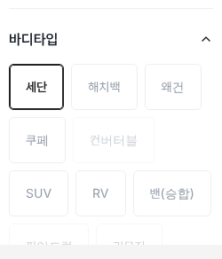
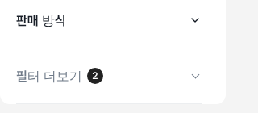

# PR #753 — PC 좌측 필터 선택 칩·적용 제목 검정

① 한 줄 요약: 차란차식 좌측 필터의 파란 선택 표시를 보배드림 규칙대로 검정으로 바꿨다.

② 과제 ID 없음 · 브랜치 `claude-consult/charancha-chip-black` · PR #753 · 병합 후 배포(v값은 병합 커밋 7자리) · 같은 날 앞서 들어간 PR #752(더보기 검정 당구공 배지)와 함께 확인.

③ 한 일
- 바디타입·차종 선택 칩: 파랑(글자 `#0740E4`·테두리 `#CDD7FA`) → 흰 바탕 · 글자 `#222` 600 · 테두리 2px `#222`.
- 테두리 안쪽 선은 `::after`로 그려 공통 포커스 규칙(`box-shadow: none`)에 지워지지 않게 했고, 마우스를 올려도 선택 테두리가 회색으로 바뀌지 않게 했다.
- 적용된 항목 제목(파랑) · 제조사 선택 경로 글자(파랑)도 검정으로.

④ 원본과 비교: 차란차 원본은 파랑 선택이다. 크기(칩 52 · 반경 5 · 간격 8)·간격은 같고 색만 다르다.

| 항목 | 차란차 | 우리 |
|---|---|---|
| 선택 칩 | 파랑 글자·연파랑 테두리 | 검정 글자 600·검정 2px |
| 적용 제목 | — | `#191F28` |

⑤ 검증: `npm run verify:qf` 통과. PC 1440 콘솔 오류 0. 선택 칩 계산값 글자 `rgb(34,34,34)` · 테두리 `rgb(34,34,34)` · 600.

⑥ 원본과 다르게 남긴 것: 선택 색(파랑 → 검정) — 보배드림 PC 규칙 「파랑은 로고·검색·주 버튼 전용」.

⑦ 못 한 것: 모바일 전체 필터·1024~1279 서랍의 파랑 적용 제목은 이번 범위가 아니라 그대로.

⑧ 확인 링크: PC `?qf=guazi&pc=1` (배포본은 `&v=<커밋>`)
