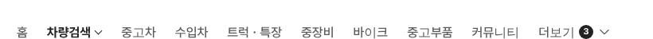
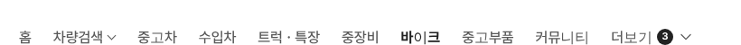

# PR #771 보고서

① 한 줄 요약: PC 탑메뉴의 현재 메뉴를 검정 알약 없이 굵은 글자로만 표시하는 미리보기(`&gnbactive=text`)를 만들었다.

② 과제 ID 없음 · 브랜치 `claude-consult/gnb-active-text` · PR https://github.com/bobaekimboae/bobaedream/pull/771 · 상태: 병합·배포

③ 한 일
- 주소 끝 `&gnbactive=text`일 때만 현재 메뉴의 검정 알약을 없앴다.
- 현재 메뉴는 700 #222 글자, 다른 메뉴는 500 #595959 그대로.
- 높이·좌우 여백을 다른 메뉴와 같게 해 메뉴 줄 간격이 바뀌지 않는다.
- 기본 화면(검정 알약)은 그대로다.

④ 비교: 기본(알약)  / 알약 없음  / 알약 없음·바이크 

⑤ 검증: verify:qf 통과, 콘솔 오류 0(1440), 현재 메뉴 computed style 바탕 투명 · #222 · 700 · 높이 49.

⑥ 원본과 다르게 남긴 것: 없음(미리보기 전용).

⑦ 다음: 알약·글자 중 하나를 고르면 기본으로 올리고 기준 문서를 정리.

⑧ 확인: `?qf=guazi&pc=1&gnbactive=text`
