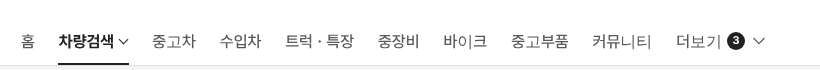
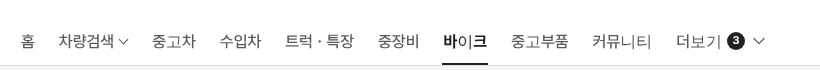

# PR #772 보고서

① 한 줄 요약: PC 탑메뉴의 현재 메뉴를 알약 없이 굵은 글자 + 2px 검정 밑줄로 보여주는 미리보기(`&gnbactive=line`)를 만들었다.

② 과제 ID 없음 · 브랜치 `claude-consult/gnb-active-line` · PR https://github.com/bobaekimboae/bobaedream/pull/772 · 상태: 병합·배포

③ 한 일
- `&gnbactive=text`(굵은 글자만)에 글자 폭 2px #222 밑줄을 더했다.
- 밑줄은 메뉴 줄 맨 아래, 헤더 아랫선과 같은 높이에 붙는다.
- 파랑은 쓰지 않았다.
- 기본 화면(검정 알약)과 `&gnbactive=text`는 그대로.

④ 결과: 차량검색  / 바이크 

⑤ 검증: verify:qf 통과, 콘솔 오류 0(1440), 밑줄 2px #222, 아랫선 = 헤더 아랫선 121.

⑥ 원본과 다르게 남긴 것: 없음(미리보기 전용).

⑦ 다음: 알약 · 글자만 · 밑줄 중 하나를 고르면 기본으로 올림.

⑧ 확인: `?qf=guazi&pc=1&gnbactive=line`
