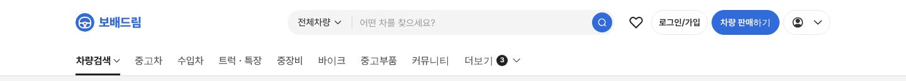
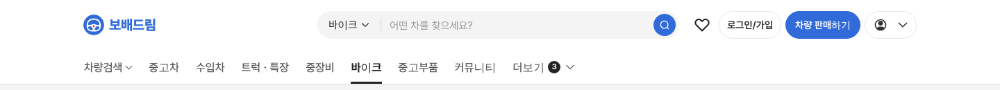
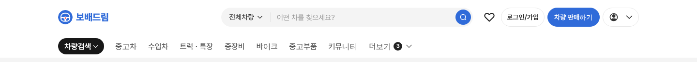

# PR #773 보고서

① 한 줄 요약: PC 탑메뉴 현재 메뉴를 굵은 검정 글자 + 3px 검정 밑줄로 기본화하고 `홈` 메뉴를 뺐다.

② 과제 ID 없음 · 브랜치 `claude-consult/gnb-line-default` · PR https://github.com/bobaekimboae/bobaedream/pull/773 · 상태: 병합·배포

③ 한 일
- 네이버 증권 리뉴얼 헤더(현재 메뉴 검정 글자 + 검정 밑줄 3px)를 1440에서 재서 비교했다.
- 우리 기본을 검정 알약 → 굵은 글자(700 #222) + 3px 검정 밑줄로 바꿨다.
- 탑메뉴 맨 앞 `홈`을 뺐다. 로고가 홈 역할을 하고, 첫 메뉴가 로고와 같은 왼쪽선에서 시작한다.
- 이전 알약은 `&gnbactive=pill`, 밑줄 없는 글자만은 `&gnbactive=text`로 남겼다.

④ 결과: 기본  / 바이크  / 이전 알약 

⑤ 검증: verify:qf 통과, 콘솔 오류 0(1440 · 1024), 1024 가로 넘침 없음, 밑줄 3px #222.

⑥ 원본과 다르게 남긴 것: 네이버는 글자 18 · 현재 600 · 비활성 #4E5052, 우리는 16 · 700 · #595959(우리 규칙 유지).

⑦ 다음: 없음.

⑧ 확인: `?qf=guazi&pc=1`
