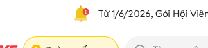
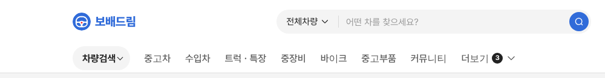
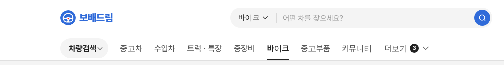

# PR #774 보고서

① 한 줄 요약: PC 탑메뉴 `차량검색 ▾`만 초톳 지역 버튼 모양의 연회색 알약으로 그린 미리보기(`&gnbsearch=pill`)를 만들었다.

② 과제 ID 없음 · 브랜치 `claude-consult/gnb-search-pill` · PR https://github.com/bobaekimboae/bobaedream/pull/774 · 상태: 병합·배포

③ 한 일
- 초톳 지역 버튼(`Toàn quốc ▾`)을 1440에서 쟀다: 140×40, #F4F4F4, 완전 둥금, 16/700.
- `차량검색 ▾`를 같은 높이·색·굵기의 알약으로 그렸다.
- 다른 메뉴와 현재 메뉴 밑줄은 그대로, 차량검색이 현재 메뉴여도 알약엔 밑줄을 그리지 않는다.
- 기본 화면은 그대로다.

④ 비교: 초톳 원본  / 우리  / 바이크 

⑤ 검증: verify:qf 통과, 콘솔 오류 0(1440), 알약 95×40 #F4F4F4 700.

⑥ 원본과 다르게 남긴 것: 초톳은 왼쪽에 핀 아이콘이 있지만 우리는 아이콘 없이 글자부터 시작.

⑦ 다음: 검색창 범위 선택(`전체차량 ▾`)과 겹쳐 보이는지 확인 후 결정.

⑧ 확인: `?qf=guazi&pc=1&gnbsearch=pill`
