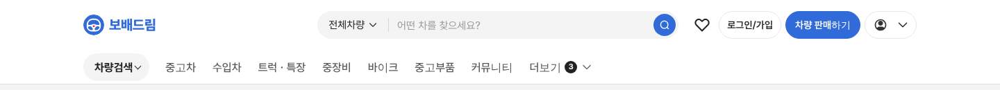

# PR #775 차량검색 연한 파랑 알약 비교 미리보기

① 한 줄 요약: 탑메뉴 `차량검색` 알약을 연한 파랑으로 그린 비교 시안(`&gnbsearch=pillblue`)을 추가했다.

② 과제 ID: 없음 · 브랜치 `claude-consult/gnb-searchpill-blue` · PR https://github.com/bobaekimboae/bobaedream/pull/775 · 상태: 아래 배포 기록 참고

③ 한 일
- vieclamtot.com 지역 알약을 직접 재려 했으나 브라우저·서버 요청 모두 Cloudflare 보안 확인 화면에 막혔고, Chrome 확장도 연결되지 않았다.
- 확인된 사실: vieclamtot 테마색 `#2561CF`(페이지 메타 정보), xe.chotot.com 지역 알약은 회색 `#F4F4F4`.
- 실측값 대신 보배드림 파랑 `#306BD9`의 10% 연한 파랑 `#EAF0FB` 바탕 + 파랑 글자로 비교 시안을 만들었다. 기존 회색 시안은 그대로.

④ 원본과 비교
| 시안 | 크기 | 바탕 | 글자 |
|---|---|---|---|
| `gnbsearch=pill` (회색) | 95×40 | `#F4F4F4` | `#222` 700 |
| `gnbsearch=pillblue` (연한 파랑) | 95×40 | `#EAF0FB` | `#306BD9` 700 |

⑤ 검증: verify:qf 통과, 콘솔 오류 PC 0. 퀵필터 규격은 바꾸지 않았다.

⑥ 원본과 다르게 남긴 것: vieclamtot 실제 색을 재지 못해 우리 파랑에서 만든 값이다.

⑦ 다음: vieclamtot 지역 알약 캡처를 받으면 실측값으로 맞춘다. 파랑을 메뉴에 쓰면 「파랑은 로고·검색·주 버튼 전용」 원칙과 겹친다.

⑧ 확인 링크: PC `?qf=guazi&pc=1&gnbsearch=pillblue` (비교 `&gnbsearch=pill`)
