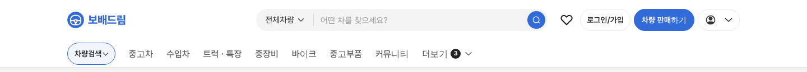

# PR #776 차량검색 연한 파랑 알약 — vieclamtot 실측 반영

① 한 줄 요약: 사용자 Chrome으로 vieclamtot 지역 알약을 직접 재서 `&gnbsearch=pillblue` 시안을 실측값으로 바꿨다.

② 과제 ID 없음 · 브랜치 `claude-consult/gnb-searchpill-blue2` · PR https://github.com/bobaekimboae/bobaedream/pull/776 · 바로 앞 PR #775(추정값 시안)를 이어서 고친 것

③ 한 일
- vieclamtot.com/viec-lam 지역 알약 `Toàn quốc ▾`: 138×40 · 바탕 `#F2F6FC` · 테두리 0.8px `#306BD9` · 완전 둥금 · 좌우 12 · 글자 14/20 600 `#222` · 핀 20 `#306BD9` · 꺾쇠 24 `#222`.
- 테두리 파랑이 보배드림 `#306BD9`와 같은 값이다.
- 우리 `차량검색` 알약을 같은 바탕·테두리·글자로 맞췄다(86×40). 핀은 우리 메뉴에 없어 넣지 않았다.

④ 비교
| 항목 | vieclamtot | 우리(이전 추정) | 우리(지금) |
|---|---|---|---|
| 바탕 | #F2F6FC | #EAF0FB | #F2F6FC |
| 테두리 | 0.8px #306BD9 | 없음 | 0.8px #306BD9 |
| 글자 | 14/20 600 #222 | 16 700 #306BD9 | 14/20 600 #222 |

⑤ 검증: verify:qf 통과, PC 콘솔 오류 0.

⑥ 다르게 남긴 것: 핀 아이콘 없음, 꺾쇠는 vieclamtot 채운 삼각형 대신 우리 꺾쇠, 마우스 올림 색은 재지 못해 `#E6EEFA`.

⑦ 다음: 회색(`pill`)·연한 파랑(`pillblue`) 중 결정하면 기본으로 승격.

⑧ 확인 링크: PC `?qf=guazi&pc=1&gnbsearch=pillblue`
