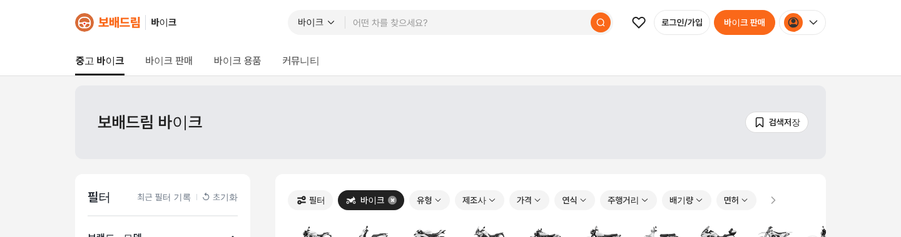
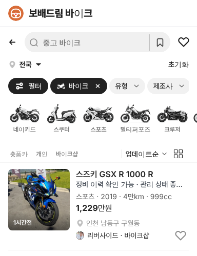

# PR #778 독립 바이크 주황 — Nhà Tốt 실측 반영

① 한 줄 요약: `/bike/` 사이트 주황을 Nhà Tốt 화면에서 직접 잰 `#FA6819`로 바꿨다.

② 과제 ID 없음 · 브랜치 `claude-consult/bike-nhatot-orange` · PR https://github.com/bobaekimboae/bobaedream/pull/778

③ 한 일
- 사용자 Chrome으로 nhatot.com 부동산 목록을 열어 색을 쟀다.
- 이전 주황 `#D86C38`은 로고 그림에서 뽑은 값이라 화면 버튼보다 어둡고 탁했다.
- 테마 변수만 바꿔 심볼·검색 버튼·바이크 판매 버튼·선택 상태가 모두 새 주황을 쓴다.

④ 비교
| 항목 | Nhà Tốt | 이전 | 지금 |
|---|---|---|---|
| 주 버튼 | #FA6819 | #D86C38 | #FA6819 |
| 마우스 올림 | #FB7328 | #BD5528 | #FB7328 |
| 연한 바탕 | #FFE5CF | #FFF1EA | #FFE5CF |

⑤ 검증: verify:qf 통과, 콘솔 오류 PC·모바일 0, 바이크 화면 파랑 0곳.

⑥ 다르게 남긴 것: Nhà Tốt 가격 분홍(#F0325E)은 가져오지 않았다(가격은 검정 규칙).

⑦ 다음: 없음.

⑧ 확인 링크: PC `/bike/?qf=guazi&pc=1&category=바이크`, 모바일 `/bike/?qf=guazi&category=바이크`
