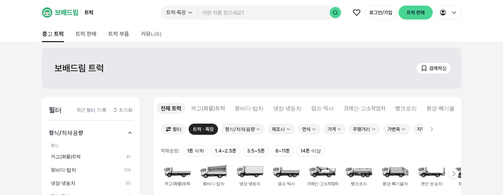
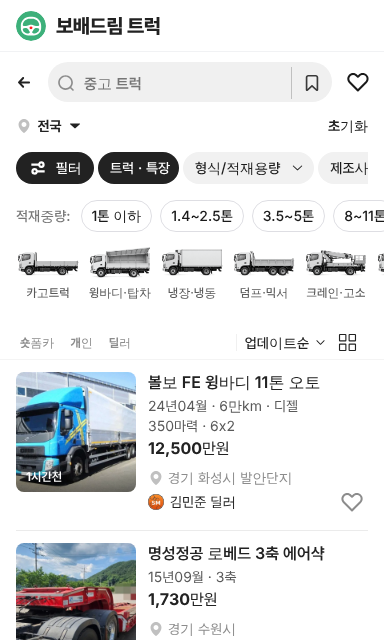

# PR #780 독립 보배드림 트럭 사이트(/truck/) — Cars & Bids 초록

① 한 줄 요약: 바이크 사이트처럼 `/truck/` 독립 사이트를 만들고, carsandbids.com에서 직접 잰 초록색을 입혔다.

② 브랜치 `claude-consult/truck-site` · PR https://github.com/bobaekimboae/bobaedream/pull/780 · 상태: 병합·배포(v 값은 채팅 보고 참고)

③ 한 일
- `truck/index.html` · `src/truck-main.tsx`로 별도 입구를 만들었다(문서 제목 `보배드림 트럭`, 첫 화면 트럭·특장 목록).
- PC 상단 메뉴를 `중고 트럭 · 트럭 판매 · 트럭 부품 · 커뮤니티`로 바꾸고 로고 옆에 `트럭`을 붙였다.
- 배너 제목 `보배드림 트럭`, 모바일 맨 위 브랜드 줄 `보배드림 트럭`, 검색 안내 `중고 트럭`.
- 초록 테마(`truck-site-theme.css`): 로고·글자 `#3DB07A`, 버튼 `#4AD493` 바탕 + 진남색 `#0F2236` 글자, 마우스 `#30C880`.
- 트럭 형식 탭·좌측 형식/적재용량 필터·목록은 메인 사이트와 같다. 메인·바이크 사이트는 바꾸지 않았다.

④ Cars & Bids 실측과 비교
| 항목 | Cars & Bids | 우리 /truck/ |
|---|---|---|
| 로고·링크 글자 | `#3DB07A` | 로고 글자·심볼 `#3DB07A` |
| 주 버튼 바탕 | `#4AD493` | `트럭 판매`·검색 버튼 `#4AD493` |
| 주 버튼 글자 | `#0F2236` | `#0F2236`(아이콘 포함) |
| 마우스 올림 | `#30C880` | `#30C880` |

⑤ 검증: `npm run verify:qf` 통과. 메뉴 이동 확인(트럭 부품 → `truckMenu=parts` 목록, 중고 트럭 복귀). 메인 사이트 `차량 판매하기`는 그대로 파랑 `#306BD9`. 콘솔 오류는 파비콘 404뿐.

⑥ 원본과 다르게 남긴 것: 연한 선택 바탕 `#E8F9F0`는 실측이 아니라 같은 색상으로 만든 값. 메인 보배드림 GNB의 `트럭 · 특장` 메뉴는 그대로 둠.

⑦ 다음에 할 것: `트럭 판매`(등록 화면) 연결, 메인 GNB에서 트럭 사이트로 보낼지 결정.

⑧ 확인 링크: PC `/truck/?pc=1&v=<커밋>`, 모바일 `/truck/?v=<커밋>`
