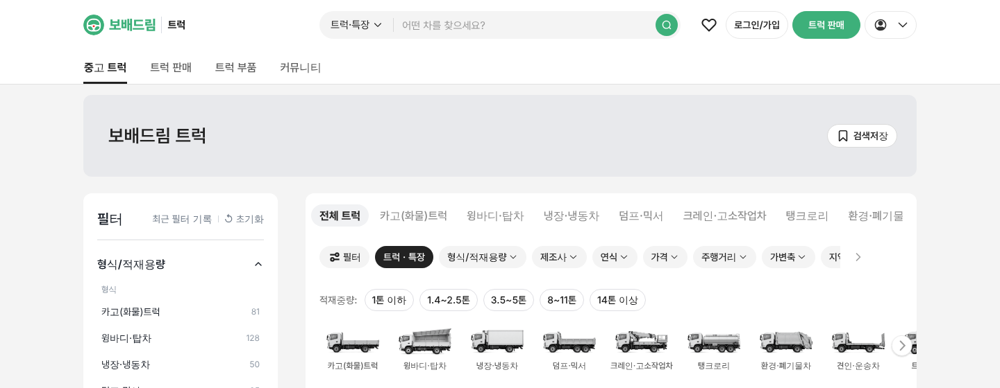

# PR #781 트럭 사이트 단일 초록

① 한 줄 요약: `/truck/`의 초록 두 가지를 Cars & Bids 로고 초록 `#3DB07A` 하나로 통일했다.

② 브랜치 `claude-consult/truck-single-green` · PR https://github.com/bobaekimboae/bobaedream/pull/781 · 상태: 병합·배포(v 값은 채팅 보고 참고)

③ 한 일
- 로고 글자·심볼·선택 글자와 `트럭 판매`·검색·필터 확인 버튼 바탕을 모두 `#3DB07A`로.
- 버튼 글자·검색 아이콘은 진남색 → 흰색.
- 마우스 올림은 `#34A06E`(같은 색상에서 한 단계 진하게).

④ 비교
| 항목 | 전 | 후 |
|---|---|---|
| 로고 글자 | `#3DB07A` | `#3DB07A` |
| 버튼 바탕 | `#4AD493` | `#3DB07A` |
| 버튼 글자 | `#0F2236` | `#FFFFFF` |
| 마우스 올림 | `#30C880` | `#34A06E` |

⑤ 검증: `npm run verify:qf` 통과, PC 1440 측정값 위 표와 같음.

⑥ 원본과 다르게: 흰 글자 대비는 약 2.8:1로 Cars & Bids(진남색 글자)보다 낮다. 연한 선택 바탕 `#E8F9F0`은 유지.

⑦ 다음: 대비가 부족하다고 느끼면 버튼 글자를 진남색으로 되돌리는 선택지가 있다.

⑧ 확인 링크: `/truck/?pc=1&v=<커밋>`
