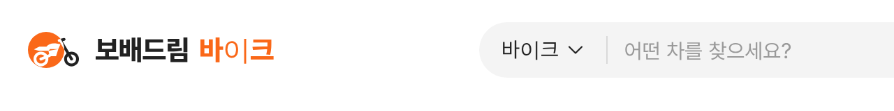
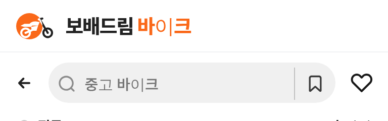
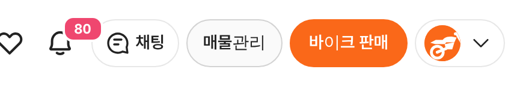

# PR #782 보배드림 바이크 로고 — 원에 걸친 오토바이

① 한 줄 요약: 주황 원 위에 오토바이가 반쯤 걸쳐 나가는 바이크 전용 로고를 새로 그려 `/bike/` PC·모바일 헤더에 적용했다.

② 브랜치 `claude-consult/bike-logo` · PR https://github.com/bobaekimboae/bobaedream/pull/782 · 상태: 병합·배포(v 값은 채팅 보고 참고)

③ 한 일
- 마크 `bike-logo-mark.svg`(44×32): 주황 원 `#FA6819`, 원 안 오토바이는 흰색, 원 밖으로 나간 앞 포크·앞바퀴는 `#222`.
- 글자: `보배드림` 검정 + `바이크` 주황(20/800), 예전 구분선 제거.
- PC 헤더·모바일 브랜드 줄 41×30 표시, 로그인 아바타·파비콘은 원형만.
- Cycle Trader는 「원 + 걸친 오토바이」 구성만 참고, 그림은 새로 그림.

④ 비교
| 항목 | 전 | 후 |
|---|---|---|
| 심볼 | 보배드림 핸들(원, `#D86C38`) | 원에 걸친 오토바이(`#FA6819`) |
| 글자 | `보배드림` 주황 + 구분선 + `바이크` 검정 | `보배드림` 검정 + `바이크` 주황 |

⑤ 검증: `npm run verify:qf` 통과. 트럭·메인 헤더는 그대로임을 캡처로 확인.

⑥ 원본과 다르게: 이 작업 환경(리눅스 헤드리스)에서는 `바이크`의 `이`가 대체 글꼴로 보였다(Pretendard 일부 글자 묶음이 늦게 불러와짐). 실제 기기에서 확인 필요.

⑦ 다음: 트럭 로고(같은 구성, 초록) 작업.

⑧ 확인 링크: `/bike/?pc=1&v=<커밋>`, `/bike/?v=<커밋>`
