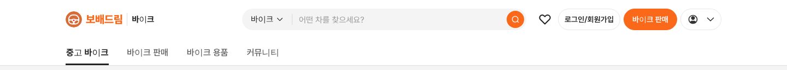
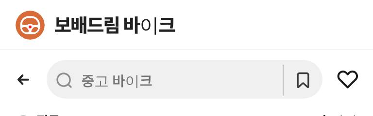

# PR #783 바이크 로고 원복

① 한 줄 요약: 보배드림 바이크 로고(원에 걸친 오토바이 마크, PR #782)를 이전 상태로 되돌렸다.

② 브랜치 `claude-consult/bike-logo-revert` · PR https://github.com/bobaekimboae/bobaedream/pull/783 · 상태: 병합 후 배포

③ 한 일
- PR #782 변경을 `git revert`로 되돌렸다: 헤더·모바일 브랜드 줄·로그인 아바타·파비콘이 다시 기존 핸들 심볼 `bike-emblem.svg`(30px)을 쓴다.
- 로고 글자는 `보배드림 바이크` 주황 단색으로 돌아갔고 `bike-logo-mark.svg`는 지웠다.
- 규칙 문서와 #782 보고서는 지우지 않고 원복 기록 한 줄을 더했다.

④ 원본과 비교: PR #782 이전 화면과 같다(아래 캡처).

⑤ 검증: `npm run verify:qf` 통과. PC·모바일 헤더 로고 이미지 = `/assets/bbm/bike-emblem.svg` 확인.

⑥ 원본과 다르게 남긴 것: 없음.

⑦ 다음에 할 것: 새 로고 방향이 정해지면 다시 작업.

⑧ 확인 링크: 모바일 `/bike/`, PC `/bike/?pc=1`

