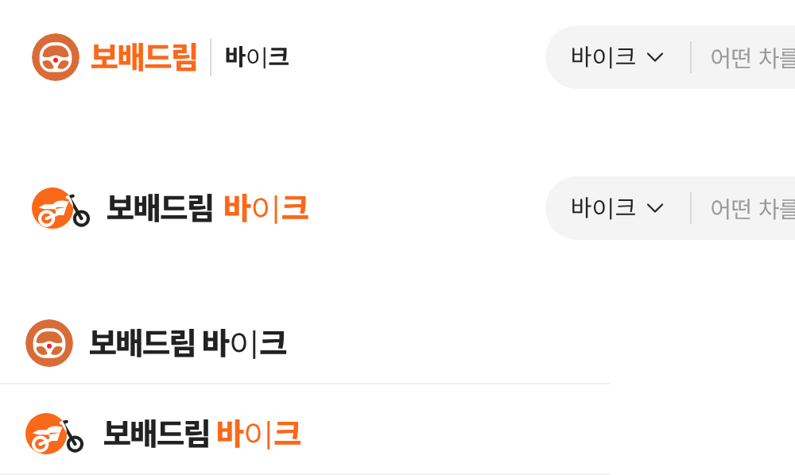

# PR #784 바이크 로고 밸런스 미리보기

① 한 줄 요약: `/bike/` 주소 끝 `&bikelogo=mark`로 원에 걸친 오토바이 마크 + 「보배드림」 검정 · 「바이크」 주황 조합을 볼 수 있게 했다(기본 화면은 그대로).

② 브랜치 `claude-consult/bike-logo-balance` · PR https://github.com/bobaekimboae/bobaedream/pull/784 · 상태: 병합 후 배포

③ 한 일
- 원복했던 오토바이 마크(`bike-logo-mark.svg`, 우리가 새로 그린 그림)를 다시 넣었다. Cycle Trader 로고 파일 자체는 쓰지 않았다.
- `&bikelogo=mark`일 때만 PC 헤더·모바일 브랜드 줄에서 마크(41×30)와 `보배드림` #222 + `바이크` 주황을 쓴다.
- 파라미터가 없으면 기존 핸들 심볼 · 주황 글자 그대로다.

④ 원본과 비교(위 2줄 PC 기본 → 미리보기, 아래 2줄 모바일 기본 → 미리보기)

⑤ 검증: `npm run verify:qf` 통과. 기본 = `bike-emblem.svg` · 글자 주황, 미리보기 = `bike-logo-mark.svg` · 글자 #222 확인.

⑥ 원본과 다르게 남긴 것: 실제 Cycle Trader 로고는 다른 회사 상표라 붙이지 않고 구성(원 + 걸친 오토바이)만 참고한 우리 그림을 썼다.

⑦ 다음에 할 것: 마크가 글자보다 가벼워 보이면 원 지름을 30으로 키우는 시안.

⑧ 확인 링크: PC `/bike/?pc=1&bikelogo=mark`, 모바일 `/bike/?bikelogo=mark`
