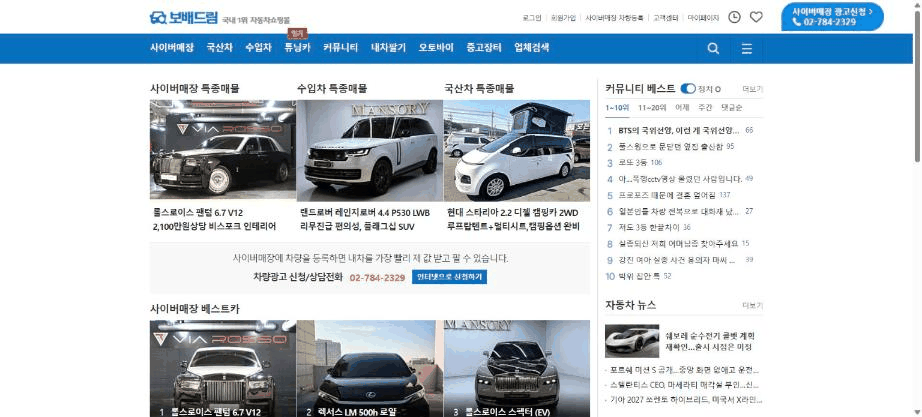
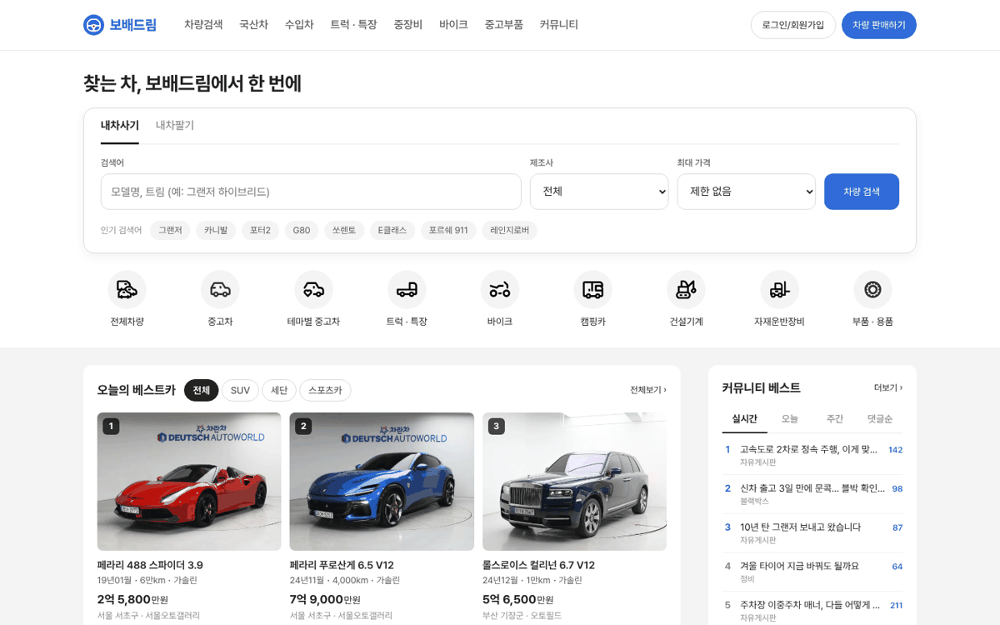
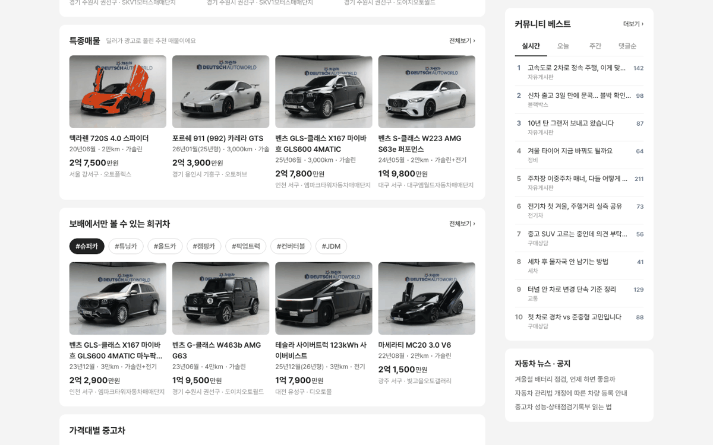

# PR #785 PC 메인 시안 v01

## ① 한 줄 요약
레거시 보배드림 메인의 「좌 매물 · 우 커뮤니티 베스트」 구조는 유지하고, 유럽 중고차 사이트처럼 위에 큰 검색 띠를 붙인 PC 메인 시안을 `?home=pc`로 만들었다.

## ② 과제 · 브랜치 · 커밋 · PR · 상태
- 과제 ID: 없음(사용자 지시 「보배드림 레거시를 신버전으로 컨설팅」 「유럽 중고차 사이트도 분석해보고 시안 만들자」)
- 브랜치: `claude-consult/pc-main-home`
- PR: https://github.com/bobaekimboae/bobaedream/pull/785
- 상태: 병합 · 배포(v 값은 채팅 보고 참고)
- 함께 들어간 과제: 없음

## ③ 한 일
- 국내 6곳(보배드림 · 엔카 · KB차차차 · 차란차 · 케이카 · 당근)과 유럽 4곳(mobile.de · AutoScout24 · Autotrader UK · La Centrale) 메인을 Chrome 1536 폭에서 열어 구역 구조를 비교했다.
- 국내에서 오른쪽 칸을 커뮤니티로 채우는 곳은 보배드림뿐이라 이 2단은 그대로 두었다.
- 유럽 사이트 공통인 「위쪽 검색 카드(사기/팔기 탭 · 검색어 · 제조사 · 가격 · 검색 버튼) + 차량 유형 아이콘 줄 + 인기 검색어」를 위에 붙였다.
- 매물 카드에 등록연월 · 주행 · 연료 · 가격 · 지역을 넣었다(레거시는 차명만).
- 오른쪽은 5단(뉴스 · 핫이슈 · 공지 · 매매가이드 포함)을 2단(커뮤니티 베스트 · 뉴스·공지)으로 줄이고 스크롤해도 위에 붙게 했다.
- 레거시 「가격대별」 바로가기가 없어 La Centrale처럼 6칸으로 넣었다.

## ④ 원본과 비교
| 구역 | 레거시 | 신버전 시안 |
|---|---|---|
| 본문 폭 | 약 1022(좌 734 · 우 263) | 1200(좌 860 · 간격 40 · 우 300) |
| 맨 위 | 특종매물 사진 3장 | 검색 카드 + 차량 유형 9칸 + 인기 검색어 |
| 매물 카드 | 사진 + 차명 | 사진 4:3 + 차명 2줄 + 등록연월·주행·연료 + 가격 + 지역·단지 |
| 커뮤니티 베스트 | 1~10위 · 11~20위 · 어제 · 주간 · 댓글순, 스크롤하면 사라짐 | 실시간 · 오늘 · 주간 · 댓글순, 화면 위에 고정 |
| 우측 아래 | 뉴스 · 핫이슈 · 공지 · 매매가이드 | 뉴스 · 공지 1개 |

## ⑤ 검증
- `npm run verify:qf` 통과(런타임 검사 · 타입 검사 · 빌드)
- 콘솔 오류 PC 1440: 0건
- 측정(1440): 좌 860 · 우 300 · 간격 40, 스크롤 후 우측 묶음 위 16 고정 확인
- 퀵필터 규격 · 필터 선택지: 이번 작업은 메인 페이지만 새로 만들어 목록 화면은 바뀌지 않았다.

## ⑥ 원본과 다르게 남긴 것과 이유
- 매물은 럭셔리카 가상 매물 v01을 썼다. 실제 오늘의 베스트카 기준(조회수 · 찜 수 등)은 정해지지 않았다.
- 커뮤니티 글 · 댓글 수는 화면 확인용 예시 문구다(실제 게시글 · 작성자 아님).
- 검색 버튼 · 판매하기 버튼만 파랑, 선택 알약은 검정으로 두었다(파랑은 로고 · 검색 · 주 버튼 전용 규칙).

## ⑦ 못 한 것 · 다음에 할 것
- 모바일 메인과는 아직 연결하지 않았다(`./`는 기존 모바일 메인 그대로).
- 가격대 바로가기의 `priceMin` · `priceMax`는 목록 화면에서 아직 읽지 않는다.
- 커뮤니티 실제 글 데이터 연결, 베스트카 선정 기준 결정.

## ⑧ 확인 링크
- PC 메인 시안: https://bobaekimboae.github.io/bobaedream/?home=pc
