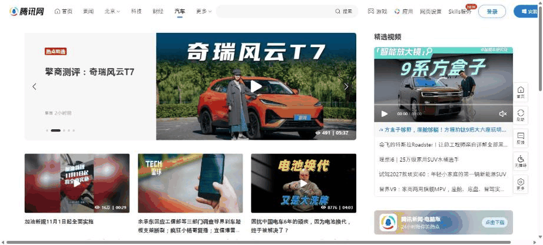
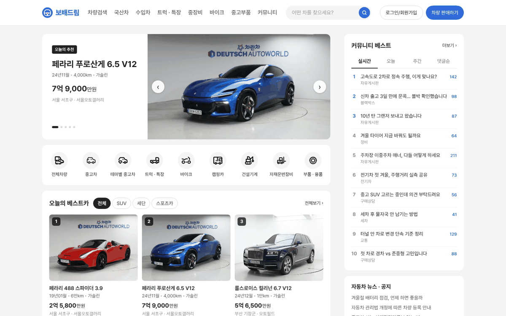
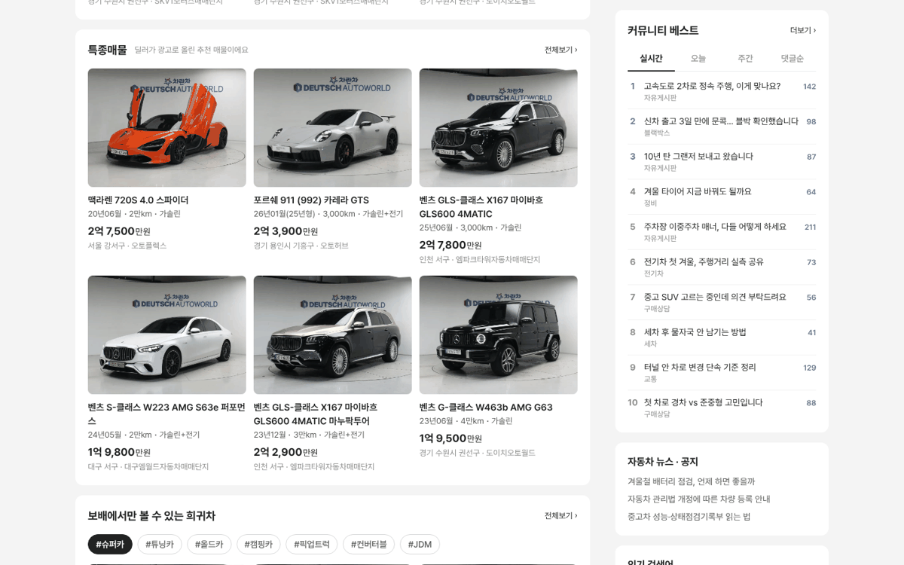

# PR #787 PC 메인 시안 v02 — 텐센트식 좌·우 분리

## ① 한 줄 요약
腾讯网 汽车처럼 헤더 바로 아래부터 좌(추천 슬라이드 + 3열 카드) · 우(커뮤니티 레일) 두 칸으로 나눴다.

## ② 과제 · 브랜치 · 커밋 · PR · 상태
- 과제 ID: 없음(사용자 지시 「https://news.qq.com/ch/auto/ 이렇게 분리해야해」)
- 브랜치: `claude-consult/pc-main-split`
- PR: https://github.com/bobaekimboae/bobaedream/pull/787
- 상태: 병합 · 배포(v 값은 채팅 보고 참고)
- 함께 들어간 과제: 없음

## ③ 한 일
- v01의 화면 전체 폭 검색 띠를 없애고, 검색칸을 헤더(GNB 오른쪽)로 올렸다.
- 본문을 헤더 아래 24에서 바로 좌 820 · 우 340으로 나눴다(텐센트 약 7:3).
- 좌측 맨 위에 텐센트 큰 슬라이드처럼 「글 상자 + 큰 사진」 추천 매물 슬라이드(5대, 5초 자동 넘김)를 넣었다.
- 그 아래 차량 유형 9칸, 이어서 모든 매물 묶음을 3열 카드로 통일했다.
- 우측 레일은 커뮤니티 베스트 → 뉴스 · 공지 → 인기 검색어 → 내 차 팔기 순서로, 스크롤해도 위에 붙는다.

## ④ 원본과 비교
| 구역 | 腾讯网 汽车(1536) | 시안 v02(1440) |
|---|---|---|
| 칸 나눔 시작 | 헤더 바로 아래 | 헤더 아래 24 |
| 좌 · 우 폭 | 약 940 · 394(7:3) | 820 · 340(7:3) |
| 좌 맨 위 | 큰 슬라이드 939×305(글 372 + 사진 566) | 추천 슬라이드 820×300(글 300 + 사진 520) |
| 좌 아래 | 3열 카드 피드 | 차량 유형 9칸 → 3열 카드 |
| 우측 | 골라 본 영상 + 제목 5줄 → 앱 배너(아래는 빈칸) | 커뮤니티 베스트 → 뉴스 · 공지 → 인기 검색어 → 내 차 팔기(고정) |

## ⑤ 검증
- `npm run verify:qf` 통과
- 콘솔 오류 PC 1440: 0건, 가로 스크롤 없음(1440 · 1280)
- 헤더: GNB 잘림 없음, 검색칸 폭 244
- 우측 레일 스크롤 후 위 16 고정 확인

## ⑥ 원본과 다르게 남긴 것과 이유
- 텐센트 우측은 스크롤하면 비지만, 우리는 커뮤니티 베스트가 계속 보이게 고정했다.
- 차량 유형 9칸은 텐센트에 없지만 이전 지시(좌측에 차량 카테고리)대로 슬라이드 아래에 남겼다.

## ⑦ 못 한 것 · 다음에 할 것
- 슬라이드에 들어갈 매물 기준(광고 상품 · 베스트 선정) 결정.
- 모바일 메인 연결.

## ⑧ 확인 링크
- https://bobaekimboae.github.io/bobaedream/?home=pc
