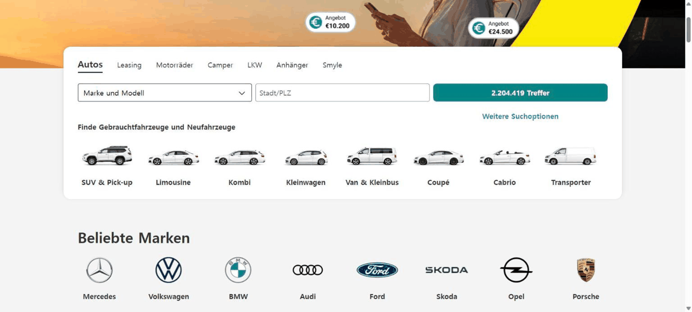
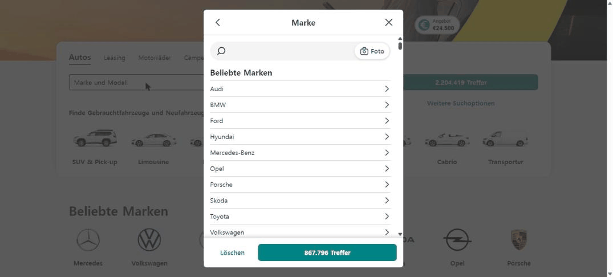
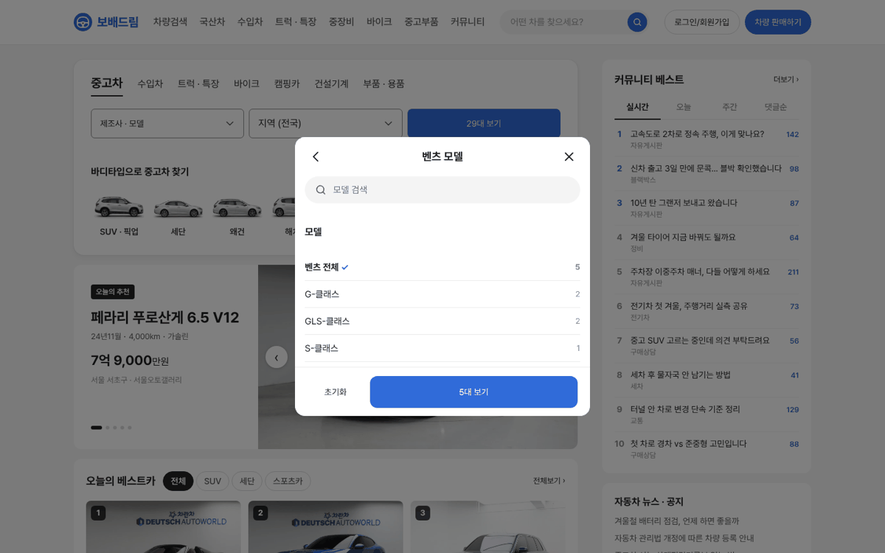
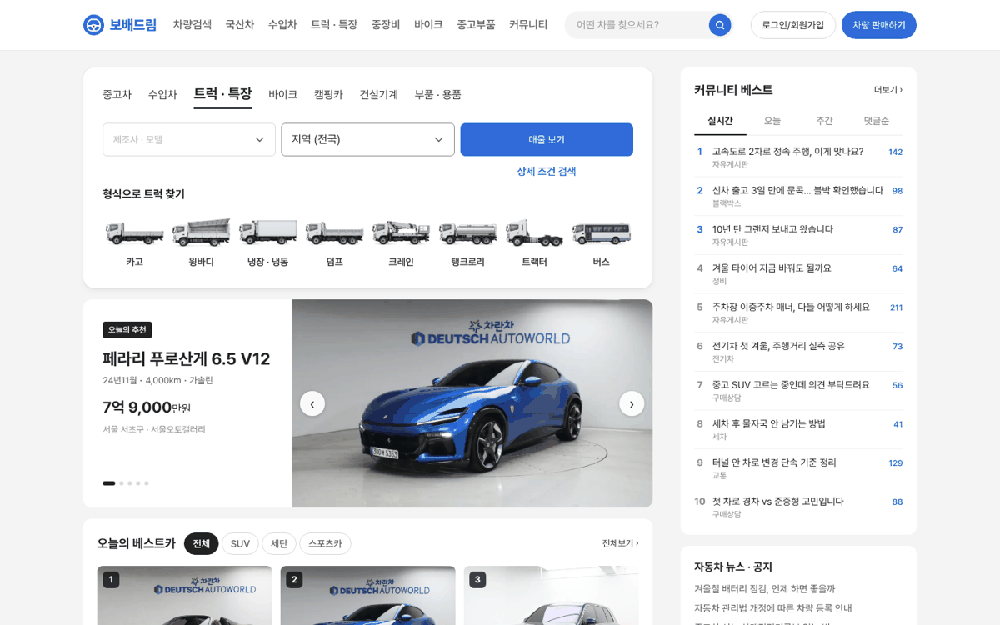

# PR #788 PC 메인 시안 v03 — AutoScout24 검색 카드 응용

## ① 한 줄 요약
AutoScout24 메인의 검색 카드(차종 탭 → 제조사·모델 · 지역 · 결과 대수 버튼 → 바디타입 그림 줄)를 PC 메인 좌측 맨 위에 옮겼다.

## ② 과제 · 브랜치 · 커밋 · PR · 상태
- 과제 ID: 없음(사용자 지시 「오토스카우트24 검색을 응용해봐」)
- 브랜치: `claude-consult/pc-main-as24-search`
- PR: https://github.com/bobaekimboae/bobaedream/pull/788
- 상태: 병합 · 배포(v 값은 채팅 보고 참고)
- 함께 들어간 과제: 없음

## ③ 한 일
- Chrome으로 AutoScout24.de를 1536 폭에서 열어 검색 카드와 제조사 선택 창을 쟀다.
- 좌측 칸 맨 위에 같은 구조의 검색 카드를 넣었다: 차종 탭 7개, `제조사 · 모델 ▾` · `지역 ▾` · `N대 보기` 한 줄, `상세 조건 검색` 링크, 탭별 그림 8칸.
- `제조사 · 모델`을 누르면 AutoScout24처럼 가운데 창이 열리고, 제조사 → 모델로 같은 창 안에서 넘어간다. 아래 버튼 대수가 고를 때마다 바뀐다.
- 트럭 · 바이크 탭은 기존 `autoscout-v01` 형식 · 장르 그림을 쓴다.
- v02의 차량 유형 9칸은 탭과 겹쳐 뺐다.

## ④ 원본과 비교
| 항목 | AutoScout24 | 시안 v03 |
|---|---|---|
| 카드 | 1240 · 반경 16 · 안쪽 24/32 | 820 · 반경 16 · 안쪽 24/28 |
| 탭 | 현재 20/700, 나머지 16/400 | 같음 + 현재 탭 아래 2px 선 |
| 한 줄 3칸 | 387×40 · 간격 8 | 249×48 · 간격 8 |
| 결과 버튼 | 청록 `#028484` 「2.204.419 Treffer」 | 브랜드 파랑 「29대 보기」 |
| 그림 줄 | 120×73 · 이름 16/600 | 최대 88×54 · 이름 14/600 |
| 선택 창 | 뒤로 · 제목 · 닫기 / 검색 / 인기 브랜드 / Löschen + N Treffer | 같음(사진 검색 「Foto」는 뺌) |

## ⑤ 검증
- `npm run verify:qf` 통과
- 콘솔 오류 PC 1440: 0건
- 동작: 제조사 · 모델 → 벤츠 → 아래 버튼 「5대 보기」 → 적용 후 칸 「벤츠」 · 버튼 「5대 보기」, 트럭 탭 전환 시 형식 그림 8칸

## ⑥ 원본과 다르게 남긴 것과 이유
- 버튼 색은 청록 대신 보배드림 파랑(검색 · 주 버튼 전용 규칙).
- 대수는 메인에 실린 가상 매물(수입 승용 29대) 기준이라 중고차 · 수입차 탭에서만 센다. 다른 탭은 제조사 칸 비활성 · 「매물 보기」.
- AutoScout24의 사진 검색(Foto)은 우리 기능이 없어 뺐다.

## ⑦ 못 한 것 · 다음에 할 것
- 실제 매물 수 · 국산 제조사 목록 연결.
- 목록 화면이 `region` · `body` · `model` 주소 값을 아직 읽지 않는다.

## ⑧ 확인 링크
- https://bobaekimboae.github.io/bobaedream/?home=pc
