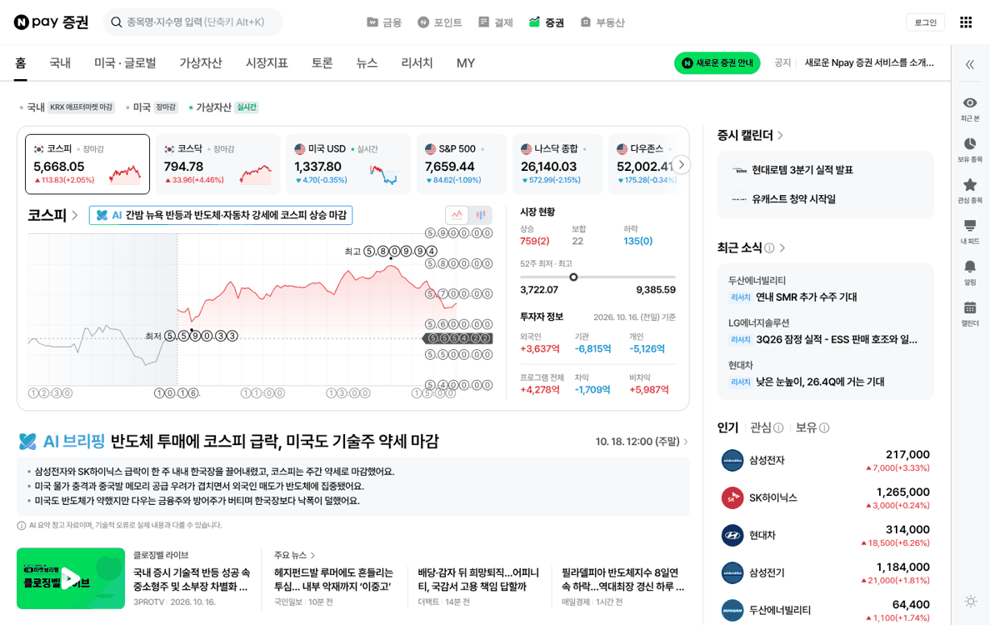
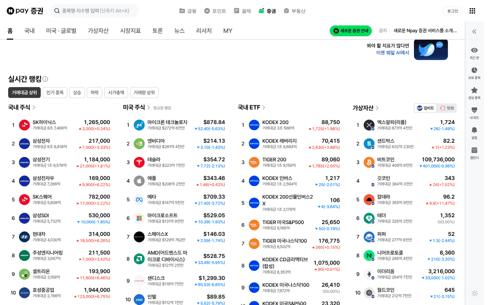
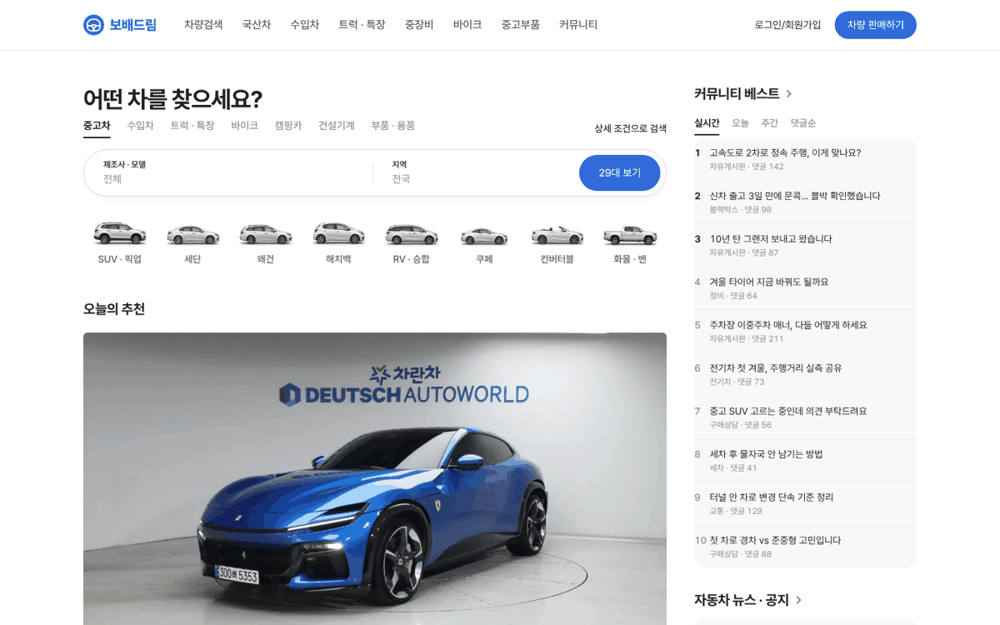
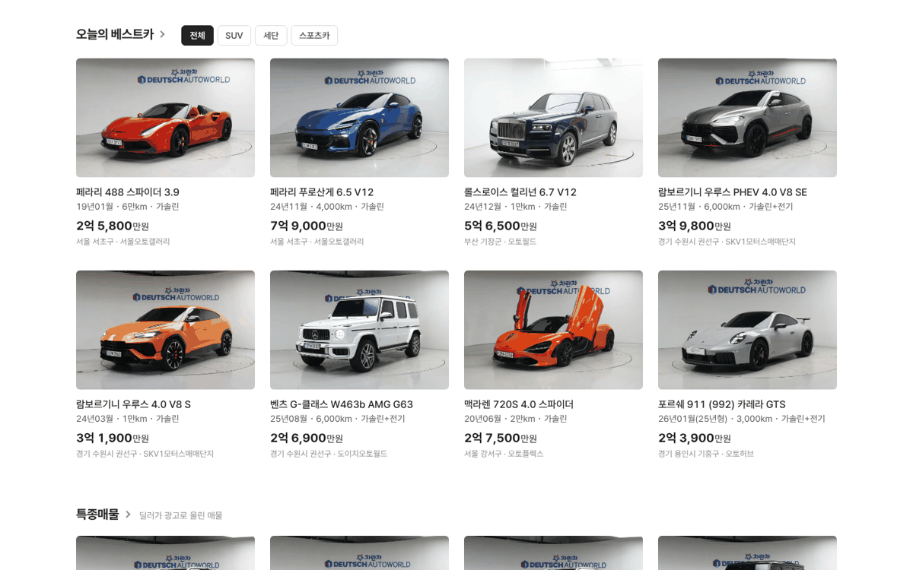
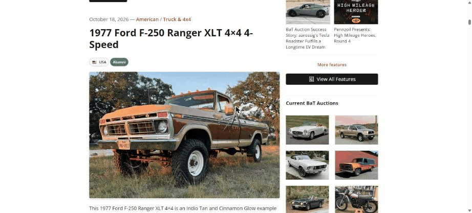
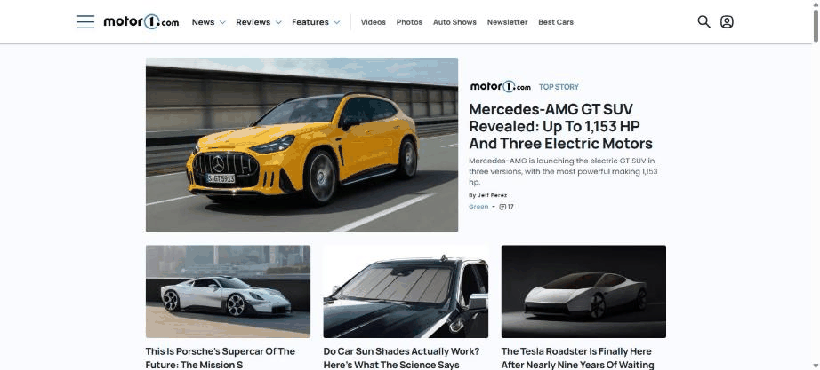

# PR #789 PC 메인 시안 v04 · v05 — 쇼룸 톤 + 네이버 증권식 좌우

## ① 한 줄 요약
「싸구려 같다」는 지적에 상자 · 파랑 · 장식을 걷어낸 흰 쇼룸 톤으로 바꾸고, 네이버 증권처럼 위쪽만 좌·우로 나누고 아래는 전체 폭 4열로 이었다.

## ② 과제 · 브랜치 · 커밋 · PR · 상태
- 과제 ID: 없음(사용자 지시 「너무 싸구려 사이트 같아」 「네이버 증권처럼 이질감 없게 좌 우 구분」)
- 브랜치: `claude-consult/pc-main-showroom`
- PR: https://github.com/bobaekimboae/bobaedream/pull/789
- 상태: 병합 · 배포(v 값은 채팅 보고 참고)
- 함께 들어간 과제: 없음

## ③ 한 일
- 싼 느낌의 원인 네 가지를 걷어냈다: 회색 바탕 위 같은 흰 상자 반복, 파랑 남용, 슬라이드 화살표 · 점 · 순위 배지, 같은 크기 제목.
- 흰 바탕 · 여백 · 가는 선으로 구획하고 파랑은 로고 · 검색 버튼 · 판매하기 버튼에만 남겼다.
- 검색을 한 덩어리 캡슐(제조사·모델 / 지역 / N대 보기)로 묶었고, 헤더 검색칸은 메인에서 뺐다.
- 슬라이드를 큰 사진 1장 + 고르는 썸네일로 바꿨다(자동 넘김 없음).
- 네이버 증권처럼 위쪽만 좌 840 · 우 320, 우측 내용은 연회색 판, 양쪽 제목은 같은 20/700 + ›.
- 아래 매물 묶음은 전체 폭 4열, 구분 칩은 선택 = 검정 채움.

## ④ 원본과 비교
| 항목 | 네이버 증권(1440) | 시안 v05(1440) |
|---|---|---|
| 좌 · 사이 · 우 | 969 · 40 · 312 | 840 · 40 · 320 |
| 바탕 | 양쪽 흰색, 세로선 없음 | 같음 |
| 우측 내용 | 연회색 둥근 판 | `#F7F8FA` 반경 16 판 |
| 제목 | 굵은 제목 + › | 20/700 + › |
| 아래 | 실시간 랭킹 전체 폭 4열 | 매물 묶음 전체 폭 4열 |
| 칩 | 선택 검정 채움 · 나머지 회색 테두리 | 같음 |

참고로 레퍼런스 시트에서 좌·우를 나눈 고급 사이트를 찾은 결과(Chrome 1536 실측): Bring a Trailer(본문 640 · 우 320, 우측에 경매 썸네일 2열), Motor1(본문 644 · 사이 32 · 우 300). 캡처:  

## ⑤ 검증
- `npm run verify:qf` 통과
- 콘솔 오류 PC 1440: 0건
- 검색 캡슐 → 벤츠 → 「5대 보기」 동작 유지

## ⑥ 원본과 다르게 남긴 것과 이유
- 매물 사진의 매매단지 벽 로고(차란차 · 도이치오토월드)는 원본 사진이라 그대로 두었다.
- 커뮤니티 글 · 매물은 화면 확인용 예시 · 가상 값이다.

## ⑦ 못 한 것 · 다음에 할 것
- 실제 매물 수 · 커뮤니티 글 연결, 모바일 메인 연결.

## ⑧ 확인 링크
- https://bobaekimboae.github.io/bobaedream/?home=pc
