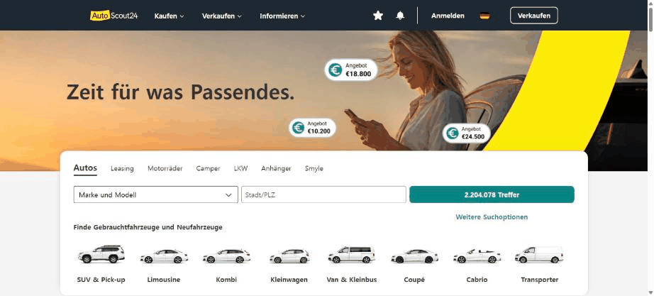
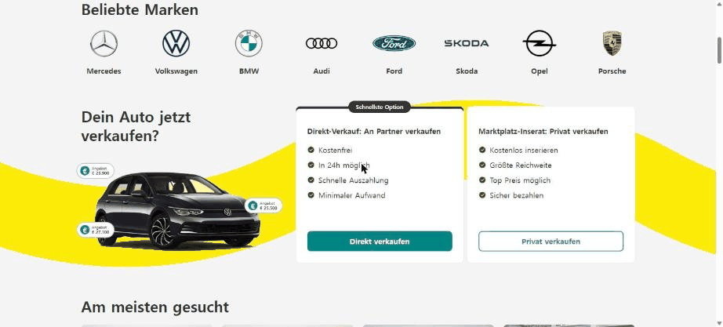
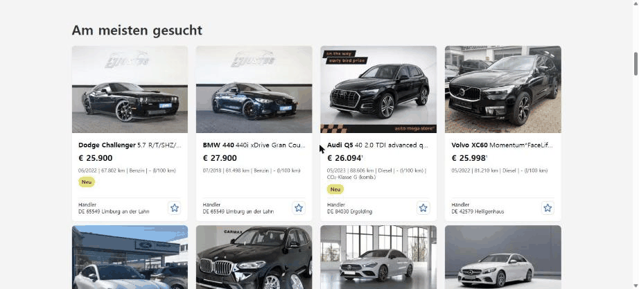
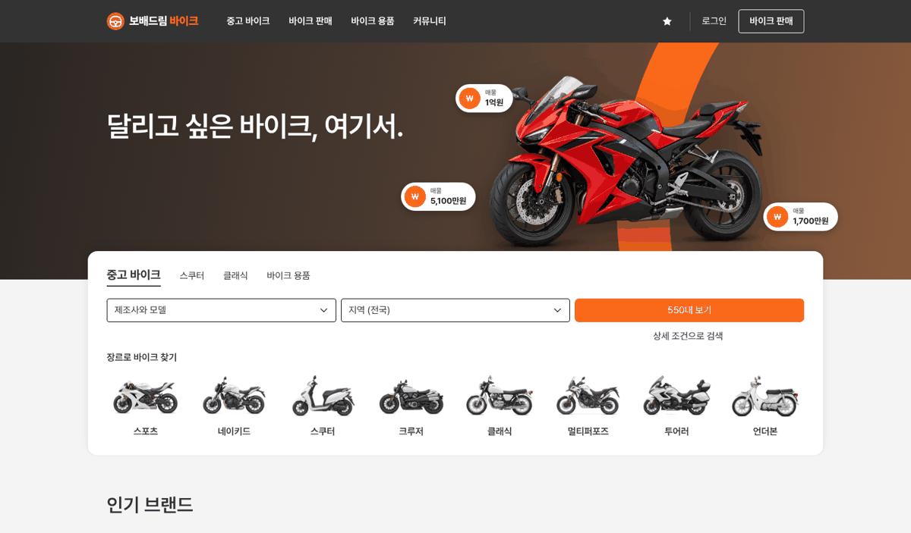
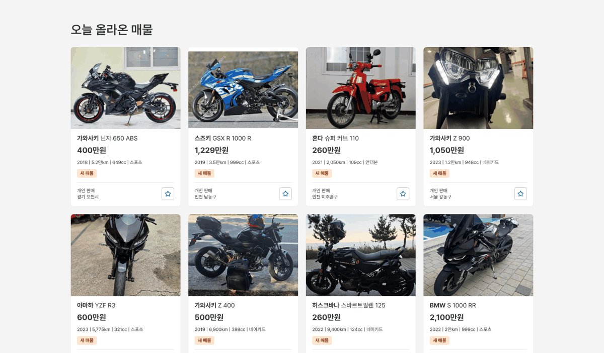
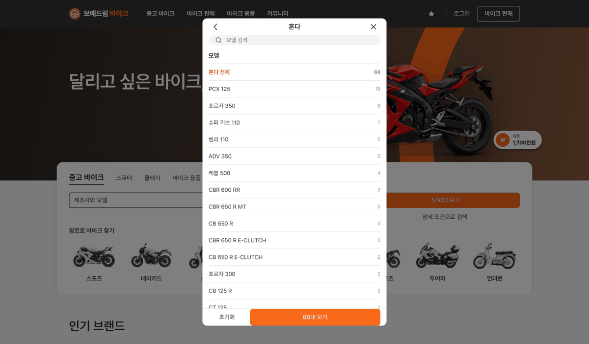
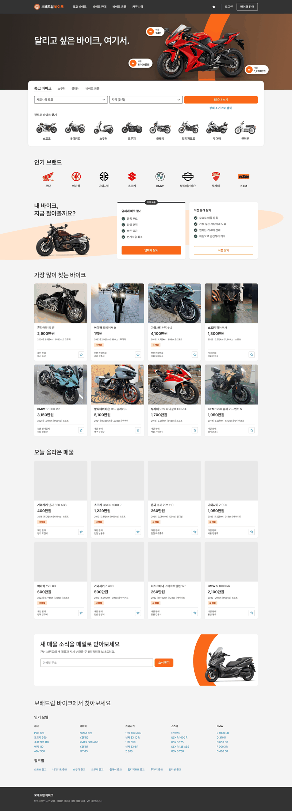

# PR #791 보배드림 바이크 메인 시안 v01 — AutoScout24 동일 구성

## ① 한 줄 요약
AutoScout24 메인과 같은 순서 · 크기로 보배드림 바이크 메인을 만들었다(`/bike/?home=as24`, 커뮤니티 베스트글 없음).

## ② 과제 · 브랜치 · 커밋 · PR · 상태
- 과제 ID: 없음(사용자 지시 「베스트글 없이 오토스카우트 24 동일하게」 「바이크 메인에」 「보배드림 말고 바이크로」)
- 브랜치: `claude-consult/bike-main-as24`
- PR: https://github.com/bobaekimboae/bobaedream/pull/791
- 상태: 병합 · 배포(v 값은 채팅 보고 참고)
- 함께 들어간 과제: 없음

## ③ 한 일
- AutoScout24.de를 Chrome 1536에서 열어 구역 순서와 크기를 쟀다(헤더 72, 히어로 400, 검색 카드 1240 · 반경 16, 매물 카드 279×422 · 반경 8 · 사진 279×209, 구역 제목 32/600, 바탕 `#F4F4F4`).
- 같은 순서로 바이크 메인을 만들었다: 헤더 → 사진 히어로 + 가격 말풍선 → 걸친 검색 카드 → 인기 브랜드 8 → 내 바이크 팔기 두 카드 → 매물 4열 두 묶음 → 뉴스레터 → 인기 모델 링크 → 바닥글.
- 노랑 · 청록 자리는 바이크 사이트 주황으로 바꿨다.
- 매물 · 대수는 바이크 가상 매물 550대(v08 + v11)에서 실제로 센다.
- 제조사·모델 칸은 AutoScout24처럼 가운데 창에서 제조사 → 모델을 고르고, 버튼 대수가 바로 바뀐다.

## ④ 원본과 비교
| 구역 | AutoScout24 | 바이크 메인 |
|---|---|---|
| 헤더 | `#333` 72 · 노랑 로고 · 흰 테두리 Verkaufen | `#333` 72 · 주황 바이크 로고 · 흰 테두리 바이크 판매 |
| 히어로 | 사진 + 노랑 곡선 + 가격 말풍선 3 | 스튜디오 바이크 + 주황 곡선 + 실제 매물 가격 말풍선 3 |
| 검색 카드 | 탭 7 · 3칸 40 · 청록 「N Treffer」 · 바디타입 8 | 탭 4 · 3칸 40 · 주황 「N대 보기」 · 장르 8 |
| 인기 브랜드 | 8 · 로고 96×60 | 8 · 로고 96×60 |
| 팔기 | 문구 + 노랑 곡선 차 + 두 카드 | 문구 + 연주황 곡선 바이크 + 두 카드 |
| 매물 | 4열 × 2줄 두 묶음(많이 찾는 · 가격 인하) | 4열 × 2줄 두 묶음(많이 찾는 · 오늘 올라온) |
| 아래 | 뉴스레터 · 매거진 · SEO 링크 | 뉴스레터 · 인기 모델 링크(매거진 없음) |

## ⑤ 검증
- `npm run verify:qf` 통과
- 1536 콘솔 오류 · 404 0건, 매물 사진 모두 로드
- 제조사 창 → 혼다 선택 → 모델 목록 · 대수 바뀜

## ⑥ 원본과 다르게 남긴 것과 이유
- AutoScout24의 「가격 인하」는 우리에게 가격 변동 자료가 없어 「오늘 올라온 매물」로 바꿨다.
- 매거진 구역은 바이크 기사 자료가 없어 넣지 않았다.
- 뉴스레터는 시안이라 실제로 메일을 보내지 않는다.
- 히어로 사진은 매물 사진이 히어로로 쓰기 어려워 기존 투명 스튜디오 바이크(혼다 · 할리데이비슨)를 썼다.

## ⑦ 못 한 것 · 다음에 할 것
- `/bike/` 기본 진입을 이 메인으로 바꿀지 결정.
- 목록 화면이 `model` · `region` 주소 값을 아직 읽지 않는다.

## ⑧ 확인 링크
- https://bobaekimboae.github.io/bobaedream/bike/?home=as24
