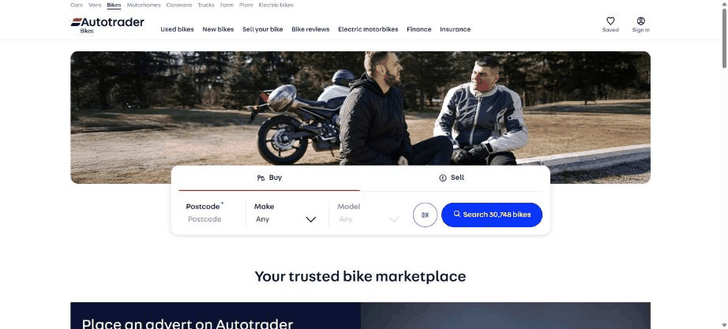
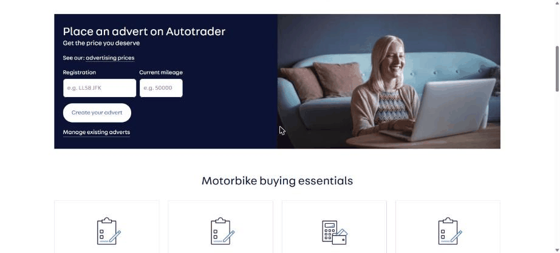
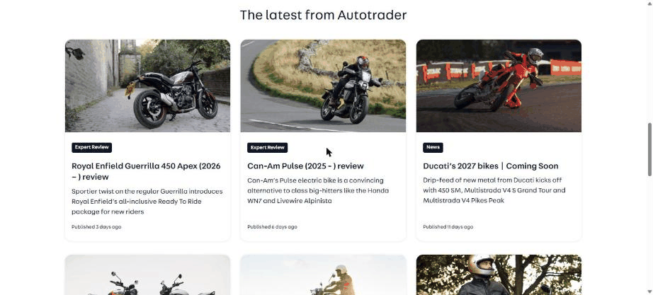
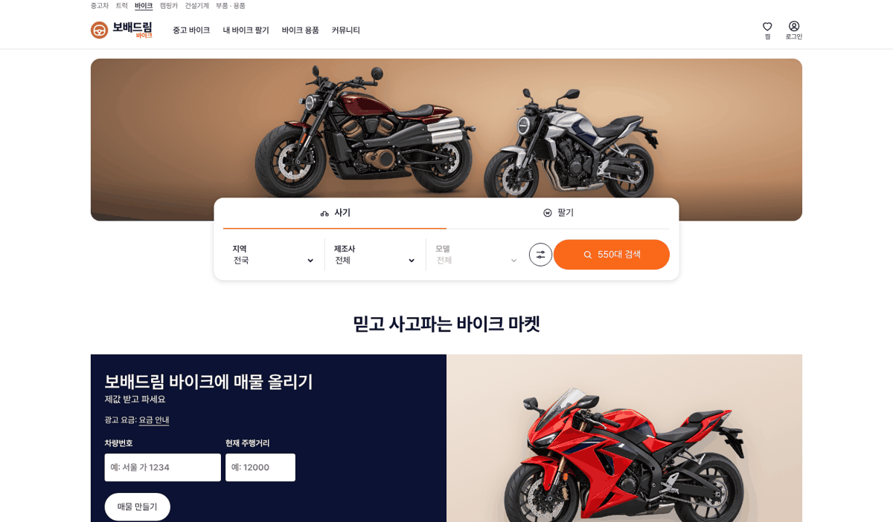
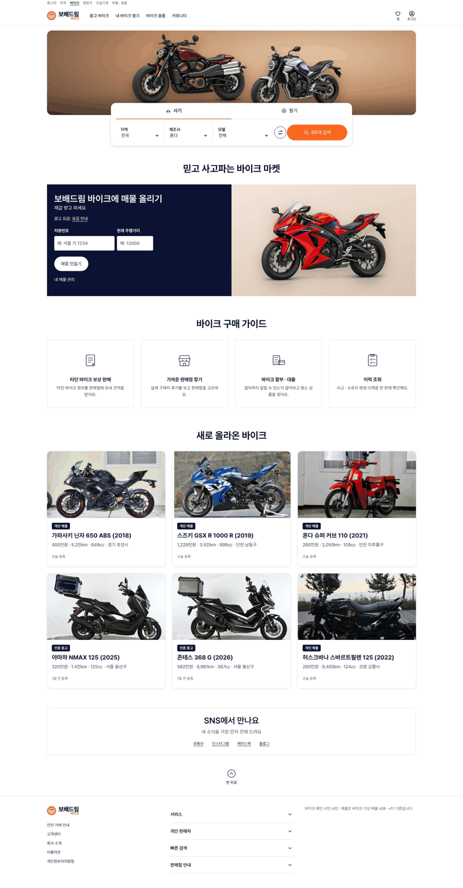

# PR #792 보배드림 바이크 메인 시안 v02 — 영국 Autotrader Bikes 구성

## ① 한 줄 요약
영국 오토트레이더 바이크 메인과 같은 순서 · 크기로 보배드림 바이크 메인을 만들었다(`/bike/?home=at`).

## ② 과제 · 브랜치 · 커밋 · PR · 상태
- 과제 ID: 없음(사용자 지시 「영국 오토트레이더 바이크 메인으로」)
- 브랜치: `claude-consult/bike-main-autotrader`
- PR: https://github.com/bobaekimboae/bobaedream/pull/792
- 상태: 병합 · 배포(v 값은 채팅 보고 참고)
- 함께 들어간 과제: 없음

## ③ 한 일
- autotrader.co.uk/bikes를 Chrome 1536에서 열어 구역 순서 · 크기 · 색을 쟀다.
- 같은 순서로 만들었다: 차종 글자 줄 → 흰 헤더 → 둥근 사진 1224×280 → 걸친 검색 카드 800(사기/팔기 탭, 지역 · 제조사 · 모델, 조건 원, 둥근 `N대 검색`) → 가운데 큰 제목 → 남색 매물 올리기 판 → 구매 가이드 4칸 → 새로 올라온 바이크 3열 → SNS 상자 → 맨 위로 → 바닥글.
- 빨강 밑줄 · 파랑 버튼 자리는 바이크 주황 하나로 바꿨다.
- 검색 대수는 가상 매물 550대에서 실제로 센다(혼다 선택 → 88대).
- v01(AutoScout24식)은 `?home=as24`로 비교용으로 남겼다.

## ④ 원본과 비교
| 구역 | Autotrader Bikes | 바이크 메인 v02 |
|---|---|---|
| 맨 위 | Cars · Vans · Bikes … 12px | 중고차 · 트럭 · 바이크 … 12px |
| 사진 | 1224×280 반경 16 · 사람 사진 | 1224×280 반경 16 · 스튜디오 바이크 2대 |
| 검색 카드 | 800 · Buy/Sell 빨강 밑줄 · Postcode/Make/Model · 파랑 Search | 800 · 사기/팔기 주황 밑줄 · 지역/제조사/모델 · 주황 N대 검색 |
| 판 | 남색 Place an advert + 사진 | 남색 매물 올리기 + 바이크 |
| 가이드 | 4칸 테두리 | 4칸 테두리 |
| 기사 | The latest 3열 | 새로 올라온 바이크 3열(매물) |

## ⑤ 검증
- `npm run verify:qf` 통과
- 1536 콘솔 오류 · 404 0건

## ⑥ 원본과 다르게 남긴 것과 이유
- 사람이 나오는 생활 사진이 없어 스튜디오 바이크를 썼다.
- 기사 자료가 없어 기사 칸을 매물 카드로 채웠다.
- 가이드 4칸 · SNS는 아직 화면이 없어 누르면 「준비 중」 안내.

## ⑦ 못 한 것 · 다음에 할 것
- `/bike/` 기본 진입을 메인으로 바꿀지 결정.

## ⑧ 확인 링크
- https://bobaekimboae.github.io/bobaedream/bike/?home=at
