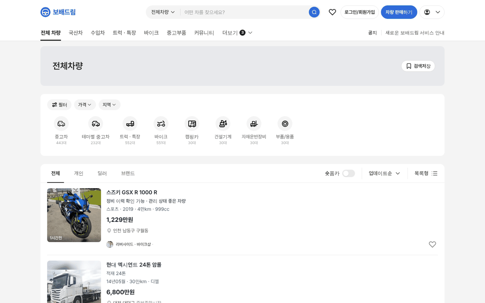
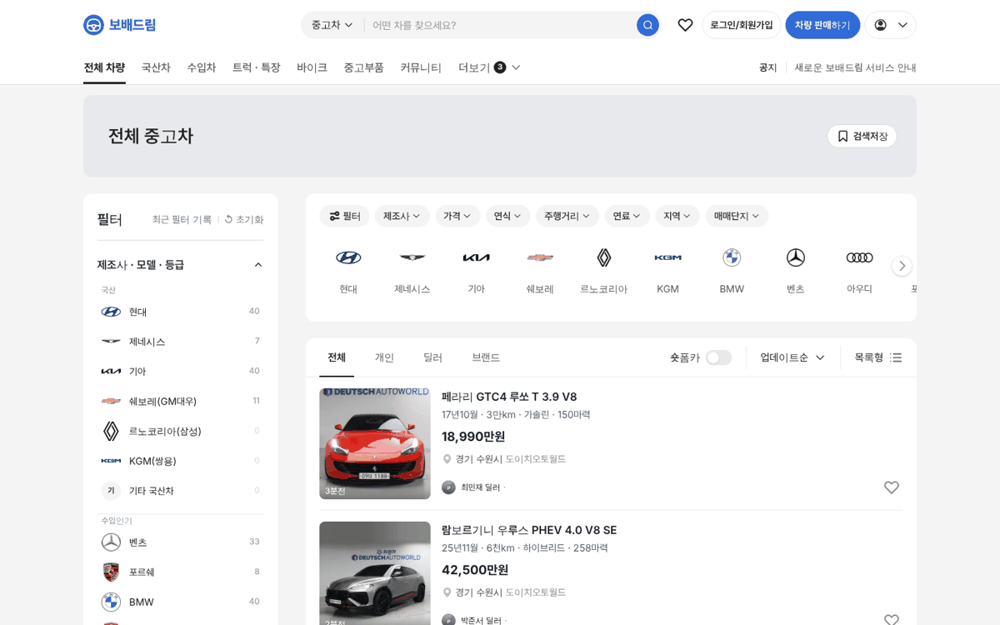

# PR #794 PC 전체 차량 좌측 필터 숨김 · 탑메뉴 꺾쇠 제거

## ① 한 줄 요약
PC 「전체 차량」 목록은 좌측 필터 없이 전체 폭으로 펼치고 칩은 가격 · 지역만 남겼다. 탑메뉴 「전체 차량」 옆 꺾쇠도 뺐다.

## ② 과제 · 브랜치 · 커밋 · PR · 상태
- 과제 ID: 없음(사용자 지시 「전체차량은 피씨에서는 좌측 필터가 안쓰는게 어떨까」 「진행해라」 「전체차량엔 화살표 빼다」)
- 브랜치: `claude-consult/all-vehicles-no-sidebar`
- PR: https://github.com/bobaekimboae/bobaedream/pull/794
- 상태: 병합 · 배포(v 값은 채팅 보고 참고)
- 함께 들어간 과제: 없음

## ③ 한 일
- 전체 차량은 승용 · 트럭 · 바이크 · 건설기계 · 부품이 섞여 승용 기준 좌측 필터가 맞지 않아, PC에서 숨기고 목록을 1200 전체 폭으로 펼쳤다.
- 상단 칩은 공통으로 쓸 수 있는 `필터 · 가격 · 지역`만 남겼다.
- 유형 줄에서 유형을 고르면 그 유형의 기존 좌측 필터 · 칩이 그대로 나온다.
- 탑메뉴 「전체 차량」 옆 ▾ 꺾쇠를 뺐다(누르면 유형 목록이 열리는 동작은 그대로).

## ④ 원본과 비교
| 항목 | 전 | 후 |
|---|---|---|
| 좌측 필터 | 있음(280) | 없음 |
| 목록 폭 | 880 | 1200 |
| 상단 칩 | 필터 · 제조사 · 가격 · 연식 · 주행거리 · 연료 · 지역 · 매매단지 | 필터 · 가격 · 지역 |
| 탑메뉴 | 전체 차량 ▾ | 전체 차량 |

## ⑤ 검증
- `npm run verify:qf` 통과
- PC 1440 콘솔 오류 0건, 전체 차량 좌측 필터 없음 · 목록 1200, 중고차는 좌측 필터 · 칩 그대로

## ⑥ 원본과 다르게 남긴 것과 이유
- `필터` 버튼(전체 필터 창)은 남겼다. 상세 조건이 필요한 사람의 입구다.

## ⑦ 못 한 것 · 다음에 할 것
- 전체 폭이 된 목록 카드 줄이 길어 보이면 2열 카드로 바꾸는 안 검토.

## ⑧ 확인 링크
- 전체 차량 PC: https://bobaekimboae.github.io/bobaedream/?qf=guazi&pc=1&category=%EC%A0%84%EC%B2%B4
