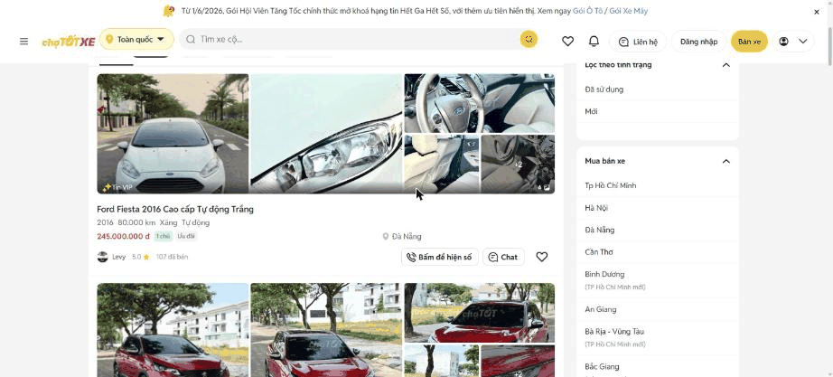
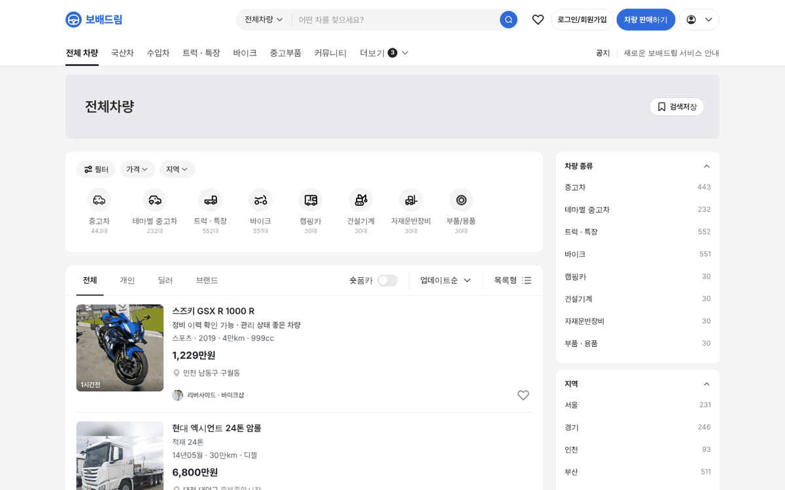
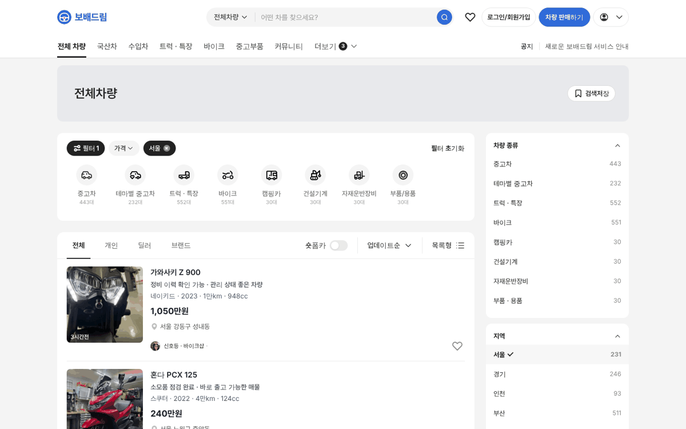

# PR #795 PC 전체 차량 초톳식 우측 필터

## ① 한 줄 요약
PC 전체 차량 목록 오른쪽에 초톳처럼 300 칸 필터 상자(차량 종류 · 지역 · 유용한 정보)를 붙였다.

## ② 과제 · 브랜치 · 커밋 · PR · 상태
- 과제 ID: 없음(사용자 지시 「초톳처럼 우측에 필터 잡아라」)
- 브랜치: `claude-consult/all-vehicles-no-sidebar`
- PR: https://github.com/bobaekimboae/bobaedream/pull/795
- 상태: 병합 · 배포(v 값은 채팅 보고 참고)
- 함께 들어간 과제: 없음

## ③ 한 일
- xe.chotot.com을 Chrome 1536에서 열어 오른쪽 필터 칸을 쟀다(목록 876 · 간격 24 · 우측 300, 흰 상자 반경 12, 제목 14/700 + 접기, 항목 14/400 줄 41).
- 전체 차량(PC) 목록 오른쪽에 같은 칸을 붙였다: 차량 종류(매물 수 · 누르면 이동), 지역(17개 시도 · 매물 수 · 누르면 바로 적용), 유용한 정보.
- 위 필터 카드와 목록은 876 폭으로 맞췄다.

## ④ 원본과 비교
| 항목 | 초톳 | 전체 차량 PC |
|---|---|---|
| 목록 · 간격 · 우측 | 876 · 24 · 300 | 876 · 24 · 300 |
| 상자 | 흰 · 반경 12 · 위아래 16 | 같음 |
| 제목 / 항목 | 14/700 + 접기 / 14/400 · 41 | 같음 + 오른쪽 매물 수 |
| 상자 순서 | 상태 · 지역 · 유용한 정보 | 차량 종류 · 지역 · 유용한 정보 |

## ⑤ 검증
- `npm run verify:qf` 통과
- PC 1440 콘솔 오류 0건, 목록 876 · 우측 300, 서울 선택 → 상단 `서울 ×` 칩 · 목록 필터 적용

## ⑥ 원본과 다르게 남긴 것과 이유
- 초톳 첫 상자 「상태(중고 · 신차)」는 우리 매물에 신차가 없어 「차량 종류」로 바꿨다.
- 「유용한 정보」 항목은 아직 화면이 없어 「준비 중」 안내.

## ⑦ 못 한 것 · 다음에 할 것
- 「차량 종류」 상자와 위 유형 줄이 같은 역할이라 하나로 줄일지 결정.

## ⑧ 확인 링크
- https://bobaekimboae.github.io/bobaedream/?qf=guazi&pc=1&category=%EC%A0%84%EC%B2%B4
