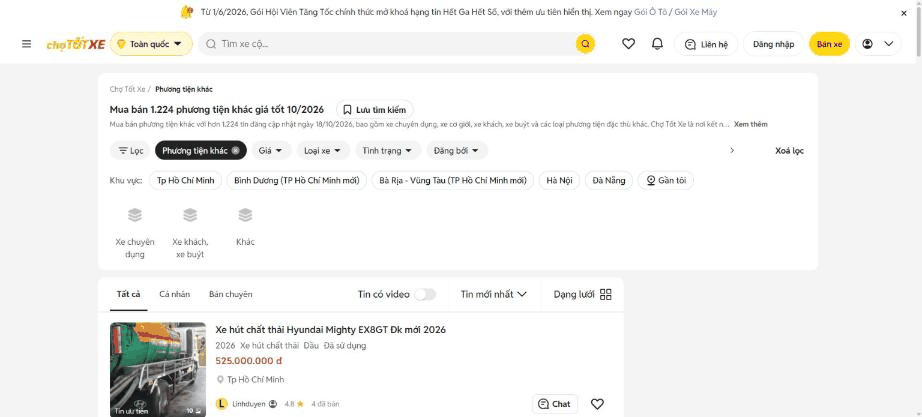
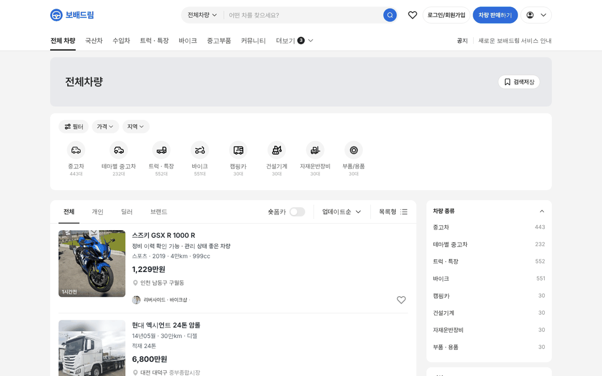

# PR #796 PC 트럭 카드 마력 줄 순서 원복 · 전체 차량 퀵필터 전체 폭

## ① 한 줄 요약
PC 트럭 카드에서 위로 올라가 있던 마력 줄을 다시 아래로 내리고, 전체 차량 퀵필터 카드를 초톳처럼 1200 전체 폭으로 올렸다.

## ② 과제 · 브랜치 · 커밋 · PR · 상태
- 과제 ID: 없음(사용자 지시 「트럭 마력이 위로 올라가」 「그리고 퀵필터는 풀로」)
- 브랜치: `claude-consult/truck-power-order`
- PR: https://github.com/bobaekimboae/bobaedream/pull/796
- 상태: 병합 · 배포(v 값은 채팅 보고 참고)
- 함께 들어간 과제: 없음

## ③ 한 일
- PC 트럭 카드: `마력 · 적재 · 차축` 줄이 `등록연월 · 주행 · 연료`보다 위에 있던 PC 전용 순서를 끄고 모바일과 같은 순서로 되돌렸다.
- 전체 차량 PC: 퀵필터 카드(필터 · 가격 · 지역 + 유형 줄)를 배너 아래 1200 전체 폭으로 옮기고, 그 아래에 목록 876 · 우측 필터 300을 둔다(초톳 `mua-ban-phuong-tien-khac` 실측과 같음).

## ④ 원본과 비교
| 항목 | 전 | 후 |
|---|---|---|
| PC 트럭 카드 | 350마력 · 적재 11톤 · 6x2 → 24년04월 · 6만km · 디젤 | 24년04월 · 6만km · 디젤 → 350마력 · 적재 11톤 · 6x2 |
| 전체 차량 퀵필터 | 목록 열 안 876 | 1200 전체 폭 |

## ⑤ 검증
- `npm run verify:qf` 통과
- PC 1440 콘솔 오류 0건, 트럭 카드 줄 순서 · 퀵필터 1200 · 목록 876 · 우측 300 측정

## ⑥ 원본과 다르게 남긴 것과 이유
- 없음.

## ⑦ 못 한 것 · 다음에 할 것
- 우측 「차량 종류」 상자와 유형 줄 중복 정리 결정.

## ⑧ 확인 링크
- 전체 차량 PC: https://bobaekimboae.github.io/bobaedream/?qf=guazi&pc=1&category=%EC%A0%84%EC%B2%B4
- 트럭 PC: https://bobaekimboae.github.io/bobaedream/?qf=guazi&pc=1&category=%ED%8A%B8%EB%9F%AD%20%C2%B7%20%ED%8A%B9%EC%9E%A5
