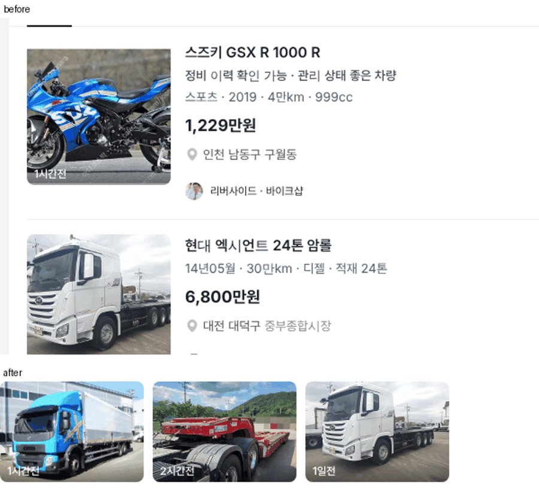

# PR #798 — PC 목록 카드 사진 잘림 수정(트럭)

① 한 줄 요약: PC 목록 카드에서 트럭 사진 위아래(바퀴·캡 윗부분)가 잘리던 것을 원본 사진으로 바꿔 차 전체가 보이게 했다.

② 과제 ID 없음 · 브랜치 `claude-consult/pc-photo-no-crop` · PR https://github.com/bobaekimboae/bobaedream/pull/798 · 상태: 병합·배포(v 값은 채팅 보고 참고) · 함께 들어간 과제 없음

③ 한 일
- 원인: PC 사진 칸은 가로로 긴 160×112인데, 모바일 정사각 칸(120×120)용으로 만든 정사각 사본(600×600)을 꽉 채우기(`cover`)로 넣어 위아래 약 15%씩 잘렸다. 정사각 사본은 차 바닥선을 위에서 85%에 두기 때문에 바퀴가 칸 아래 끝에 걸려 잘려 보였다.
- PC 카드는 정사각 사본·정사각 자르기 값(`listCrop`)을 쓰지 않고 원본 사진(4:3 등 가로형)을 쓴다. 원본은 칸과 가로세로 비율이 비슷해 거의 잘리지 않는다.
- 같은 원인이라 트럭뿐 아니라 PC 목록 전체(럭셔리카·바이크 등)에 같이 적용된다. 모바일은 그대로.

④ 원본과 비교: `pr-798/truck-photo-before-after.png` (위 = 수정 전, 아래 = 수정 후, 1440 PC 트럭 첫 3대)

⑤ 검증: `npm run verify:qf` 통과. 1440 PC 트럭·전체차량·럭셔리카 콘솔 오류 0. 사진 칸 160×112, 원본 800×600 · 640×480 등 `cover`. 모바일 변경 없음.

⑥ 원본과 다르게 남긴 것: 없음.

⑦ 못 한 것: 원본 사진 자체가 아주 가까이 찍힌 매물은 원본대로 보인다.

⑧ 확인 링크: PC `?qf=guazi&pc=1&category=트럭 · 특장`
