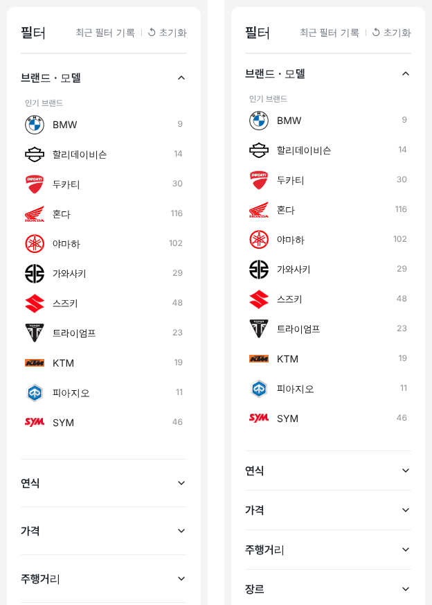

# PR #799 — PC 좌측 필터 항목 높이 69 → 57

① 한 줄 요약: 차란차형 PC 좌측 필터의 닫힌 항목 한 줄 높이를 69에서 57로 줄여 엔카·K Car·AutoScout24(55~56) 수준으로 맞췄다.

② 과제 ID: 없음(사용자 지시 「줄여보자」) · 브랜치 `claude-consult/filter-row-56` · PR https://github.com/bobaekimboae/bobaedream/pull/799 · 상태: 병합·배포(v 값은 채팅 보고 참조) · 함께 들어간 과제: 없음

③ 한 일
- 1440 화면에서 우리·차란차·엔카·K Car·AutoScout24 좌측 필터의 닫힌 항목 높이를 같은 방법으로 쟀다.
- 우리 필터는 차란차 값을 그대로 따라 69였고, 나머지는 55~56이었다.
- 항목 위아래 여백을 22 → 16으로 줄였다(`필터 더보기` 줄도 같게). 글자 16/24 600, 꺾쇠, 구분선은 그대로다.

④ 원본과 비교
| 사이트 | 한 줄 높이 |
|---|---|
| 우리 (작업 전) | 69 |
| 우리 (작업 후) | 57 |
| 차란차 | 69 |
| 엔카 | 55 |
| K Car | 56 |
| AutoScout24 | 56 |

⑤ 검증
- `npm run verify:qf` 통과(빌드 성공).
- 로컬 1440: 바이크·국산차의 닫힌 항목 모두 57, 콘솔 오류 0.
- 퀵필터 규격(레일 96 · 카드 80×72 · 트림 칩 32)은 이번 변경과 무관하다(좌측 필터 CSS 두 줄만 바꿈).

⑥ 원본과 다르게 남긴 것: 제목 글자 16px 유지(엔카·K Car는 14px). 「14는 너무 작아 보인다」 기준 때문이다.

⑦ 못 한 것·다음: 펼친 항목 안쪽 간격과 트럭 엔카식 카탈로그 행(34·38)은 손대지 않았다.

⑧ 확인 링크: 모바일 `?qf=guazi` · PC `?qf=guazi&pc=1&category=바이크&filterLayout=compact`
