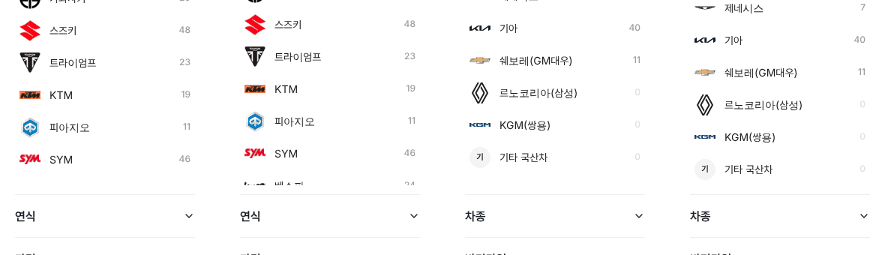

# PR #800 — PC 좌측 필터 펼친 제조사 목록 끝 정리

① 한 줄 요약: 항목 높이를 57로 줄인 뒤 어색하던 펼친 제조사 목록 끝의 빈 칸을 정리했다.

② 과제 ID: 없음(사용자 지시 「맞춰봐라」) · 브랜치 `claude-consult/filter-open-bottom` · PR https://github.com/bobaekimboae/bobaedream/pull/800 · 상태: 병합·배포(v 값은 채팅 보고 참조) · 함께 들어간 과제: 없음

③ 한 일
- 국산차처럼 목록이 스크롤되지 않는 화면: 마지막 행 글자에서 구분선까지 37이던 것을 21로 줄였다. 닫힌 항목의 글자→구분선(약 21)과 같은 간격이다.
- 바이크·수입차처럼 목록이 스크롤되는 화면: 목록 높이 500이 행 경계에 딱 맞아 아래가 빈 칸처럼 보였다. 512로 늘려 다음 행이 절반 보이게 했고, 이 절반 행이 "아래에 더 있다"는 단서가 된다.

④ 원본과 비교
| 화면 | 작업 전 | 작업 후 |
|---|---|---|
| 국산차 (스크롤 없음) | 마지막 글자 → 구분선 37 | 21 |
| 바이크 (스크롤) | SYM 아래 빈 칸 | 베스파 절반 보임 |

⑤ 검증: `npm run verify:qf` 통과, 로컬 1440 바이크·국산차·수입차 실측(목록 높이 512, 국산차 간격 21), 콘솔 오류 0.

⑥ 원본과 다르게 남긴 것: 차란차 원본의 목록 높이는 500이지만, 우리 행 높이(43)에서는 빈 칸으로 끝나 512로 바꿨다.

⑦ 못 한 것·다음: 트럭 엔카식 카탈로그(500)는 그대로 두었다.

⑧ 확인 링크: PC `?qf=guazi&pc=1&category=바이크&filterLayout=compact` · `?qf=guazi&pc=1&category=국산차`
