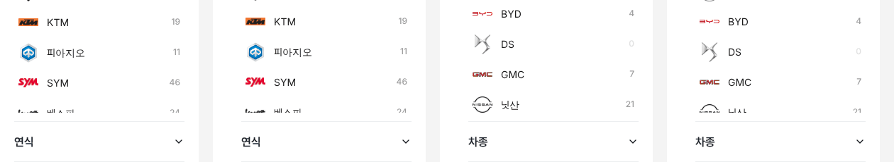

# PR #801 — PC 좌측 필터 스크롤 목록 절반 행 자동 맞춤

① 한 줄 요약: 수입차·전체 중고차도 바이크처럼 목록 아래에 다음 행이 정확히 절반 보이게 했다.

② 과제 ID: 없음(사용자 지시 「수입차도 적용해봐라」) · 브랜치 `claude-consult/filter-halfrow` · PR https://github.com/bobaekimboae/bobaedream/pull/801 · 상태: 병합·배포(v 값은 채팅 보고 참조) · 함께 들어간 과제: 없음

③ 한 일
- 고정 높이 512는 바이크에만 맞았다. 수입차는 목록 안 묶음 제목 때문에 다음 행이 약 77% 보였다.
- 높이를 숫자로 고정하지 않고, 기준 500 근처를 가로지르는 행을 화면에서 직접 재서 그 행이 절반 보이도록 목록 높이를 맞춘다.
- 제조사 → 모델로 단계가 바뀌거나 창 크기가 바뀔 때 다시 잰다.
- 트럭은 엔카 실측 400 상자를 그대로 둔다.

④ 원본과 비교(다음 행이 보이는 비율, 1440)
| 화면 | 작업 전 | 작업 후 |
|---|---|---|
| 바이크 | 49% | 51% |
| 수입차 | 77% | 51% |
| 전체 중고차 | 77% | 51% |
| 수입차 › 벤츠 모델 | — | 51% |
| 국산차(스크롤 없음) | 변화 없음 | 변화 없음 |
| 트럭 | 400 유지 | 400 유지 |

⑤ 검증: `npm run verify:qf` 통과, 로컬 1440 실측 위 표, 콘솔 오류 0.

⑥ 원본과 다르게 남긴 것: 차란차 원본은 고정 500이다. 우리 행·묶음 제목 높이에서는 빈 칸으로 끝나 행 위치로 맞춘다.

⑦ 못 한 것·다음: 안쪽 스크롤 대신 「인기 10개 + 전체 브랜드 보기」 비교 시안은 아직 만들지 않았다.

⑧ 확인 링크: PC `?qf=guazi&pc=1&category=수입차&filterLayout=compact` · `?qf=guazi&pc=1&category=바이크&filterLayout=compact`
