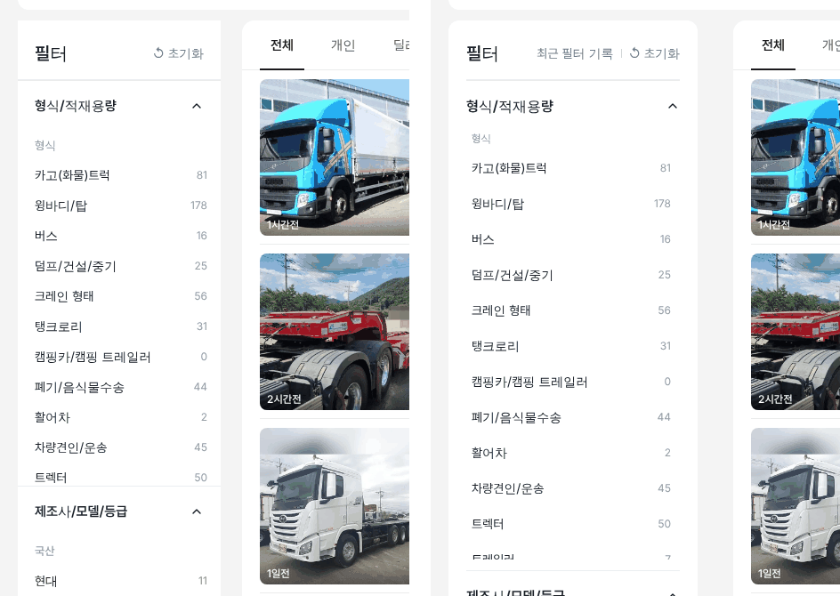
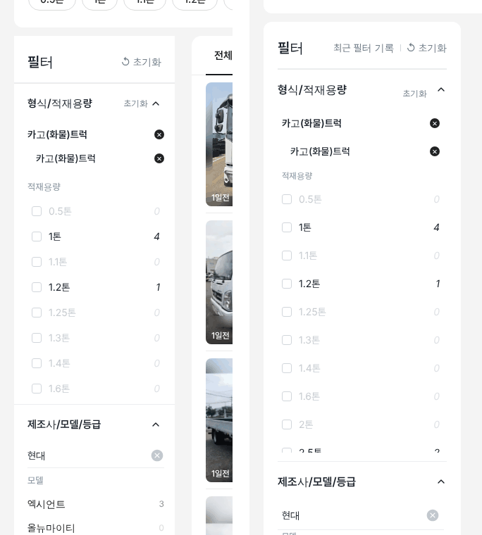

# PR #802 — PC 트럭 좌측 필터 우리 커스텀 크기로

① 한 줄 요약: 트럭 좌측 필터를 엔카 실측 크기에서 국산차·바이크와 같은 우리 크기로 바꿨다. 형식 → 세부형식 → 적재용량 단계 구조는 그대로다.

② 과제 ID: 없음(사용자 지시 「트럭은 엔카 필터 사이즈인데 우리 커스텀으로 변경해봐라」) · 브랜치 `claude-consult/truck-filter-custom` · PR https://github.com/bobaekimboae/bobaedream/pull/802 · 상태: 병합·배포(v 값은 채팅 보고 참조) · 함께 들어간 과제: 없음

③ 한 일
- 열 228 → 280, 필터와 매물 사이 24 → 40(매물 열 948 → 880). 국산차와 같은 배치다.
- 흰 카드 반경 12 · 안쪽 20, 머리에 `최근 필터 기록`을 다시 보이게 했다.
- 닫힌 항목 55(15px) → 57(16/24 600).
- 목록 행 34·36 → 40(형식·세부형식·선택 × 행·적재용량 체크 행 모두 같은 높이).
- 목록 상자 400 고정 → 기준 500에서 다음 행이 절반 보이게 자동 맞춤(국산차·수입차와 같은 공용 규칙).

④ 원본과 비교(1440)
| 항목 | 작업 전(엔카) | 작업 후(우리) |
|---|---|---|
| 필터 열 · 간격 | 228 · 24 | 280 · 40 |
| 닫힌 항목 | 55 · 15px | 57 · 16px |
| 목록 행 | 34 / 적재용량 36 | 40 |
| 목록 상자 | 400 고정 | 482 · 509(다음 행 절반) |
| 카드 모양 | 각진 흰 칸 | 반경 12 흰 카드 |

⑤ 검증: `npm run verify:qf` 통과, 로컬 1440 처음 화면과 카고 → 카고 → 현대 선택 실측(위 표), 콘솔 오류 0.

⑥ 원본과 다르게 남긴 것: 단계 구조와 선택 × 행은 엔카 방식을 그대로 둔다. 크기만 우리 값으로 바꿨다.

⑦ 못 한 것·다음: 형식 선택 × 행(검정 ×)과 제조사 선택 행(회색 원 ×)의 아이콘이 달라 하나로 맞출 필요가 있다. 위쪽 트럭 유형 알약 줄의 마지막 `기타`가 오른쪽에서 잘리는 문제는 이번 범위 밖이다.

⑧ 확인 링크: PC `?qf=guazi&pc=1&category=트럭 · 특장&filterLayout=compact`
