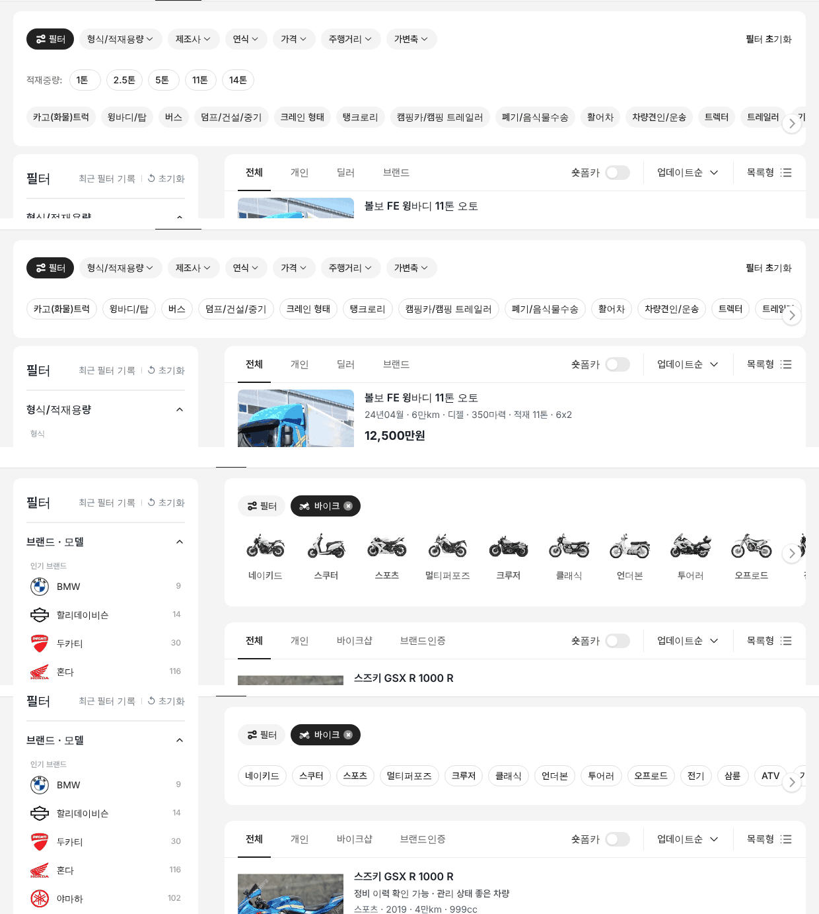
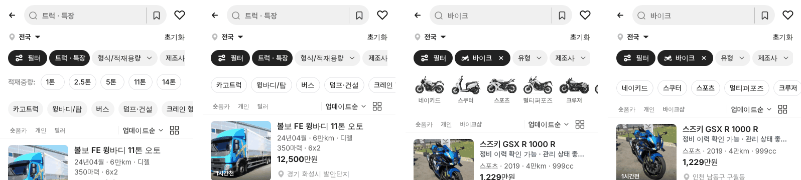

# PR #803 — 우리 알약칩 규칙 · 트럭 적재중량 제거 · 바이크 유형 알약

① 한 줄 요약: 적재중량 알약 모양을 우리 알약칩 규칙으로 정했다. 트럭은 적재중량 줄을 빼고 형식 유형 줄만 남겼고, 바이크 유형은 이미지 카드 대신 같은 알약으로 바꿨다.

② 과제 ID: 없음(사용자 지시) · 브랜치 `claude-consult/pill-rule` · PR https://github.com/bobaekimboae/bobaedream/pull/803 · 상태: 병합·배포(v 값은 채팅 보고 참조) · 함께 들어간 과제: 없음

③ 한 일
- 알약칩 규칙: 흰 바탕 · 1px `#DEDEE3` · 높이 32 · 좌우 10 · 최소 폭 48 · 14/20 500 · 칩 사이 8 · 선택은 `#222` 채움 흰 글자.
- 트럭 첫 화면에서 `적재중량:` 줄을 뺐다. 형식 유형 줄은 회색 채움 알약에서 규칙 알약으로 바꿨다.
- 바이크 첫 화면 유형 13종을 이미지 카드에서 규칙 알약으로 바꿨다(PC·모바일). 동작은 같다(누르면 그 장르로 거르고 제조사 줄로 넘어감).
- PC에서 두 화면 모두 칩 줄 → 알약 30 · 알약 → 카드 끝 28로 맞췄다.

④ 원본과 비교
| 항목 | 작업 전 | 작업 후 |
|---|---|---|
| 트럭 첫 화면 줄 | 적재중량 + 형식 유형(회색 채움) | 형식 유형(규칙 알약)만 |
| 트럭 PC 퀵필터 높이 | 112 | 56 |
| 바이크 유형 | 이미지 카드 76×102 | 규칙 알약 32 |
| 바이크 PC 칩 줄 → 알약 | — | 30 (트럭과 같음) |

⑤ 검증: `npm run verify:qf` 통과, 로컬 PC 1440 · 모바일 384 실측(알약 32 · 테두리 `#DEDEE3` · 줄 56), 바이크 `스쿠터` 누름 → 제조사 줄 전환 확인, 콘솔 오류 0.

⑥ 원본과 다르게 남긴 것: `&qfbrand=shadowcard` 비교 시안은 바이크 유형 이미지 카드를 그대로 둔다.

⑦ 못 한 것·다음: 트럭 형식 유형 13개가 테두리 알약이 되며 조금 넓어져 PC 1200 안에 다 들어가지 않는다(마지막 2개가 오른쪽 넘김). 적재중량 알약 함수(`applyTruckQuickSpec`)는 다른 곳에서 다시 쓸 수 있어 남겼다.

⑧ 확인 링크: PC `?qf=guazi&pc=1&category=트럭 · 특장&filterLayout=compact` · `?qf=guazi&pc=1&category=바이크&filterLayout=compact` · 모바일 `?qf=guazi&category=바이크`
