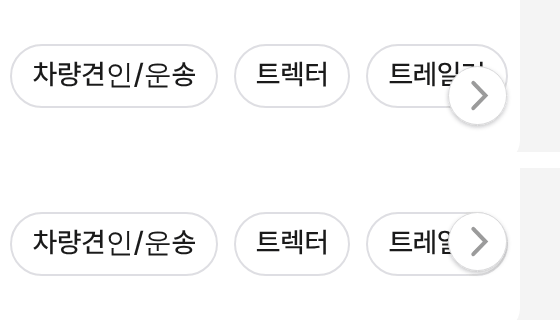

# PR #804 — 알약 줄 넘김 화살표 세로 정렬

① 한 줄 요약: 트럭·바이크 알약 줄의 오른쪽 넘김 버튼이 알약보다 11px 아래로 처진 것을 줄 가운데로 맞췄다.

② 과제 ID: 없음(사용자 지시 「우측 이동 버튼 틀어졌다」) · 브랜치 `claude-consult/pill-arrow` · PR https://github.com/bobaekimboae/bobaedream/pull/804 · 상태: 병합·배포(v 값은 채팅 보고 참조) · 함께 들어간 과제: 없음

③ 한 일
- 원인: 넘김 버튼이 이미지 줄(높이 102)에 맞춘 `top: 20px`을 알약 줄(높이 56)에서도 그대로 썼다.
- 알약 줄에서만 버튼을 줄 세로 가운데(`top: calc(50% - 19px)`)에 둔다. 이미지 줄은 그대로다.

④ 원본과 비교(1440, 세로 가운데 y)
| 화면 | 알약 | 버튼(전) | 버튼(후) |
|---|---|---|---|
| 트럭 | 241 | 252 | 241 |
| 바이크 | 241 | 252 | 241 |

⑤ 검증: `npm run verify:qf` 통과, 로컬 1440 실측 위 표, 콘솔 오류 0.

⑥ 원본과 다르게 남긴 것: 없음.

⑦ 못 한 것·다음: 트럭 유형 13개가 PC 1200 안에 다 들어가지 않아 화살표가 마지막 알약 위에 겹친다. 간격·이름 줄이기로 한 줄에 넣으면 화살표 자체가 사라진다.

⑧ 확인 링크: PC `?qf=guazi&pc=1&category=트럭 · 특장&filterLayout=compact` · `?qf=guazi&pc=1&category=바이크&filterLayout=compact`
