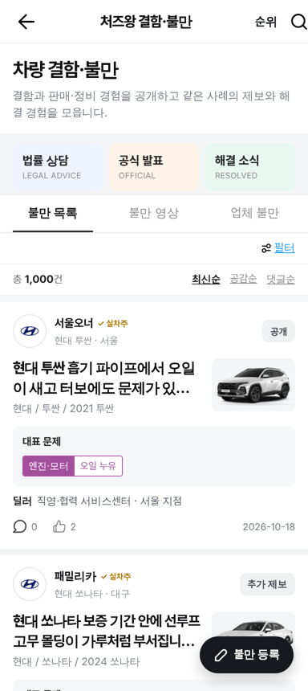
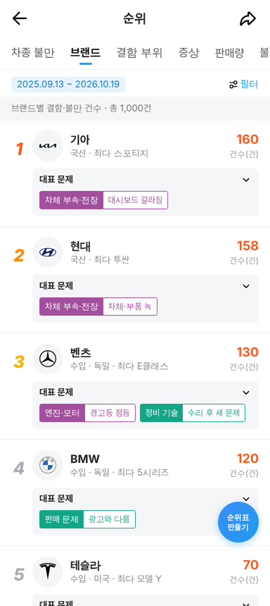
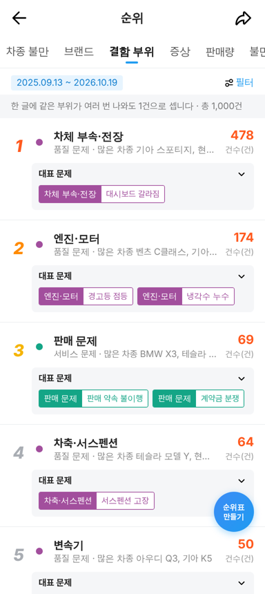
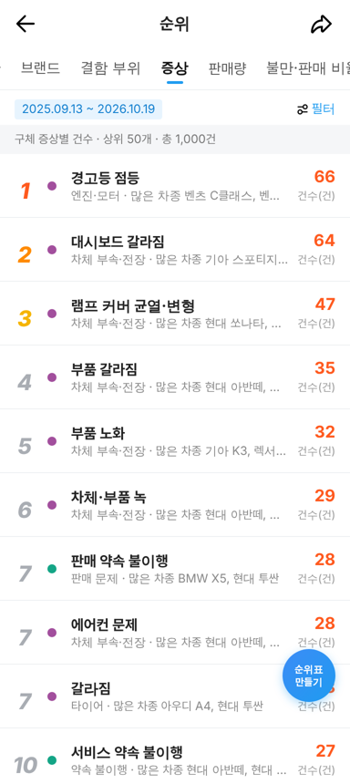
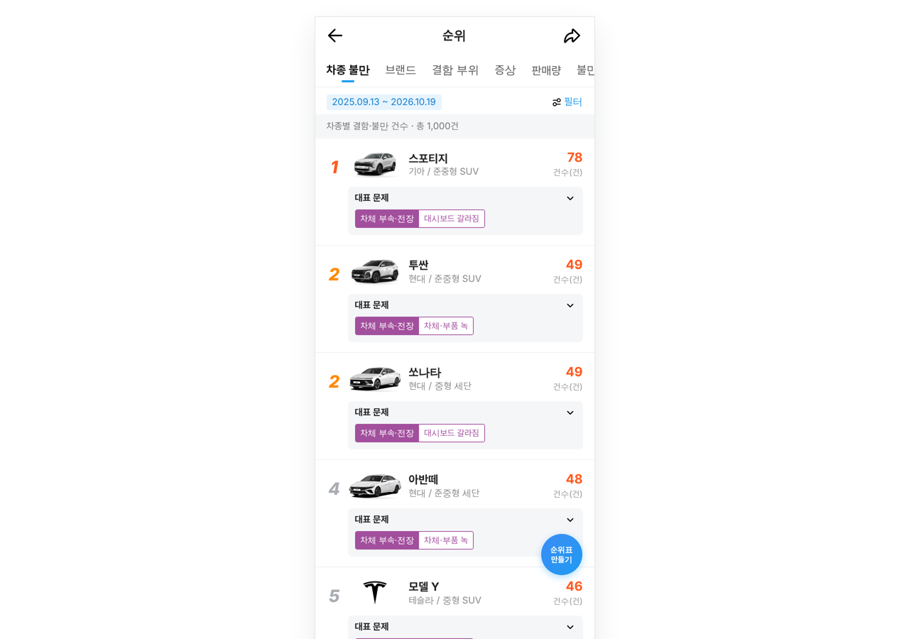

# 결함·불만 게시판 1,000건 확장 · 목록·순위 보강

① 한 줄 요약: 처즈왕 공개 불만 1,000건을 한국어로 옮겨 결함·불만 게시판을 채우고, 불만 목록(건수·정렬·더 보기)과 불만 순위(브랜드·결함 부위·증상 탭 추가)를 보강했다.

② 과제 ID 없음 · 브랜치 `claude-consult/complaint-1000` · PR https://github.com/bobaekimboae/bobaedream/pull/827 · 병합·배포 v값은 채팅 보고 참고 · 이번 병합으로 함께 들어간 과제 없음

③ 한 일
- 처즈왕(12365auto.com) 공개 불만 목록에서 모은 사례 중 1,000건을 골라 제목 855종을 한국어로 옮겼다(중국 판매명 → 한국 판매명, 차명은 제목에서 뺌).
- 브랜드 22개: 현대 158 · 기아 160 · 벤츠 130 · BMW 120 · 테슬라 70 · 아우디 50 · 볼보 45 · 폭스바겐 35 등. 한국 판매가 확인되지 않은 지커 · 샤오펑은 뺐다.
- 대표 문제는 처즈왕 결함 코드를 기존 281개 한국어 분류에 그대로 맞췄다(품질 788 · 서비스 159 · 종합 36 · 기타 17).
- 목록: 30건씩 보여 주고 `더 보기`, `총 N건`, `최신순 · 공감순 · 댓글순` 정렬을 추가했다.
- 순위: `차종 불만 · 브랜드 · 결함 부위 · 증상 · 판매량 · 불만·판매 비율` 6개 탭(브랜드·결함 부위·증상 새로 추가), 기간은 실제 글 날짜 범위로 표시.

④ 원본과 비교
| 영역 | 작업 전 | 작업 후 |
|---|---|---|
| 글 수 | 가상 글 50여 건(같은 문장 반복) | 처즈왕 사례 번역 1,000건 |
| 목록 | 전부 한 번에 표시, 건수·정렬 없음 | 30건씩 · 총 N건 · 정렬 3종 |
| 순위 탭 | 불만 · 판매량 · 비율 3개 | 차종 불만 · 브랜드 · 결함 부위 · 증상 · 판매량 · 비율 6개 |
| 기간 표시 | 고정 2026.09.18 ~ 10.17 | 실제 범위 2025.09.13 ~ 2026.10.19 |

| 모바일 목록 | 브랜드 순위 | 결함 부위 순위 |
|---|---|---|
|  |  |  |

| 증상 순위 | PC 차종 순위 |
|---|---|
|  |  |

⑤ 검증
- `npm run verify:qf` 통과.
- 콘솔 오류: 모바일 384 · PC 1280 모두 0건(파비콘 제외).
- 동작: 목록 30 → 더 보기 60, 공감순 정렬, 불만 영상 탭 245건, 테슬라 필터 70건, 순위 6개 탭 모두 표시.
- 퀵필터 화면은 바꾸지 않아 measure:qf 수치 변화 없음.

⑥ 원본과 다르게 남긴 것
- 처즈왕의 접수번호·처리 단계·제조사 회신은 한국에 공식 절차가 없어 넣지 않았다.
- 본문은 처즈왕 원문이 아니라 증상·분류로 만든 짧은 요약이다(원문 본문은 옮기지 않음).
- 세부 모델은 중국 판매 사양(엔진 등)이 한국과 달라 `연식 + 모델`까지만 쓴다.
- 작성자 별명·지역·주행거리·구매일·월 판매량·가격은 가상 값이다.

⑦ 못 한 것·다음에 할 것
- 차량 사진은 모델 카탈로그에 있는 36개 차종만 실제 사진, 나머지 93개는 제조사 로고.
- 증상 순위에서 같은 증상 이름이 다른 부위에 겹쳐 나온다(예: 엔진·변속기의 `경고등 점등`) — 부위 이름을 함께 표시해 구분.

⑧ 확인 링크
- 모바일: `community/naver-cafe-list.html?board=chezhiwang-complaint`
- 순위: `community/naver-cafe-list.html?board=chezhiwang-complaint&czw=rank&rank=brand`
- PC: 같은 주소에 `&pc=1`
