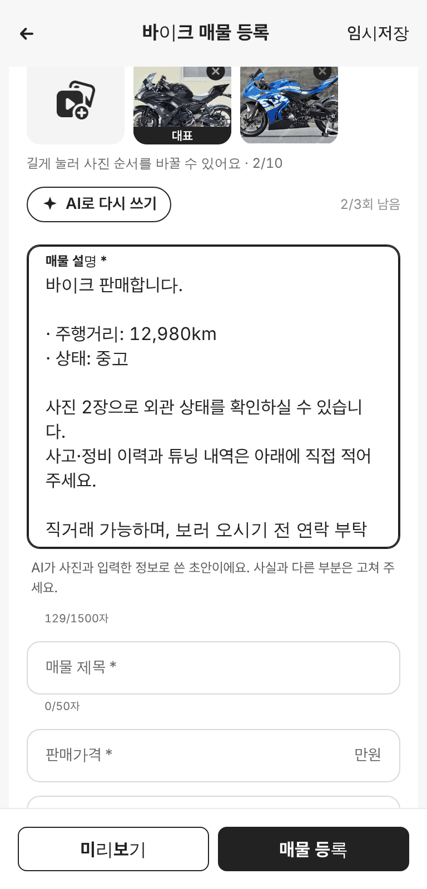

# PR #829 바이크 등록폼 AI 설명 초안 버튼

## ① 한 줄 요약
초톳 등록폼(ia_version=3)의 「AI가 써 줘요」 구조를 분석해, 우리 바이크 등록폼에 사진을 올리면 설명 초안을 채워 주는 버튼을 시안으로 넣었다(지금은 가짜 응답).

## ② 과제 · 브랜치 · 커밋 · PR · 상태
- 과제 ID: 없음(사용자 지시 「우리 등록폼에 직접 구현해봐」)
- 브랜치: `claude/bike-ai-description`
- PR: https://github.com/bobaekimboae/bobaedream/pull/829
- 상태: 병합·배포(배포 v값은 채팅 보고 참고)
- 함께 들어간 과제: 없음

## ③ 한 일
- 초톳 공개 화면 코드에서 흐름을 확인했다: 사진 업로드 → `generate_description`에 카테고리·사진 주소·이미 쓴 글 전송 → 설명 글 받기, 사진 0장 차단, 1인 3회, 생성 뒤 커서를 글 끝으로.
- 우리 바이크 등록폼(`register=bike`) 설명칸 위에 `AI로 설명 쓰기` 버튼과 `N/3회 남음`을 넣었다.
- 누르면 약 1.5초 기다림 표시 후 설명칸을 채우고, 아래에 「AI가 쓴 초안이에요. 사실과 다른 부분은 고쳐 주세요」를 보여 준다.
- 이미 쓴 글은 지우지 않고 그 아래에 붙이고, 다시 쓰기를 눌러도 초안이 겹쳐 쌓이지 않는다.
- 요청 부분은 `ai-description.ts` 한 파일로 분리해, 실제 서버가 생기면 이 함수만 바꾸면 된다.

## ④ 원본과 비교
| 항목 | 초톳 | 우리 |
|---|---|---|
| 버튼 위치 | 설명칸 | 설명칸 위 알약 |
| 사진 0장 | 막음 | 막음(안내 토스트) |
| 횟수 제한 | 3회 | 3회 |
| 생성 뒤 | 설명칸 커서 끝 | 같음 |
| 정보 채우기(`generate_ad_param`) | 있음 | 이번에 안 함 |

## ⑤ 검증
- `npm run verify:qf` 통과(런타임 검사·타입 검사·빌드)
- 콘솔 오류: 모바일 384 0건, PC 1280 0건
- 동작: 사진 0장 안내 ✓, 사진 2장 후 작성 ✓, 남은 횟수 3→2 ✓, 다시 쓰기 중복 없음 ✓
- 퀵필터 규격 변경 없음(이번 작업은 등록폼만)

## ⑥ 원본과 다르게 남긴 것과 이유
- AI는 실제 이미지 분석이 아니라 입력값으로 만든 가짜 문장이다. 시안 사이트에 서버가 없기 때문이다.
- 사진으로 알 수 없는 사고·정비 이력은 쓰지 않고 직접 적도록 안내한다(허위 정보 방지).

## ⑦ 못 한 것 · 다음
- 실제 서버 연결(사진 분석 AI 호출, 키는 서버에만 보관).
- 초톳처럼 사진으로 제조사·모델·제목·가격까지 채우는 2단계.
- 설명칸이 제조사·모델 입력보다 위에 있어, 먼저 누르면 「바이크 판매합니다」처럼 일반 문장이 나온다.

## ⑧ 확인 링크
- 모바일: https://bobaekimboae.github.io/bobaedream/?qf=guazi&register=bike
- PC: https://bobaekimboae.github.io/bobaedream/?qf=guazi&register=bike&pc=1
