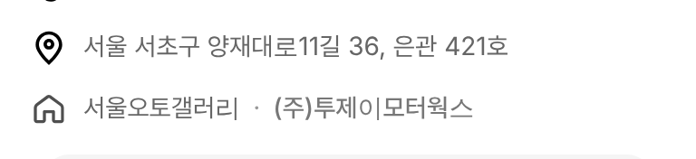
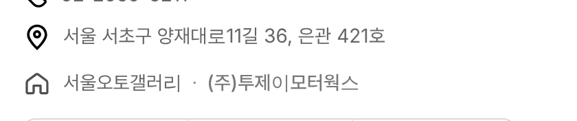

# PR #833 딜러 화면 매매단지 아이콘 교체

① 한 줄 요약: 김태규 딜러 화면의 매매단지 줄 아이콘을 노션 AutoScout24 홈 아이콘(`홈_20_21`)으로 바꾸고 글자 시작선을 지역 줄과 맞췄다.

② 과제 ID: 없음(사용자 지시 「김태규 딜러페이지 / 매매단지 아이콘」) · 브랜치 `claude/dealer-complex-home-icon` · 커밋 `14113d6` → main `e6f41a9` · PR https://github.com/bobaekimboae/bobaedream/pull/833 · 상태: 병합·배포(v=e6f41a9) · 함께 들어간 과제: 없음

③ 한 일
- 노션의 AutoScout24 `홈_20_21` 원본 SVG를 한 글자도 고치지 않고 `public/icons/dealer-profile/complex-home-as24.svg`로 넣었다.
- 딜러 화면 프로필의 매매단지 줄(`서울오토갤러리 · (주)투제이모터웍스`)이 이 아이콘을 쓴다(이전: 속 채운 집 `complex-home`, 파일은 남김).
- 아이콘 20×20, 여백 `0 9px 0 1px`로 위 지역 줄 아이콘(22) 가운데 아래에 오게 했다.

④ 원본과 비교
| 항목 | 작업 전 | 작업 후 |
|---|---|---|
| 아이콘 | 속 채운 집 | AutoScout24 외곽선 집(노션 원본) |
| 매매단지 글자 시작(모바일 384) | 44 | 46 (지역 글자 46과 같음) |
| 매매단지 글자 시작(PC 1280) | 254 | 256 (지역 글자 256과 같음) |

⑤ 검증: `npm run verify:qf` 통과 · 콘솔 오류 PC·모바일 0 · 퀵필터 화면은 바꾸지 않아 measure:qf 대상 아님

⑥ 원본과 다르게 남긴 것: 아이콘 색은 원본 `#333333` 그대로이며 opacity .86만 기존 값을 유지했다.

⑦ 못 한 것·다음: 다른 딜러 화면도 같은 컴포넌트라 자동 적용된다. 따로 남은 일 없음.

⑧ 확인 링크
- 모바일: https://bobaekimboae.github.io/bobaedream/?qf=guazi&profile=dealer&shop=450554&emp=1&v=e6f41a9
- PC: https://bobaekimboae.github.io/bobaedream/?qf=guazi&profile=dealer&shop=450554&emp=1&v=e6f41a9&pc=1
