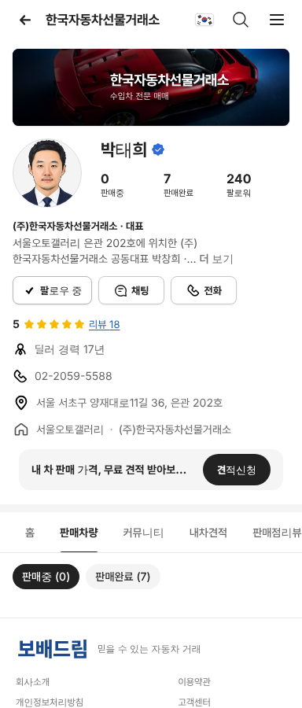
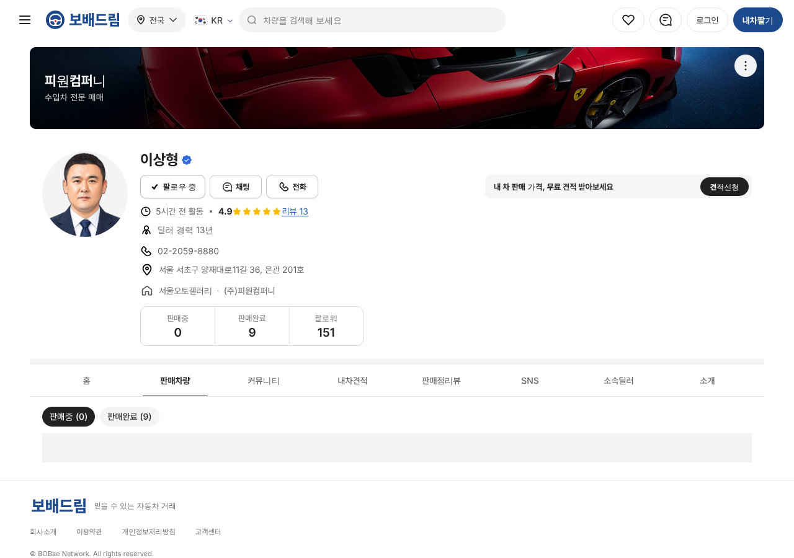

# PR #835 서울오토갤러리 상사 대표 판매자페이지

① 한 줄 요약: 서울오토갤러리 회원사 79곳의 대표 88자리(공동대표 포함)에 김태규 딜러 화면과 같은 판매자페이지를 만들고 대표 전화를 표기했다.

② 과제 ID: 없음(사용자 지시) · 브랜치 `claude/sag-shop-owner-pages` · 커밋 `203466b` → main `598be76` · PR https://github.com/bobaekimboae/bobaedream/pull/835 · 상태: 병합·배포 · 함께 들어간 과제: 없음

③ 한 일
- 공개 회원사 목록(총 79개)에서 상사명·대표·호수·상사 번호·대표 전화를 `src/prototype/data/seoul-autogallery-shops-v01.ts`로 옮겼다.
- 상사 79곳 · 공동대표 9곳 → 대표 자리 88개. 대표 인원은 겹치는 사람(강홍구 3곳, 박상용·서용석·장광일·황신승·이승훈·아베타케시 2곳)을 빼면 80명.
- 대표마다 딜러 화면(`?profile=dealer&shop=<ShopNo>&emp=<1·2>`)을 연다. 기존 5명(김태규·강홍구·서용석·주한솔·박진희) 주소는 그대로.
- 상사명·호수·주소·전화·판매중 차량은 실제 값, 평점·리뷰·판매완료·팔로워·경력은 화면 확인용 가상 값.
- 전화 미기재(0000) 22곳은 전화 줄을 빼고 전화 버튼은 채팅 안내 문구로 바꿨다. 판매중 차량이 없으면 안내 문구를 보여 준다.
- 매물 상세의 상사명 링크도 그 상사 대표 페이지로 연결한다(예: 점보모빌리티 매물 → 이기련 대표).

④ 확인 결과
| 항목 | 결과 |
|---|---|
| 대표 페이지 88개 이름 표시 | 88 / 88 |
| 전화 표기 | 57곳 표시 · 22곳 미기재 |
| 판매중 차량 연결 | 점보모빌리티 1 · 브로엠와이 7 · 서울자동차선물거래소 2 · 디앤디플러스 2 |
| 김태규 페이지 | 기존 값 그대로(판매중 24 · 02-2059-5211) |

⑤ 검증: `npm run verify:qf` 통과 · 88개 페이지 콘솔 오류 0(모바일 384) · 표본 7곳 PC 1280 · 모바일 384 오류 0 · 퀵필터 화면은 바꾸지 않아 measure:qf 대상 아님

⑥ 원본과 다르게 남긴 것: 대표 사진은 실제 사진이 없어 기존 딜러 일러스트 5종을 돌려 썼다. 팩스·허가·사업자 번호는 목록에 없어 화면에서 뺐다. 에이치에스효성더클래스는 목록에 휴대전화(010)가 대표 번호로 올라 있어 그대로 표기했다.

⑦ 못 한 것·다음: 서울오토갤러리 카테고리의 딜러 레일은 기존 9명 그대로다(88명 전체를 레일에 넣을지 결정 필요). 상사 소속 일반 딜러(종사원)는 목록에 없어 만들지 않았다.

⑧ 확인 링크
- 김태규(모바일): https://bobaekimboae.github.io/bobaedream/?qf=guazi&profile=dealer&shop=450554&emp=1&v=598be76
- 공동대표 예(박태희): https://bobaekimboae.github.io/bobaedream/?qf=guazi&profile=dealer&shop=450314&emp=2&v=598be76
- PC 예(이상형): https://bobaekimboae.github.io/bobaedream/?qf=guazi&profile=dealer&shop=450502&emp=1&v=598be76&pc=1
