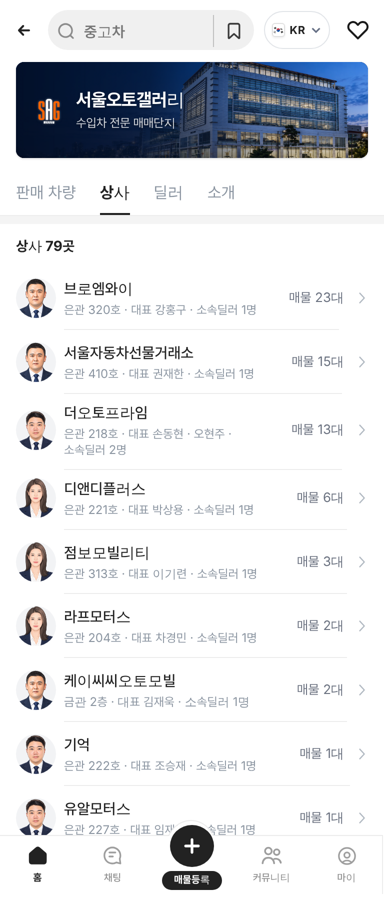
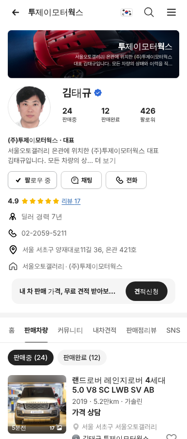

# PR #839 딜러 화면 모바일 탭 복구 · 상사 탭 프사·호수·소속딜러 수

① 한 줄 요약: 모바일 딜러 화면에서 사라졌던 `SNS · 소속딜러 · 소개` 탭을 되살렸다. 서울오토갤러리 상사 탭 줄에는 프사, 은관·금관 호수, 소속딜러 수를 넣었다.

② 과제 ID: 없음(사용자 지시 「소속딜러 정보등 탭에서 사라졌다」 · 「호수에서 은관 금관 있어야하고 · 상사 프사 추가 · 대표자 옆으로 소속딜러 명수」) · 브랜치 `claude/dealer-tabs-restore` · 커밋 `538bef7` → main `267ff2d` · PR https://github.com/bobaekimboae/bobaedream/pull/839 · 상태: 병합·배포(v=267ff2d) · 함께 들어간 과제: 없음

③ 한 일
- 원인: 앞선 리뷰 탭 보정(d85493e)이 모바일 구역 탭을 5칸 격자로 바꿨다. 이때 6번째 탭부터(`SNS · 소속딜러 · 소개`) 숨기도록 되어 있었다.
- 모바일도 8개 탭을 모두 한 줄에 두고, 옆으로 밀어 넘기게 되돌렸다. 탭 좌우 여백은 10, 글자는 14px다. PC는 바꾸지 않았다.
- 상사 탭의 각 줄 맨 앞에 40px 원형 프사를 넣었다. 첫 대표의 판매자페이지 사진과 같은 그림이다.
- 둘째 줄은 `은관 320호 · 대표 강홍구 · 소속딜러 N명`이다. 금관 상사는 원본 표기 `금관 2층`을 그대로 쓴다.
- 둘째 줄이 길면 말줄임 대신 항목 단위로 두 줄로 내려간다.

④ 원본과 비교
| 항목 | 작업 전 | 작업 후 |
|---|---|---|
| 모바일 딜러 화면 탭 | 5개(SNS·소속딜러·소개 숨김) | 8개, 가로로 밀어 넘김 |
| 상사 줄 프사 | 없음 | 40 원형 |
| 호수 | `320호` | `은관 320호` / `금관 2층` |
| 소속딜러 수 | 없음 | `소속딜러 N명` |

⑤ 검증
- `npm run verify:qf` 통과.
- 콘솔 오류: 모바일 0, PC 0.
- 탭 노출(모바일 384·PC 1280, 상사 2곳): 8개 모두 보임.
- 상사 79줄 그대로이고, 공동대표 클릭(오현주 → `emp=2`)도 정상.
- 퀵필터는 바꾸지 않아 measure:qf 대상이 아니다.

⑥ 원본과 다르게 남긴 것
- 소속딜러 수는 판매자페이지 `소속딜러` 탭에 실제로 나오는 인원(대표 + 우리가 아는 딜러)과 같은 기준이다. 그래서 대부분 상사가 1~2명으로 보인다. 공개 상사 목록에 딜러 인원이 없기 때문이다.
- 프사는 일러스트 5장을 돌려 쓰는 자리용이다. 대표의 실제 사진이 아니며 성별도 맞지 않을 수 있다.

⑦ 못 한 것·다음
- 실제 딜러 인원과 사진을 받으면 소속딜러 수와 프사를 바꾼다.
- PC 서울오토갤러리 화면에는 상사·딜러 탭이 아직 없다.

⑧ 확인 링크
- 상사 탭: https://bobaekimboae.github.io/bobaedream/?qf=guazi&category=서울오토갤러리&sag=companies&v=267ff2d
- 모바일 딜러 화면: https://bobaekimboae.github.io/bobaedream/?qf=guazi&profile=dealer&shop=450554&emp=1&v=267ff2d
- PC 딜러 화면: https://bobaekimboae.github.io/bobaedream/?qf=guazi&profile=dealer&shop=450554&emp=1&v=267ff2d&pc=1
