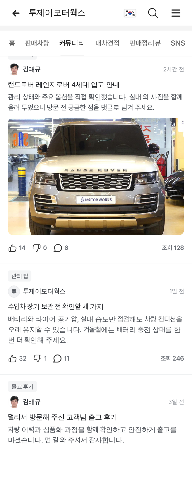
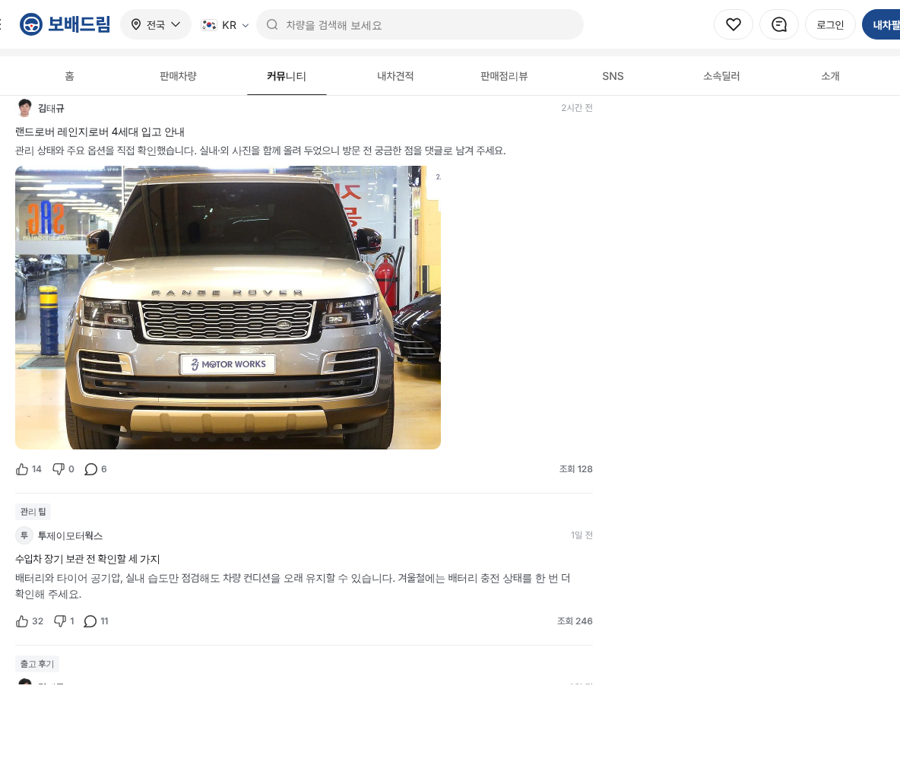

# PR #841 판매자페이지 커뮤니티 → 네이버 토론 피드

① 한 줄 요약: 판매자페이지 `커뮤니티` 탭을 우리 커뮤니티의 네이버 토론 피드 카드 모양으로 바꿨다.

② 과제 ID: 없음(사용자 지시 「커뮤니티 우리 네이버 토론 피드로 보기 화면 바꾸자」 → 「판매자페이지 커뮤니티」) · 브랜치 `claude/dealer-community-feed` · 커밋 `3413f81` → main `5bfa3fe` · PR https://github.com/bobaekimboae/bobaedream/pull/841 · 상태: 병합·배포(v=5bfa3fe) · 함께 들어간 과제: 없음

③ 한 일
- 카드 구조를 토론 피드와 같게 했다: 분류 칩 → 작성자 줄(프사 · 이름 · 오른쪽 시간) → 제목 → 본문 3줄 → 차량 사진 → 좋아요·싫어요·댓글·조회 줄.
- 크기와 색은 `public/community/naver-discussion-feed.css` 값을 그대로 썼다(제목 16/24 750, 본문 14/21, 칩 22, 프사 24, 반응 아이콘 18).
- 글은 4개다: 차량 소개 · 관리 팁 · 출고 후기 · 시세 이야기. 관리 팁의 작성자는 상사이고, 프사 자리에 상사 첫 글자를 넣었다.
- 사진은 그 딜러가 지금 파는 차 사진이다.
- PC는 목록 폭을 760, 사진 폭을 560까지로 제한했다.

④ 원본과 비교
| 항목 | 작업 전 | 작업 후 |
|---|---|---|
| 카드 모양 | 자체 목록형 | 네이버 토론 피드와 같은 카드 |
| 반응 줄 | 없음 | 좋아요 · 싫어요 · 댓글 · 조회 |
| 사진 | — | 판매중 차량 사진 3:2 |

⑤ 검증
- `npm run verify:qf` 통과.
- 콘솔 오류: 모바일 0, PC 0.
- 카드 4개 표시, 깨진 사진 0. 확인한 상사: 투제이모터웍스 김태규, 공동대표 `450471&emp=2`. 폭은 384와 1280.
- 퀵필터는 바꾸지 않아 measure:qf 대상이 아니다.

⑥ 원본과 다르게 남긴 것
- 글 내용, 좋아요·댓글·조회 수, 시간은 화면 확인용 가상 값이다. 제목 속 차량명만 실제 판매중 차량이다.
- 누르면 아직 안내 문구만 뜬다. 글 상세 화면은 없다.

⑦ 못 한 것·다음
- 딜러가 실제로 쓴 글이 들어오면 데이터로 바꾼다.
- 글 상세 화면과 댓글 화면을 연결하는 일이 남았다.

⑧ 확인 링크
- 모바일: https://bobaekimboae.github.io/bobaedream/?qf=guazi&profile=dealer&shop=450554&emp=1&v=5bfa3fe
- PC: https://bobaekimboae.github.io/bobaedream/?qf=guazi&profile=dealer&shop=450554&emp=1&v=5bfa3fe&pc=1
