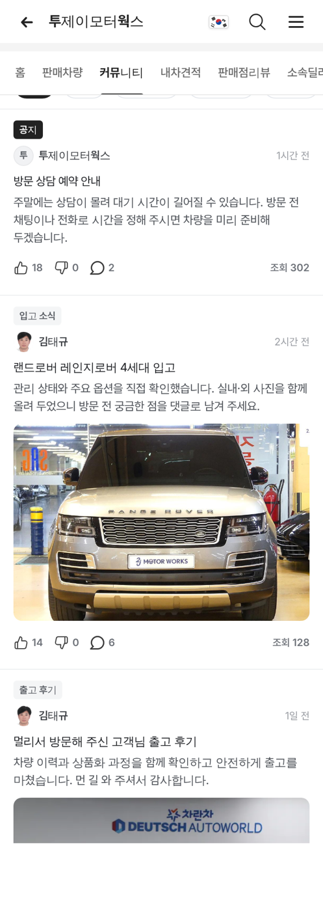
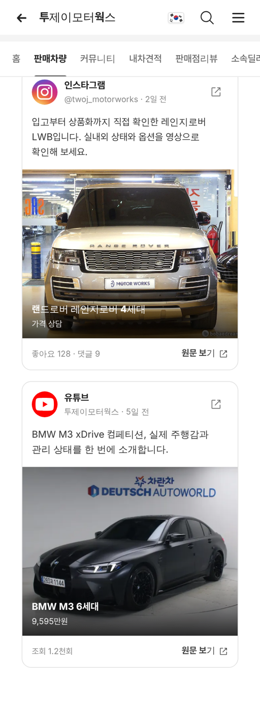

# PR #843 딜러 커뮤니티 말머리·아이콘 수정 · SNS 판매 차량

① 한 줄 요약: 딜러 커뮤니티의 깨진 반응 아이콘을 고치고, 딜러용 말머리를 추가했다. SNS 탭은 빼고 판매차량 안의 `SNS 판매 차량 (2)`로 옮겼다.

② 과제 ID: 없음(사용자 지시 「아이콘 깨진다 · 말머리 딜러에 맞게 추가」 · 「SNS 탭을 없애고 판매완료 차량 옆으로 SNS 판매 차량 (2)」) · 브랜치 `claude/dealer-community-tags` · 커밋 `eea489b` → main `e07eb88` · PR https://github.com/bobaekimboae/bobaedream/pull/843 · 상태: 병합·배포(v=4e3cefd, 다른 작업 `4e3cefd 딜러 배너 상담 문구`가 바로 뒤에 들어와 함께 배포됨) · 함께 들어간 과제: `4e3cefd`(다른 작업)

③ 한 일
- 아이콘이 깨진 이유: 배포 빌드가 코드 안의 `/assets/` 글자를 `/bobaedream/assets/`로 바꿔, 주소가 `community/bobaedream/assets/…`가 됐다. 주소를 조각으로 이어 붙여 바뀌지 않게 했다.
- 커뮤니티 위에 말머리 알약 줄 `전체 · 공지 · 입고 소식 · 출고 후기 · 관리 팁 · 시세 정보 · 이벤트`를 두었다. 누르면 그 말머리 글만 보인다.
- 글은 말머리마다 1개씩 6개다. 공지 말머리만 검정 칩이다.
- 구역 탭에서 `SNS`를 뺐다.
- 판매차량 상태 알약에 `SNS 판매 차량 (2)`를 더했다. 누르면 차량이 걸린 SNS 게시물 2개가 나온다.
- SNS 카드 가격의 `만원만원` 중복도 고쳤다.

④ 원본과 비교
| 항목 | 작업 전 | 작업 후 |
|---|---|---|
| 반응 아이콘(배포본) | 깨짐(주소 오류) | 정상 |
| 커뮤니티 말머리 | 칩만 있음, 거르기 없음 | 7개 알약으로 거르기 |
| 구역 탭 | 8개(SNS 포함) | 7개 |
| 판매차량 상태 | 판매중 · 판매완료 | 판매중 · 판매완료 · SNS 판매 차량 (2) |

⑤ 검증
- `npm run verify:qf` 통과.
- 콘솔 오류: 모바일 384 0, PC 1280 0.
- 배포본 아이콘 3개 모두 정상으로 불러옴.
- 말머리 `공지`를 누르면 글 1개, `전체`는 6개.
- SNS 판매 차량 게시물 2개.
- 퀵필터는 바꾸지 않아 measure:qf 대상이 아니다.

⑥ 원본과 다르게 남긴 것
- 글 내용과 반응 수, SNS 게시물은 화면 확인용 가상 값이다.
- `(2)`는 사용자 지시대로 고정했다. 실제 SNS 연동 대수가 생기면 그 값으로 바꾼다.
- 예전 `section=social` 주소는 판매차량을 연다.

⑦ 못 한 것·다음
- 글 상세 화면과 글쓰기는 아직 안내 문구뿐이다.

⑧ 확인 링크
- 모바일: https://bobaekimboae.github.io/bobaedream/?qf=guazi&profile=dealer&shop=450554&emp=1&v=4e3cefd
- PC: https://bobaekimboae.github.io/bobaedream/?qf=guazi&profile=dealer&shop=450554&emp=1&v=4e3cefd&pc=1
