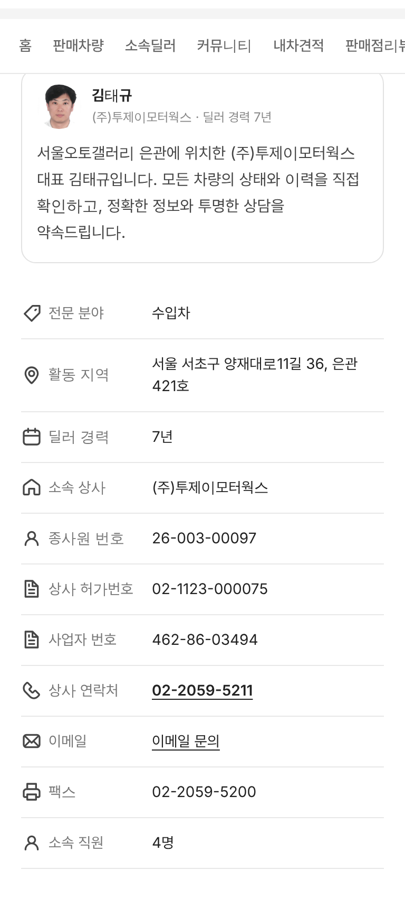
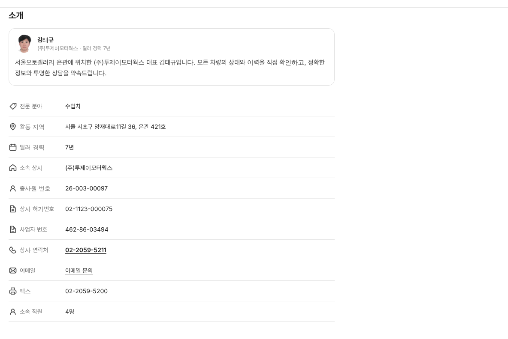
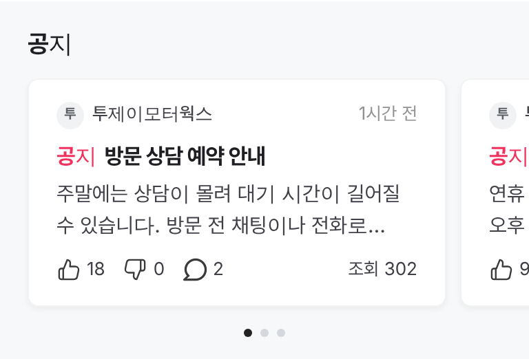
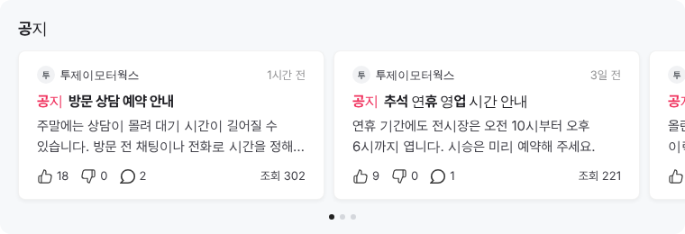

# PR #845 딜러 커뮤니티 공지 핫글형 · 소개 AS24 아이콘 · 소속딜러 탭 이동

① 한 줄 요약: 딜러 화면 커뮤니티의 공지를 네이버 토론 「핫글」처럼 회색 띠 위 가로 카드로 바꾸고, 소개 탭 정보 줄에 오토스카우트24 원본 아이콘을 달고, `소속딜러` 탭을 `판매차량` 바로 오른쪽으로 옮겼다.

② 과제 ID: 없음(사용자 지시 「공지는 인기글처럼 만들자」 · 「아이콘 오토스카우트 24 맞춰서 추가 · 판매차량 우측으로 소속딜러 탭 이동」) · 브랜치 `claude/dealer-notice-hot` · 커밋 `6fb5ef6` → main `8764f80` · PR https://github.com/bobaekimboae/bobaedream/pull/845 · 상태: 병합·배포(v=8764f80) · 함께 들어간 과제: 없음

③ 한 일
- 커뮤니티 `전체`에서 공지 3개를 목록에서 빼고, 말머리 줄 아래 회색 띠(`#F6F8FA`)에 `공지` 제목과 옆으로 넘기는 흰 카드로 보여 준다. 카드 아래에 점 3개로 위치를 알린다.
- 카드 크기·글자는 네이버 핫글 실측값(카드 폭 화면 − 40, 반경 8, 제목 16/22 굵게, 본문 15/23 두 줄)을 따랐다. 공지 표시는 빨강 `공지` 글자다.
- 소개 탭 정보 줄 11개 모두 노션 「독일_오토24」의 원본 아이콘(파일은 고치지 않음)을 20px로 달았다: 자동차 판매 · 위치 · 캘린더 · 홈 · 판매자 · 서류 · 전화 · 이메일 · 프린터.
- 라벨 칸을 100 → 124로 넓혀 `상사 허가번호`가 한 줄에 들어가게 했다.
- 구역 탭 순서: `홈 · 판매차량 · 소속딜러 · 커뮤니티 · 내차견적 · 판매점리뷰 · 소개`.

④ 원본과 비교
| 항목 | 작업 전 | 작업 후 |
|---|---|---|
| 공지 | 목록 카드 사이에 섞임 | 회색 띠 + 가로 카드 3장(네이버 핫글형) |
| 소개 아이콘 | 4줄만(그중 2줄 같은 아이콘) | 11줄 모두 AS24 원본 |
| 라벨 줄바꿈 | `상사 허가번호` 두 줄 | 한 줄 |
| 소속딜러 탭 위치 | 6번째 | 3번째(판매차량 오른쪽) |

⑤ 검증: `npm run verify:qf` 통과 · 콘솔 오류 모바일 0 · PC 0(배포본) · 소개 아이콘 11개 모두 불러옴(깨진 그림 0) · 공지 카드 3장 · 퀵필터는 바꾸지 않아 measure:qf 대상 아님

⑥ 원본과 다르게 남긴 것
- 원본 아이콘 색이 서로 달라서(서류만 회색) 파일은 그대로 두고 화면에서만 검정 72%로 맞췄다.
- 네이버 핫글의 빨간 불꽃 `HOT` 대신 빨강 `공지` 글자를 썼다. 공지 글은 가상 값이다.
- `전문 분야`는 AS24에 맞는 아이콘이 없어 「자동차 판매」(가격표 모양)를 썼다.

⑦ 못 한 것·다음: 공지를 누르면 아직 상세 글로 가지 않는다(안내만).

⑧ 확인 링크
- 모바일 소개: https://bobaekimboae.github.io/bobaedream/?qf=guazi&profile=dealer&shop=450554&emp=1&tab=intro&v=8764f80
- PC 소개: https://bobaekimboae.github.io/bobaedream/?qf=guazi&profile=dealer&shop=450554&emp=1&tab=intro&v=8764f80&pc=1
- 모바일 커뮤니티: https://bobaekimboae.github.io/bobaedream/?qf=guazi&profile=dealer&shop=450554&emp=1&tab=community&v=8764f80
