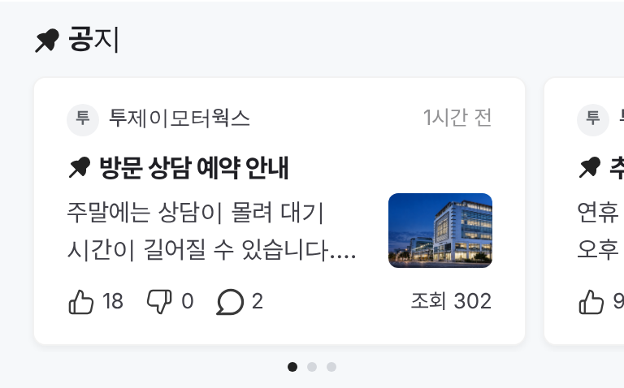
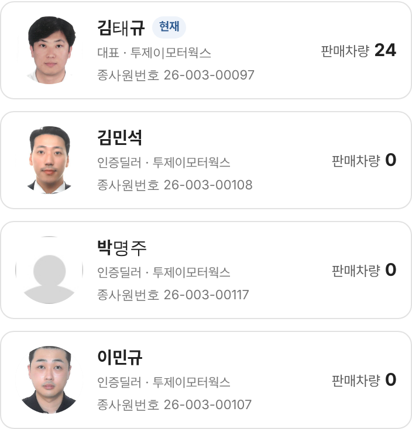

# PR #847 딜러 커뮤니티 공지 레딧 핀·사진 샘플 · 소속딜러 판매차량 수

① 한 줄 요약: 공지 표시를 레딧 고정 핀 아이콘으로 바꾸고 회색 띠를 줄였다. 첫 공지에 사진 샘플을 붙였다. 소속딜러 카드의 `매물 보기`는 `판매차량 N`으로 바꿨다.

② 과제 ID: 없음(사용자 지시 「공지 핀 레딧 아이콘 쓰고 · 위 아래 구분선 줄이자」 · 「이미지도 공지에 하나 샘플로」 · 「판매차량 3 이런방식」) · 브랜치 `claude/dealer-notice-pin` · 커밋 `9c42b99` → main `c8bc511` · PR https://github.com/bobaekimboae/bobaedream/pull/847 · 상태: 병합·배포(v=7839ed3). 내 배포 실행은 바로 뒤 커밋에 밀려 취소됐고, 그 커밋으로 함께 배포됐다. · 함께 들어간 과제: `7839ed3 fix: align dealer review identity row`(다른 작업)

③ 한 일
- 공지 띠 제목 `공지` 앞과 카드 제목 앞의 빨강 `공지` 글자를 노션 「미국_레딧 › 고정 핀_블랙」 원본(`pin-fill`)으로 바꿨다.
  - 파일은 고치지 않았고 `public/icons/dealer-profile/pin-reddit.svg`에 그대로 두었다.
  - 크기는 띠 제목 18, 카드 16이다.
- 회색 띠의 위아래를 줄였다.
  - 안쪽 여백 20/16 → 12/10.
  - 제목 → 카드 12 → 10.
  - 점 위 8 → 6.
- 첫 공지(방문 상담 예약 안내)의 본문 오른쪽에 사진 64×46 샘플을 붙였다. 사진은 서울오토갤러리 건물이다.
- 소속딜러 카드 오른쪽의 파랑 `매물 보기`를 `판매차량 N`으로 바꿨다.
  - `판매차량`은 12 회색, 숫자는 15/700 검정이다.

④ 원본과 비교
| 항목 | 작업 전 | 작업 후 |
|---|---|---|
| 공지 표시 | 빨강 `공지` 글자 | 레딧 고정 핀 아이콘 |
| 띠 안쪽 위/아래 | 20 / 16 | 12 / 10 |
| 공지 사진 | 없음 | 첫 공지 64×46 |
| 소속딜러 오른쪽 | `매물 보기`(파랑) | `판매차량 24` |

⑤ 검증
- `npm run verify:qf` 통과.
- 배포본 기준 콘솔 오류: 모바일 384에서 0, PC 1280에서 0.
- 핀 아이콘과 사진은 모두 정상으로 불러왔다.
- 퀵필터 화면은 바꾸지 않아 measure:qf 대상이 아니다.

⑥ 원본과 다르게 남긴 것
- 레딧 핀은 원래 초록색이지만 파랑·초록 강조색을 아끼기 위해 검정(`#222`)으로 칠했다. 색은 CSS로만 바꿨다.
- `판매차량 N`은 그 딜러의 실제 판매중 대수다. 그래서 대표 외 딜러는 0으로 보인다.

⑦ 못 한 것·다음
- 공지 사진은 샘플 1장이다. 실제 공지 사진이 정해지면 바꾼다.

⑧ 확인 링크
- 모바일: https://bobaekimboae.github.io/bobaedream/?qf=guazi&profile=dealer&shop=450554&emp=1&v=7839ed3
- PC: https://bobaekimboae.github.io/bobaedream/?qf=guazi&profile=dealer&shop=450554&emp=1&v=7839ed3&pc=1
