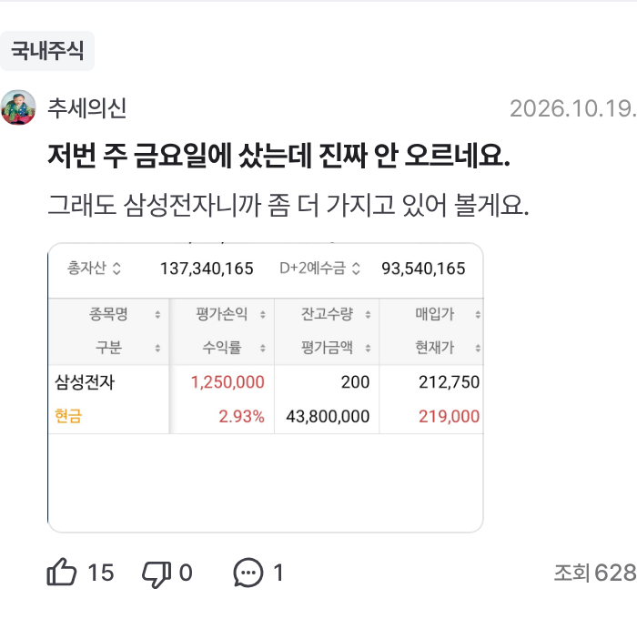
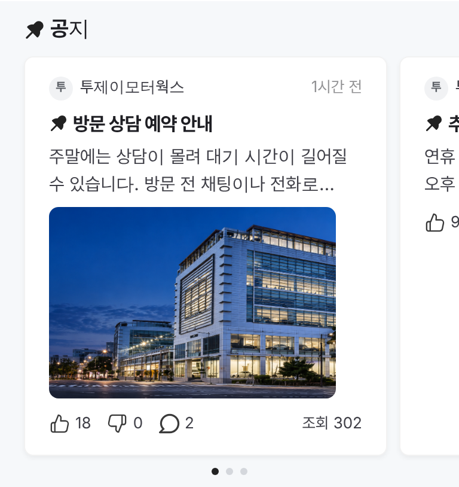
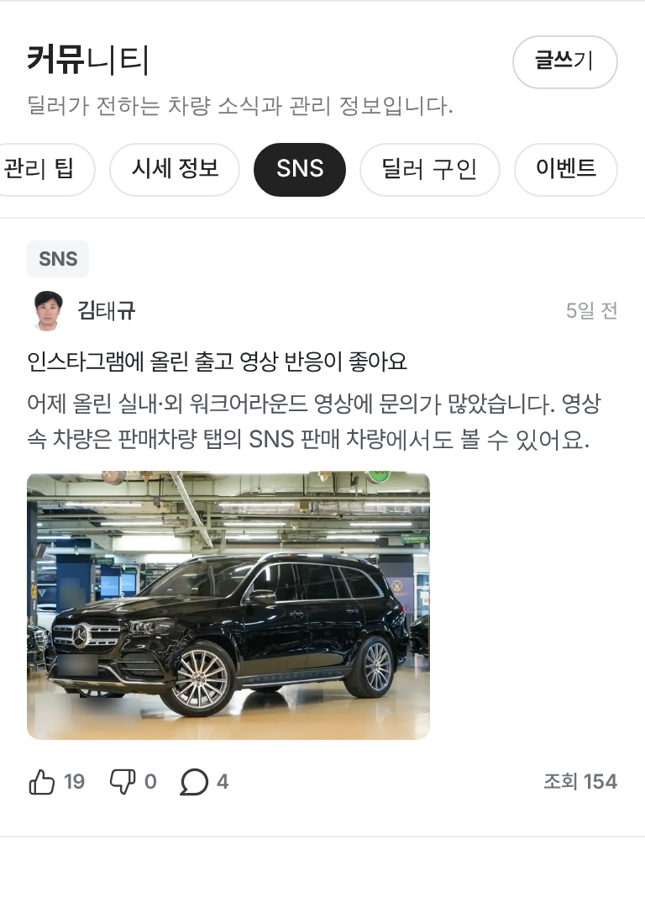

# PR #850 딜러 커뮤니티 사진 네이버 크기 · 탭 순서 · SNS/딜러 구인 말머리

① 한 줄 요약: 공지·커뮤니티 글 사진을 네이버 토론 글과 같은 240×160 크기로 바꿨다. 커뮤니티 탭은 판매차량 바로 옆으로 옮기고, 말머리에 `SNS` · `딜러 구인`을 더했다.

② 과제 ID: 없음(사용자 지시 「이미지 공지 풀로 채우더라 네이버토론 인기글 이미지 있는 샘플 찾아봐」 · 「커뮤니티 탭을 판매차량 옆으로 · 말머리에 SNS · 딜러구인」)
- 브랜치: `claude/dealer-community-tags-v2`. 같은 이름의 옛 원격 브랜치가 있어서 PR #849는 닫고 다시 올렸다.
- 커밋: `963b7c9` → main `ecb2d4b`
- PR: https://github.com/bobaekimboae/bobaedream/pull/850
- 상태: 병합·배포(v=ecb2d4b)
- 함께 들어간 과제: 없음. 바로 앞의 `f08ed8c revert: restore Chotot dealer reviews`(다른 작업)는 이미 main에 있었다.

③ 한 일
- 네이버 증권 토론 홈(m.stock.naver.com, 폭 390)을 직접 열어 쟀다.
  - 지금 인기글(핫글) 카드에는 사진이 있는 글이 하나도 없다.
  - 화면 규칙(CSS)에도 핫글 사진 칸이 없다.
- 사진이 있는 일반 토론 글은 사진을 폭에 꽉 채우지 않는다. 본문 아래 8에 240×160 · 모서리 8 · 잘라 맞춤(cover)으로 둔다.
- 우리 공지 카드 사진과 커뮤니티 글 사진(전에는 폭 전체 3:2)을 모두 같은 240×160으로 바꿨다.
- 구역 탭 순서는 `홈 · 판매차량 · 커뮤니티 · 소속딜러 · 내차견적 · 판매점리뷰 · 소개`다.
- 말머리는 `전체 · 공지 · 입고 소식 · 출고 후기 · 관리 팁 · 시세 정보 · SNS · 딜러 구인 · 이벤트`다.
  - SNS 글: 인스타그램 출고 영상, 차량 사진 포함.
  - 딜러 구인 글: 함께 일할 딜러를 찾는 글.
  - 두 글 모두 화면 확인용 가상 글이다.

④ 원본과 비교
| 항목 | 네이버 토론 | 작업 전 | 작업 후 |
|---|---|---|---|
| 글 사진 크기 | 240×160 | 폭 전체 3:2 | 240×160 |
| 사진 모서리 | 8 | 10 | 8 |
| 본문 → 사진 | 8 | 10 | 8 |
| 핫글 카드 사진 | 없음(지금 데이터 기준) | 64×46 오른쪽 | 240×160 본문 아래 |

⑤ 검증
- `npm run verify:qf` 통과.
- 배포본 콘솔 오류: 모바일 384에서 0, PC 1280에서 0.
- 사진 5장 모두 240×160이고 정상으로 불러왔다.
- 딜러 구인 말머리를 누르면 글 1개가 나온다.
- 퀵필터는 바꾸지 않아 measure:qf 대상이 아니다.

⑥ 원본과 다르게 남긴 것
- 네이버 핫글 카드에는 지금 사진 글이 없다. 그래서 공지 카드 사진은 일반 토론 글의 사진 크기를 그대로 빌려 썼다.

⑦ 못 한 것·다음
- 네이버 핫글에 사진 글이 올라오면 다시 재서 비교한다.

⑧ 확인 링크
- 모바일: https://bobaekimboae.github.io/bobaedream/?qf=guazi&profile=dealer&shop=450554&emp=1&v=ecb2d4b
- PC: https://bobaekimboae.github.io/bobaedream/?qf=guazi&profile=dealer&shop=450554&emp=1&v=ecb2d4b&pc=1
