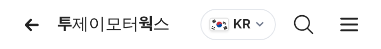

# PR #851 딜러 화면 상단 국가 알약칩

① 한 줄 요약: 모바일 딜러 화면 머리줄의 국가(언어) 선택을 국기만 보이던 동그란 버튼에서 알약칩으로 바꿨다.

② 과제 ID: 없음(사용자 지시 「상단 국가는 알약칩 처라」)
- 브랜치: `claude/dealer-lang-pill`
- 커밋: `1745261` → main `b541cef`
- PR: https://github.com/bobaekimboae/bobaedream/pull/851
- 상태: 병합·배포(v=b541cef)
- 함께 들어간 과제: 없음

③ 한 일
- 알약 모양은 높이 32 · 완전 둥금 · 1px `#E4E7EC` 테두리 · 흰 바탕이다.
- 알약 안에는 국기 20×14, 코드 `KR`(13/18 600), 꺾쇠가 들어간다.
- 알약이 넓어진 만큼 상사명은 남은 폭만 쓰고, 길면 말줄임한다.
- 누르면 전과 같이 언어 4개 목록이 열린다.

④ 원본과 비교
| 항목 | 작업 전 | 작업 후 |
|---|---|---|
| 모양 | 국기만, 44 원형 투명 | 알약 32 · 테두리 · 국기 + KR + 꺾쇠 |
| 긴 상사명 | 알약 자리와 겹칠 수 있음 | 알약 앞에서 말줄임 |

⑤ 검증
- `npm run verify:qf` 통과.
- 배포본 콘솔 오류 0.
- 폭 360·384에서 가로 넘침이 없었다.
- 가장 긴 상사명(`한국자동차선물거래소`)도 알약 앞 8에서 끝난다.
- 언어 목록 4개가 정상으로 열린다.

⑥ 원본과 다르게 남긴 것: PC 딜러 화면 머리줄은 이번에 바꾸지 않았다.

⑦ 못 한 것·다음: 없음

⑧ 확인 링크
- 모바일: https://bobaekimboae.github.io/bobaedream/?qf=guazi&profile=dealer&shop=450554&emp=1&v=b541cef
