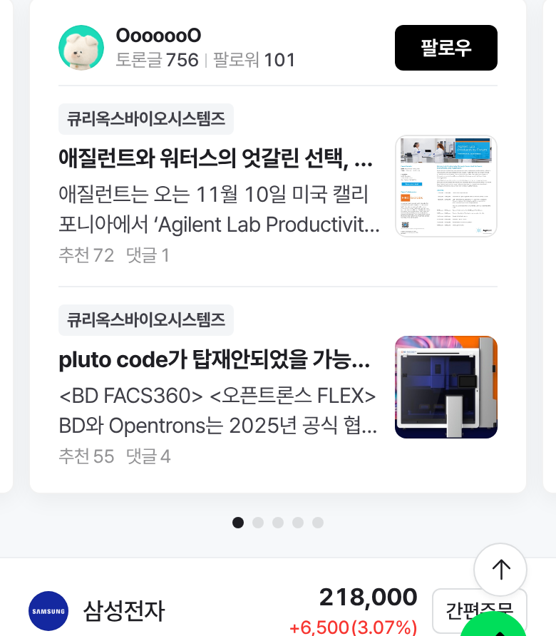
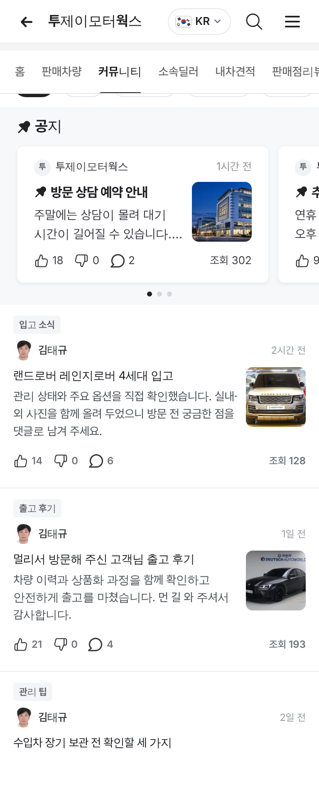

# PR #853 딜러 커뮤니티 사진 네이버 우측 썸네일형

① 한 줄 요약: 공지·커뮤니티 글 사진을 본문 아래 큰 사진(240×160)에서 네이버 토론 인기글처럼 글 오른쪽 72×72 썸네일로 바꿨다.

② 과제 ID: 없음(사용자 지시 「그게 아니라 네이버 토론 우측 썸네일형으로 하라고」)
- 브랜치: `claude/dealer-thumb-right`
- 커밋: main `2181a6b`
- PR: https://github.com/bobaekimboae/bobaedream/pull/853
- 상태: 병합·배포 완료. 바로 뒤에 다른 작업 `97f29ad`(딜러 머리 사진 교체)가 병합되어 그 배포에 함께 실렸다(v=97f29ad).

③ 한 일
- 네이버 증권 토론 인기글(m.stock.naver.com, 폭 390)을 다시 쟀다.
  - 글 칸 226, 사이 10, 썸네일 72×72, 반경 8.
  - 썸네일 윗선은 글 묶음 윗선과 같다.
- 공지 카드와 커뮤니티 글 모두 제목·본문을 왼쪽에 두고, 사진은 오른쪽 썸네일로 붙였다.
- 반응 줄(좋아요·싫어요·댓글·조회)은 그 아래 전체 폭에 그대로 두었다.
- 사진이 없는 글은 글이 전체 폭을 쓴다.

④ 원본과 비교
| 항목 | 네이버 인기글 | 작업 전 | 작업 후 |
|---|---|---|---|
| 사진 위치 | 글 오른쪽 | 본문 아래 | 글 오른쪽 |
| 크기 | 72×72 | 240×160 | 72×72 |
| 글 ↔ 사진 | 10 | - | 10 |
| 반경 | 8 | 8 | 8 |
| 윗선 맞춤 | 같음 | - | 같음(차이 0) |

⑤ 검증
- `npm run verify:qf` 통과.
- 배포본 콘솔 오류: 모바일 384 0, PC 1280 0.
- 썸네일 5장 모두 72×72 · 간격 10 · 윗선 차이 0이고 정상으로 불러왔다.

⑥ 원본과 다르게 남긴 것
- 네이버는 반응 줄도 글 칸 안(썸네일 왼쪽)에 넣는다. 우리는 반응 줄 아이콘·조회 위치를 유지하려고 전체 폭 아래에 두었다.

⑦ 못 한 것·다음: 없음

⑧ 확인 링크
- 모바일: https://bobaekimboae.github.io/bobaedream/?qf=guazi&profile=dealer&shop=450554&emp=1&v=97f29ad
- PC: https://bobaekimboae.github.io/bobaedream/?qf=guazi&profile=dealer&shop=450554&emp=1&v=97f29ad&pc=1
