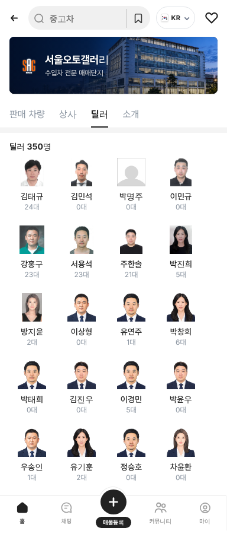

# PR #856 서울오토갤러리 소속딜러 전원 판매자페이지

① 한 줄 요약: 서울오토갤러리 79개 상사의 소속딜러 345명 모두에게 판매자페이지를 만들었다.

② 과제 ID 없음 · 브랜치 `feat/sag-all-dealer-pages` · 커밋 `8ce86c1` · https://github.com/bobaekimboae/bobaedream/pull/856 · 병합·배포 v=8ce86c1 · 번들 `assets/main-DgG7bwD9.js`

③ 한 일
- 공개 상사 페이지(`car/sangsa_detail.html?ShopNo=…`) 79곳의 「소속딜러」 이름과 보유차량 대수를 사용자 Chrome으로 하나씩 읽어 `src/prototype/data/seoul-autogallery-staff-v01.ts`에 옮겼다. 상사마다 사이트의 `소속직원 N명`과 읽은 인원이 모두 같다(합계 345명).
- 딜러마다 `?qf=guazi&profile=dealer&shop=<ShopNo>&emp=<n>` 판매자페이지가 열린다. 기존 주소(레일 9명, 대표 emp 1·2)는 그대로이고, 나머지는 그 상사의 다음 빈 번호를 쓴다.
- 역할은 대표 / 소속딜러로 표시하고, 판매차량 수는 사이트 보유차량 대수, 소개 탭 `소속 직원`은 그 상사 인원이다.
- 판매자페이지 소속딜러 탭, 서울오토갤러리 `딜러` 탭(350명), `상사` 탭의 소속딜러 수가 모두 같은 명단을 쓴다.

④ 원본과 비교: 상사 79곳 모두 사이트 소속직원 수 = 우리 명단 수(차이 0곳).

⑤ 검증: verify:qf 통과, 콘솔 오류 0. 대표(450555 emp 1 강홍구), 소속딜러(450087 emp 5 김남헌), 기존 레일 딜러(450554 emp 5 김민석 · 450560 emp 4 방지윤) 페이지가 바르게 열린다. 도이치모터스 소속딜러 탭 22명. 배포본에서도 소속딜러 페이지를 확인했다.

⑥ 원본과 다르게 남긴 것
- 딜러 개인 휴대폰 번호(010)는 사이트에 공개돼 있지만 옮기지 않았다. 판매자페이지 전화는 상사 대표번호다.
- 딜러 탭이 350명인 이유: 사이트 345명에, 기존 데이터에 있던 5명(엘앤티토요타·엘앤티렉서스 공동대표 아베타케시, 오토유레카 유현식, 바오모터스(450539) 이승훈, 투제이모터웍스 박명주)을 기존 주소 보존을 위해 남겼다.
- 프로필 사진은 실사진이 있는 9명 외에는 정장 일러스트 5종을 돌려 써서 성별이 맞지 않을 수 있다.
- 이름은 사이트 표기 그대로다(450356 배진수 2명, 450505 「정마수」).

⑦ 못 한 것·다음에 할 것: 딜러 실사진, 딜러별 실제 매물 연결(현재는 시트 매물 중 이름이 같은 것만 보인다). WebFetch는 사이트가 세션 기준으로 상사를 바꿔 보여 줘 쓰지 못했고, 사용자 Chrome으로 수집했다.

⑧ 확인 링크
- 모바일 딜러 탭: https://bobaekimboae.github.io/bobaedream/?qf=guazi&category=서울오토갤러리&v=8ce86c1 (딜러 탭)
- 소속딜러 예시: https://bobaekimboae.github.io/bobaedream/?qf=guazi&profile=dealer&shop=450087&emp=5&v=8ce86c1
- PC: https://bobaekimboae.github.io/bobaedream/?qf=guazi&profile=dealer&shop=450087&emp=5&v=8ce86c1&pc=1
