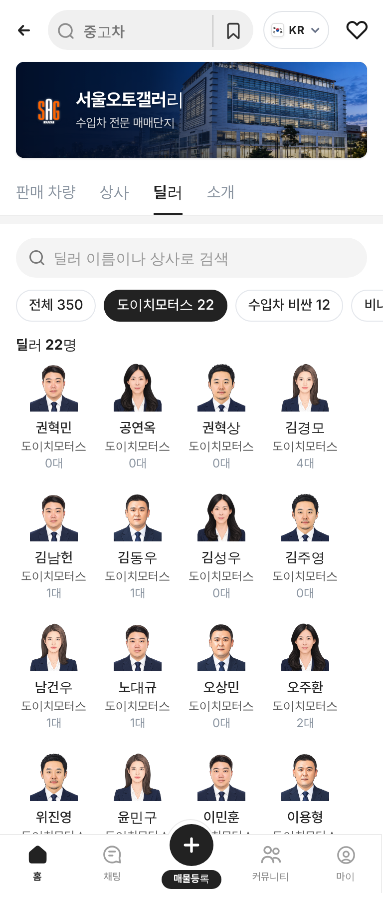

# PR #858 서울오토갤러리 딜러 탭 검색·상사 알약칩·카드 상사명

① 한 줄 요약: 서울오토갤러리 `딜러` 탭에 검색칸과 소속 상사 알약칩을 넣고, 딜러 카드에 상사명을 표시했다.

② 과제 ID 없음 · 브랜치 `feat/sag-dealer-tab-search` · 커밋 `b889b38` · https://github.com/bobaekimboae/bobaedream/pull/858 · 병합·배포 v=b889b38 · 번들 `assets/main-f-snpXMe.js`

③ 한 일
- 탭 맨 위 회색 알약 검색칸(높이 40). 이름과 상사명을 모두 찾고 띄어쓰기는 무시한다.
- 소속 상사 알약칩 줄: `전체 350` → 딜러가 많은 상사 순(`도이치모터스 22`, `수입차 비싼 12` …), 다시 누르면 해제. 우리 알약 규칙(32/16 · 1px #E4E7EC · 선택 #222).
- 딜러 카드: 이름 아래에 상사명 12/16 #595959 한 줄(넘치면 말줄임), 카드 높이 118.
- 제목 `딜러 N명`은 걸러진 인원이다. 결과가 없으면 안내 문구와 `검색 초기화` 버튼을 보여 준다.

④ 원본과 비교: 해당 없음(신규 기능).

⑤ 검증: verify:qf 통과, 콘솔 오류 0(384). 검색 `김` 52명 · `도이치` 22명 · 칩 `도이치모터스 22` → 22명 · 없는 이름 → 안내 화면. 카드 76×118.

 

⑥ 원본과 다르게 남긴 것: 목록 위 레일 9명 카드에는 상사명을 넣지 않았다. PC 서울오토갤러리 화면에는 `딜러` 탭이 없어 이번 작업도 모바일만이다.

⑦ 못 한 것·다음에 할 것: PC 딜러 목록 화면, 딜러 실사진.

⑧ 확인 링크: 모바일 https://bobaekimboae.github.io/bobaedream/?qf=guazi&category=서울오토갤러리&v=b889b38 (딜러 탭)
