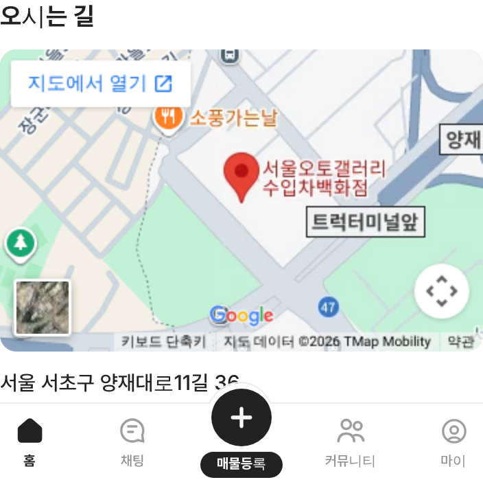
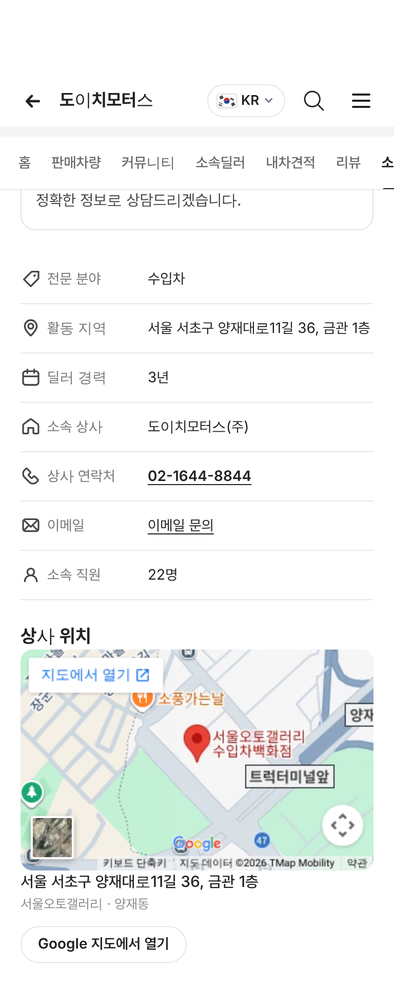

# PR #861 서울오토갤러리·판매자페이지 소개 구글맵

① 한 줄 요약: 서울오토갤러리 `소개` 탭과 판매자페이지 `소개` 탭에 서울오토갤러리 위치 구글맵을 넣었다.

② 과제 ID 없음 · 브랜치 `feat/sag-about-google-map` · 커밋 `2312adf` · https://github.com/bobaekimboae/bobaedream/pull/861 · 병합·배포 v=2312adf · 번들 `assets/main-B8amrGUc.js`

③ 한 일
- 공용 지도 부품 `src/prototype/listing/sag-google-map.tsx`: 제목 → 지도(반경 12, 모바일 16:10 · PC 16:7) → 주소 → `서울오토갤러리 · 양재동`.
- 서울오토갤러리 소개 탭: `오시는 길`. 판매자페이지 소개 탭: 정보 목록 아래 `상사 위치`(주소에 은관/금관 호수까지).
- 지도는 API 키 없이 쓰는 구글 지도 퍼가기 주소이고, 화면에 들어올 때 불러온다. 핀은 「서울오토갤러리 수입차백화점」에 꽂힌다.

④ 원본과 비교: 해당 없음.

⑤ 검증: verify:qf 통과, 콘솔 오류 0. 모바일 지도 344×215, 구글 지도 표시 확인.

 

⑥ 원본과 다르게 남긴 것: 따로 `Google 지도에서 열기` 버튼은 두지 않았다. 지도 안 왼쪽 위 구글 기본 `지도에서 열기`가 같은 일을 한다.

⑦ 못 한 것·다음에 할 것: 네이버·카카오 지도 길찾기 버튼(국내 사용자는 이쪽이 익숙함).

⑧ 확인 링크
- 서울오토갤러리 소개: https://bobaekimboae.github.io/bobaedream/?qf=guazi&category=서울오토갤러리&v=2312adf (소개 탭)
- 판매자페이지 소개: https://bobaekimboae.github.io/bobaedream/?qf=guazi&profile=dealer&shop=450087&emp=5&tab=intro&v=2312adf
