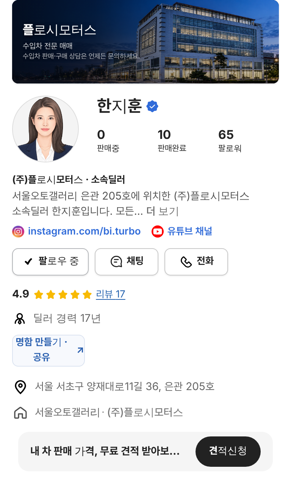

# PR #866 서울오토갤러리 딜러 인스타그램·유튜브 링크

① 한 줄 요약: SNS 레퍼런스 시트에 있는 서울오토갤러리 딜러 13명과 상사 4곳의 인스타그램·유튜브를 판매자페이지 프로필에 인스타그램 소개 링크처럼 걸었다.

② 과제 ID 없음 · 브랜치 `feat/sag-dealer-sns-links` · 커밋 `0d0009b` · https://github.com/bobaekimboae/bobaedream/pull/866 · 병합·배포 v=0d0009b · 번들 `assets/main-DBQhhRuM.js`

③ 한 일
- 구글 시트 「SNS 레퍼런스 › 인스타딜러」에서 서울오토갤러리 소속 행을 골라, 상사 소속딜러 명단과 이름이 같은 사람만 연결했다(`src/prototype/data/seoul-autogallery-sns-v01.ts`).
- 딜러 본인 13명: 만소리 선우혁·박찬민·송금배·이혜성 / 플로시 한지훈·장지수·주한솔 / 비아로쏘 공지만·강심균 / 에이원 정지원 / 비나인 정다인 / 씨엔모터스 장금용·장정훈.
- 상사 공식 계정 4곳(플로시모터스·비아로쏘·에이원오토모빌·지케이앤코): 본인 계정이 없는 그 상사 딜러 페이지에 `상사 공식 계정` 표시와 함께 보인다.
- 표시: 프로필 소개 문단 바로 아래(PC는 매매단지 줄 아래) 아이콘 16 + 짧은 주소 13/19 600 파랑. 누르면 새 창.
- 같이 고친 것: 소속딜러 소개 문구가 `대표 이름`으로 나오던 것을 `소속딜러 이름`으로.

④ 원본과 비교: 인스타그램 프로필의 소개 아래 링크 줄(아이콘 + 주소, 파랑)과 같은 구성.

⑤ 검증: verify:qf 통과, 콘솔 오류 0. 한지훈 `instagram.com/bi.turbo | 유튜브 채널`, 주한솔 `instagram.com/aka_flossy`, 비아로쏘 대표 `instagram.com/viarosso_official | youtube.com/@viarossotv | 상사 공식 계정`, 링크 없는 딜러는 줄 없음(384 · 1280).

⑥ 원본과 다르게 남긴 것: 채널 ID로만 된 유튜브 주소는 `유튜브 채널`로 표시했다. 시트 주소 중 `…/reels/`·`/shorts?app=desktop` 꼬리는 계정 첫 화면 주소로 정리했다.

⑦ 못 한 것·다음에 할 것
- 시트에는 있지만 소속딜러 명단에 이름이 없어 넣지 않음: 우진오토모빌 박재현(flatsix_vibes, 라포르 유튜브), 플로시모터스 릴리(flossy_lily, 본명 미확인). 확인되면 추가.
- 지케이앤코(gold_supercar)는 시트에 「정체가 의심스러운 사업자」 메모가 있다. 빼야 하면 알려 주세요.
- 성유인(yuin_auto)은 「오토갤러리 추정」이라 넣지 않았다.

⑧ 확인 링크
- 한지훈: https://bobaekimboae.github.io/bobaedream/?qf=guazi&profile=dealer&shop=450560&emp=3&v=0d0009b
- 비아로쏘(상사 계정): https://bobaekimboae.github.io/bobaedream/?qf=guazi&profile=dealer&shop=450461&emp=1&v=0d0009b
- PC: https://bobaekimboae.github.io/bobaedream/?qf=guazi&profile=dealer&shop=450560&emp=3&v=0d0009b&pc=1
