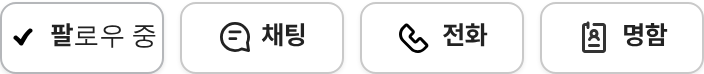

# PR #869 판매자페이지 전화 옆 명함 버튼

① 한 줄 요약: 판매자페이지 프로필 버튼 줄의 `전화` 옆에 `명함` 버튼을 넣고, 누르면 기존 딜러 명함 창이 열린다.

② 과제 ID 없음 · 브랜치 `feat/dealer-card-action` · 커밋 `3596121` · https://github.com/bobaekimboae/bobaedream/pull/869 · 병합·배포 v=3596121 · 번들 `assets/main-P-SbITi3.js`

③ 한 일
- 버튼 줄을 `팔로우 · 채팅 · 전화 · 명함` 4개로 바꿨다. 같은 폭으로 나누고 `팔로우 중`만 1.3배 넓다.
- `명함`은 기존 명함 창(#863, 명함 만들기·공유·이미지·연락처 저장)을 연다. 따로 있던 `명함 만들기 · 공유` 파랑 줄은 없앴다.
- 아이콘: 노션 「독일_오토24 › 사물 아이콘 › 신분증」 원본 SVG(수정 없음) 18px.

④ 원본과 비교: AS24 노션 DB에 명함·연락처 카드 전용 아이콘이 없어, 사람이 그려진 카드 모양인 신분증 아이콘을 썼다.

⑤ 검증: verify:qf 통과, 콘솔 오류 0. 384: 96·77·77·77, 340: 83·67·67·67(글자 잘림 없음), PC 1280: 100×38 4개. 명함 버튼 → 명함 창 열림 확인.

⑥ 원본과 다르게 남긴 것: 없음.

⑦ 못 한 것·다음에 할 것: 더 맞는 AS24 아이콘(명함·연락처 카드)이 있으면 교체.

⑧ 확인 링크: 모바일 https://bobaekimboae.github.io/bobaedream/?qf=guazi&profile=dealer&shop=450560&emp=3&v=3596121 · PC 같은 주소 + `&pc=1`
