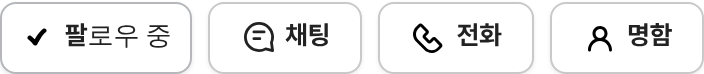

# PR #871 판매자페이지 전화번호 보강 · 명함 아이콘 교체

① 한 줄 요약: 대표 전화가 없는 22개 상사의 판매자페이지에도 전화번호(서울오토갤러리 대표 02-2059-5000)가 나오게 하고, 명함 아이콘을 AS24 symbol-143으로 바꿨다.

② 과제 ID 없음 · 브랜치 `feat/dealer-phone-fallback` · 커밋 `21940d4` · https://github.com/bobaekimboae/bobaedream/pull/871 · 병합·배포(#873과 함께) v=0680a83 · 번들 `assets/main-BPRze7vK.js`

③ 한 일
- 원인: 서울오토갤러리 공개 목록에서 상사 대표 전화가 0000(미기재)인 22곳(플로시모터스 등)은 전화 줄을 숨기고 있었다.
- 이 22곳은 사이트 하단 공식 일반문의 `02-2059-5000`을 프로필 전화 줄 · 전화 버튼 · 명함 · 소개 탭에 쓰고, 전화 줄 뒤에 회색 `서울오토갤러리 대표`, 소개 탭 라벨은 `단지 대표 전화`로 표시한다.
- 명함 버튼 아이콘을 노션 「오토스카우트 24 › symbol-143」(사람 외곽선, 수정 없음)으로 교체.

④ 원본과 비교: 해당 없음(데이터 보강).

⑤ 검증: verify:qf 통과, 콘솔 오류 0. 450560(플로시모터스) → `02-2059-5000 서울오토갤러리 대표`, 450555 → 기존 `02-2059-7890` 그대로.

⑥ 원본과 다르게 남긴 것: 딜러 개인 휴대폰 번호는 넣지 않았다(개인정보, 수집 단계에서 차단됨).

⑦ 못 한 것·다음에 할 것: 상사별 실제 대표번호를 받으면 교체.

⑧ 확인 링크: 모바일 https://bobaekimboae.github.io/bobaedream/?qf=guazi&profile=dealer&shop=450560&emp=3&v=0680a83 · PC 같은 주소 + `&pc=1`
