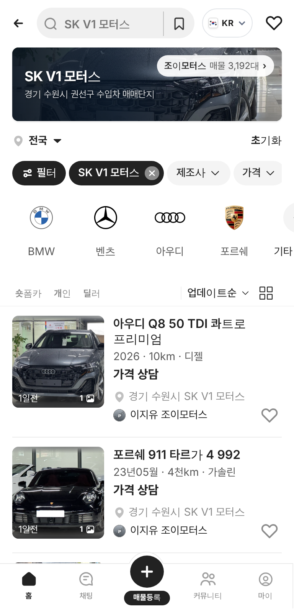
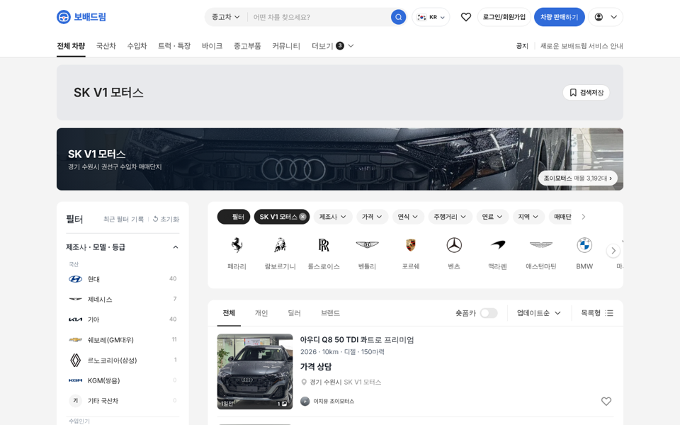
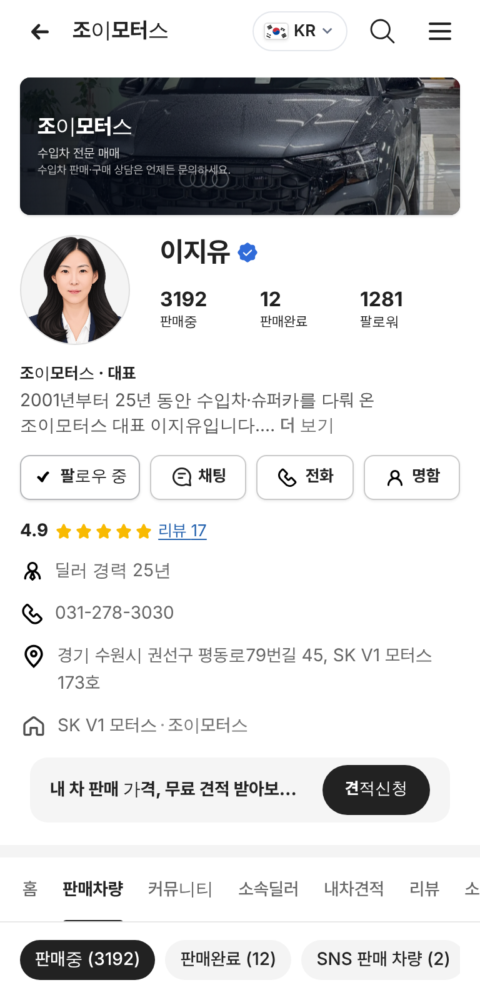
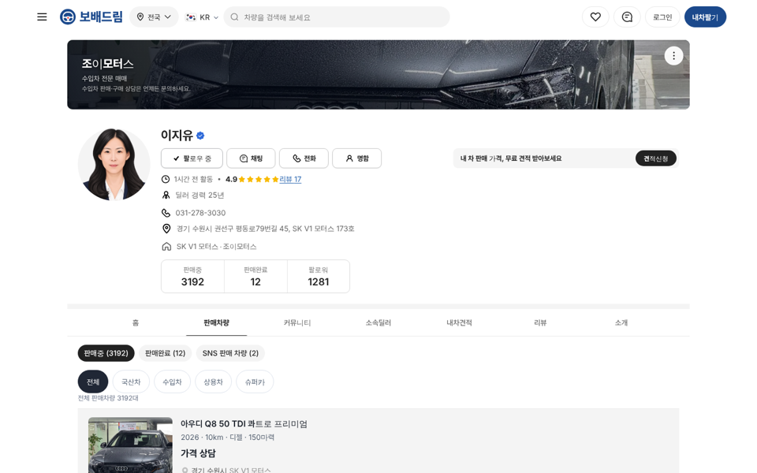

# PR #879 조이모터스 상사페이지 · 전체 매물 3,192대 · SK V1 모터스 단지

① 한 줄 요약: 조이모터스 공개 매물 3,192대를 모두 넣고, 새 단지 카테고리 `SK V1 모터스`와 조이모터스 상사페이지를 만들었다.

② 과제 ID 없음 · 브랜치 `feat/joymotors-skv1` · 커밋 `8d446e5` · https://github.com/bobaekimboae/bobaedream/pull/879 · 병합·배포 v=8d446e5 · 번들 `assets/main-CIaE0WoE.js`

③ 한 일
- e-조이모터스 공개 전체매물 3,192대(67쪽)를 모았다: 제조사·모델·세부모델·등급·연식·최초등록·주행·가격·외장색·등록일·조회수·관리번호·사진 주소.
- 사진은 조이모터스 공개 저장소 주소를 그대로 불러온다(복사 없음). 사진 있는 1,531대가 먼저, 없는 1,661대는 빈 사진 칸.
- 새 단지 카테고리 `SK V1 모터스`(중고차 아래, 도이치오토월드 다음): 첫 화면 머리 + `조이모터스 매물 3,192대 ›` 바로가기, 럭셔리 로고 레일(페라리·람보르기니·롤스로이스·벤틀리…).
- 상사페이지 `shop=joy`: 대표 이지유, 공개 상호·사업자번호·대표번호 031-278-3030·팩스·이메일·주소(SK V1 모터스 173호)·구글맵. 매물 상세의 상사명·판매자 줄도 이 페이지로 연결.

④ 원본과 비교: 브랜드 비중 포르쉐 797 · 벤츠 725 · 벤틀리 307 · 페라리 220 · 롤스로이스 206 · 람보르기니 202(원본 집계와 같음).

⑤ 검증: verify:qf 통과, 콘솔 오류 0(모바일 384 · PC 1440). 배포본에서 단지 머리·상사페이지 확인.

⑥ 원본과 다르게 남긴 것
- 가격은 공개 201대만 숫자, 2,991대는 원본대로 `가격 상담`.
- 연료는 원본 목록에 없어 등급 이름으로 추정(TDI→디젤 등).
- 상세 사진은 목록 대표 1장만(상세 사진 여러 장은 매물마다 따로 열어야 해서 아직).
- 담당자 휴대폰 번호(010)는 넣지 않고 대표번호만.
- 평점·리뷰·판매완료·팔로워는 가상 값, 프로필은 정장 일러스트.

⑦ 못 한 것·다음에 할 것: 매물별 상세 사진 여러 장, 서울 성동구 쇼룸 표기, 실제 대표 사진.

⑧ 확인 링크: 모바일 https://bobaekimboae.github.io/bobaedream/?qf=guazi&category=SK%20V1%20%EB%AA%A8%ED%84%B0%EC%8A%A4&v=8d446e5 · PC 같은 주소 + `&pc=1` · 상사페이지 https://bobaekimboae.github.io/bobaedream/?qf=guazi&profile=dealer&shop=joy&emp=1&v=8d446e5
