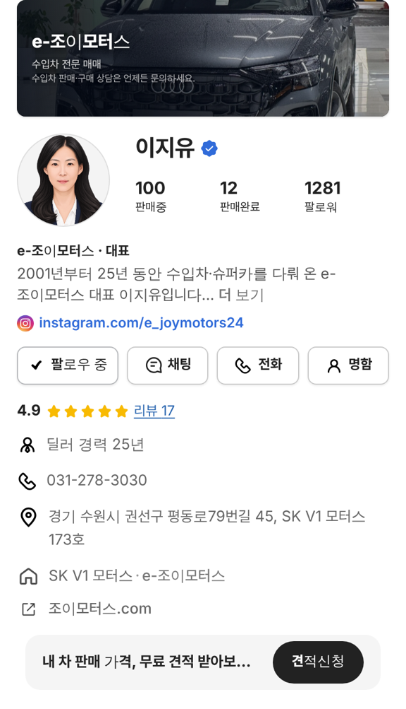
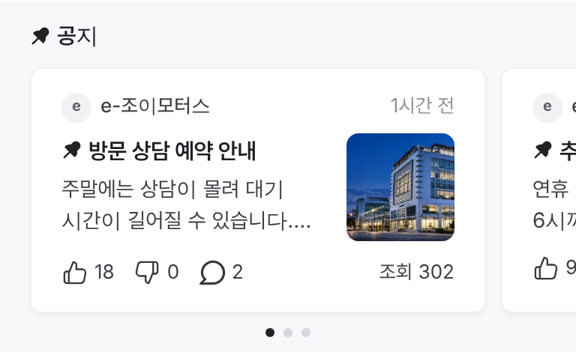
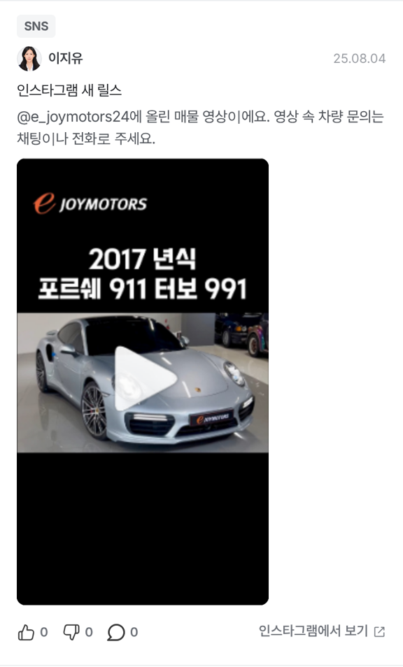

# PR #882 조이모터스 정리 · 인스타 릴스 · 홈페이지 · 공지 글자

① 한 줄 요약: 조이모터스 상사명을 `e-조이모터스`로 통일하고, 매물을 100대로 줄이고, 인스타 릴스를 피드·매물 두 곳에 넣고, 홈페이지 링크를 달고, 공지 글자를 낮췄다.

② 과제 ID 없음 · 브랜치 `fix/dealer-notice-type` · 커밋 `622150e` · https://github.com/bobaekimboae/bobaedream/pull/882 · 병합·배포 v=622150e · 번들 `assets/main-DDHvvFCC.js`

③ 한 일
- 공지 글자: 띠 제목 18/700 → 15/600, 카드 제목 16/700 → 15/600, 본문 15 → 14, 핀 14(모든 판매자페이지).
- 상사명 `e-조이모터스`로 통일(머리 · 소속 · 공지 작성자 · 매물 카드 · 단지 머리 알약). 공지 사진도 조이모터스 매물 사진으로.
- 매물: 사진 있는 앞쪽 100대만 남기고 나머지와 작업용 수집 파일 삭제.
- 인스타 `@e_joymotors24`: 프로필 SNS 줄, `SNS 판매 차량 (12)`, 커뮤니티 피드 `SNS` 릴스 4개(우리 카드 안 9:16 영상).
- 매매단지 줄 아래 홈페이지 `조이모터스.com`.

④ 원본과 비교: 해당 없음.

⑤ 검증: verify:qf 통과, 콘솔 오류 0(384). 판매중 100 · SNS 판매 차량 12 · 피드 릴스 4 · 단지 알약 `e-조이모터스 매물 100대 ›` 확인.

⑥ 원본과 다르게 남긴 것: 릴스는 인스타 정책상 화면 안에서 바로 재생되지 않고 누르면 인스타로 넘어간다. 홈페이지 아이콘은 노션에 맞는 원본이 없어 기존 바깥 링크 아이콘을 썼다.

⑦ 못 한 것·다음에 할 것: 사용자 컴퓨터(C 드라이브)에는 이 작업으로 저장한 파일이 없다.

⑧ 확인 링크: 모바일 https://bobaekimboae.github.io/bobaedream/?qf=guazi&profile=dealer&shop=joy&emp=1&v=622150e · PC 같은 주소 + `&pc=1`
