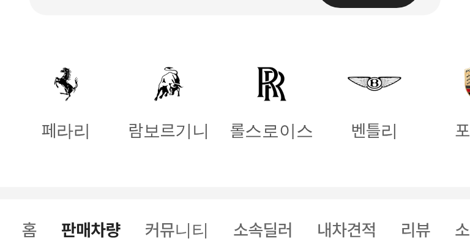
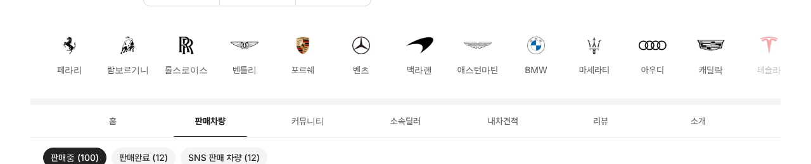

# PR #884 판매자페이지 판매차량 위 슈퍼카 로고 줄

① 한 줄 요약: 판매자페이지 구역 탭(판매차량 등) 위에 슈퍼카 로고 16개 줄을 두고, 누르면 그 브랜드 판매차량만 보이게 했다.

② 과제 ID 없음 · 브랜치 `feat/dealer-brand-rail` · 커밋 `525ee6f` · https://github.com/bobaekimboae/bobaedream/pull/884 · 병합·배포 v=525ee6f · 번들 `assets/main-DewxQEfX.js`

③ 한 일
- 슈퍼카·럭셔리카 카테고리와 같은 오토홈 로고 16개, 같은 칸 크기(모바일 76×102 · PC 84×102).
- 그 딜러 매물이 없는 브랜드는 흐리게, 누르면 판매중 목록이 그 브랜드만(조이모터스 포르쉐 22대), 다시 누르면 해제.
- 판매중 차량이 있는 모든 판매자페이지(조이모터스 · 서울오토갤러리 딜러)에 나온다.

④ 원본과 비교: 해당 없음.

⑤ 검증: verify:qf 통과, 콘솔 오류 0(384 · 1280).

⑥ 원본과 다르게 남긴 것: 없음.

⑦ 못 한 것·다음에 할 것: 브랜드 선택 뒤 모델 줄(카테고리처럼)로 이어가기.

⑧ 확인 링크: 모바일 https://bobaekimboae.github.io/bobaedream/?qf=guazi&profile=dealer&shop=joy&emp=1&v=525ee6f · PC 같은 주소 + `&pc=1`
